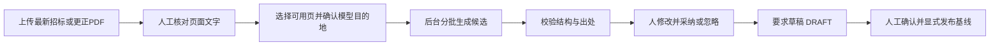

# AI 要求候选抽取：从原文到待确认草稿

适用版本：0.6.0。这一步解决“招标文件很长，需要先整理出可逐项检查的要求”的问题。模型只提供建议；它不审查投标响应，不确认满足，不发布基线。默认关闭模型服务，未配置时仍可完整使用人工流程。

## 业务上怎么用

例如原文写“接报后应在2小时内响应”。系统可以建议一条“服务响应时限”候选，并展示原文文件、页码、引文和原件链接。编写人核对它是否遗漏服务范围、前置条件或例外，再编辑标题、正文、类别与重要性，填写核对说明，点击“采纳为待确认草稿”。

采纳只是在“整理要求”新增一条 DRAFT。负责人或审查人仍须核对原文并确认，最后显式发布完整要求基线。后面的响应比对、问题登记、整改和独立复核沿用现有人工流程。模型建议、人工编辑后的草稿和处理人分别保存，不覆盖原建议。



网页入口：[我的项目](http://127.0.0.1:18080/workspace) → 进入项目 → “AI 要求候选”。OWNER/EDITOR 可以发起、取消、重试和处理候选；其他项目成员可查看。原有 OWNER/REVIEWER 确认要求的权限没有改变。

## 首次配置

在自己的本地 `.env` 追加以下变量，并填写实际服务的地址、密钥和模型名。不要把真实密钥提交 Git 或发送到聊天。服务须支持 OpenAI 兼容的 `POST /chat/completions`、Bearer 认证以及下列结构化输出方式。

```dotenv
BID_LLM_ENABLED=true
BID_LLM_BASE_URL=https://api.openai.com/v1
BID_LLM_API_KEY=填写本地实际密钥
BID_LLM_MODEL=填写服务实际支持的模型名
BID_LLM_OUTPUT_MODE=json_schema
BID_LLM_TOKEN_PARAMETER=max_completion_tokens
BID_LLM_TIMEOUT_SECONDS=45
BID_LLM_MAX_OUTPUT_TOKENS=4096
BID_LLM_ALLOW_INSECURE_HTTP=false
```

`BASE_URL` 包含版本路径，程序在后面拼接 `/chat/completions`。默认 HTTPS，不允许地址中携带用户名、密码、查询参数或片段；本地模型服务只有明确设置 `ALLOW_INSECURE_HTTP=true` 才可使用 HTTP。网络请求不读取宿主代理环境、不跟随重定向，不关闭 TLS 校验；需要代理的环境应单独安排服务网络。

配置后执行：

```powershell
docker compose up -d --wait --wait-timeout 180
```

API 与 `extraction-worker` 会同时获得配置。解析 Worker 和 dispatcher 不需要模型密钥。网页只显示模型名、目的地和配置摘要，不接收密钥。“已配置”仅说明字段齐备，不等于实际连通或效果合格。

默认 `json_schema` 使用严格 JSON Schema。若所选服务只支持 JSON object，可显式改成 `json_object`；本地 Pydantic 和出处校验仍然执行，不会因兼容模式跳过。若服务使用旧参数，可明确设置 `BID_LLM_TOKEN_PARAMETER=max_tokens`。没有静默降级；不支持接口或参数会失败。选择具体服务/模型后，仍需用许可发送的样本实测兼容性与效果。接口格式参考 [OpenAI Structured Outputs 官方说明](https://developers.openai.com/api/docs/guides/structured-outputs?api-mode=chat)。

## 页面选择与边界

- 只处理招标 TENDER 或更正 AMENDMENT 的最新文件修订，不能从投标响应中反推采购要求。
- 每个所选页的最新人工质量意见须为 `TEXT_USABLE`。这只是可处理门槛，不证明文字没有遗漏。无文字、需重处理和未核对页不可选。
- 单次1至10页、原文总计最多48000字符。按完整文字块分批，每批最多8000字符，最多8批；超限明确拒绝，不偷偷截断。一个项目最多3个活动抽取任务。
- 模型收到所选页全部提取文字和块编号；请求中不附 PDF 原件，也不附其他项目资料。使用人须确认页面可发送到展示的目的地。`store=false` 是请求参数，不能替代服务商的数据处理约定。
- 分批不重建跨页表格与跨批语义。若条款依赖其他页，应一起检查并由人补全；当前没有整份文件覆盖率或遗漏自动证明。

## 后台技术流程

FastAPI 在项目事务中冻结产物摘要、页级意见 ID、正文来源、模型非敏感配置与提示词版本，然后同时写 MySQL 的 ExtractionRun、Job 和 outbox，返回202。Dispatcher 投递到 Redis 的 `extract` 队列，独立 Celery Worker 处理；HTTP 请求不等待推理。

每批调用前检查文件、页级意见和发起人权限，延长租约；模型网络请求在数据库事务之外执行。返回后校验 JSON 结构、字段长度、枚举、引用数量与块编号；拒答、输出截断、不存在/重复的引用、超大响应和非法格式均拒绝。模型给出的引文不能覆盖服务端原文快照。校验出处存在不等于证明建议语义正确。

成功批次写 MySQL 检查点。所有批次完成后，再在项目锁和租约令牌保护下核对输入，去除相同正文与出处的重复候选，最多发布200条。中途失败或取消不发布部分候选。模型原始失败响应和密钥不写入任务错误；成功建议和来源属于项目数据，保存在本地数据库。

429、服务端错误、网络超时会有限重试，默认最多3次领取；完成批次不再调用。格式错误、拒答和参数/认证错误直接失败。手工重试仅允许输入及非敏感模型配置未变的 FAILED 任务，仍沿用完成批次；更换模型/提示词或改变输入应新建任务。

租约令牌阻止旧 Worker 在恢复或取消后提交结果。取消停止后续发布，不能保证远端撤回已经发出的调用。网络超时可能发生在服务已处理之后；即使发送相同 Idempotency-Key，也不能假定所有兼容服务都保证只计费一次。当前用量只统计已保存批次返回的 token 数，不是完整计费账单。

## 候选为何过期

来源文件上传了新修订，或所选页追加了新的质量意见，即使意见仍是“文字可用”，旧候选也显示 STALE 并禁止直接采纳。应重新核对并发起新任务，历史仍保留。若执行期间发起人失去编写权限，后台停止处理。

采纳时再次校验输入及实际出处，同一候选只可终结一次，重复请求沿用同一幂等键返回原结果；相同正文与相同出处已经存在的要求也不能重复导入。不同表述的近义要求仍需人识别，目前不是语义去重。旧候选可以写说明后忽略。

## 接口对应哪个场景

表内 `{p}` 是项目 ID，`{r}` 是抽取业务任务 ID，`{c}` 是候选 ID。抽取任务 `id` 与队列的 `job_id` 不同；解析 `artifact_id` 表示固定文件版本的文字产物。

| 使用动作 | 接口 | 返回后做什么 |
|---|---|---|
| 确认是否启用、原文发到哪里 | GET `/api/v1/extraction/config` | 显示模型、目的地和配置摘要 |
| 对明确选择的已核对页发起任务 | POST `/api/v1/projects/{p}/extraction-runs` | 返回202，保存任务 `id`，不表示候选完成 |
| 回到项目查看历史任务 | GET `/api/v1/projects/{p}/extraction-runs` | 选择一条记录，按分页读取 |
| 等待后台处理 | GET `/api/v1/projects/{p}/extraction-runs/{r}` | 看状态、真实完成批数和错误，不按时间估进度 |
| 修复临时错误后继续 | POST `/api/v1/projects/{p}/extraction-runs/{r}/retry` | 只重试未完成批次，可能再次计费 |
| 不再需要当前抽取 | POST `/api/v1/projects/{p}/extraction-runs/{r}/cancel` | 保留任务，阻止后续候选发布 |
| 逐条核对原建议与出处 | GET `/api/v1/projects/{p}/requirement-candidates?run_id={r}` | 人工修改或说明忽略，候选不计入基线 |
| 确定一条建议如何处理 | POST `/api/v1/projects/{p}/requirement-candidates/{c}/decisions` | IMPORT创建DRAFT；REJECT仅保留处理说明 |

写接口均需 `Idempotency-Key`；Cookie 写请求还需同源 `Origin`。创建任务必须回传 `expected_config_fingerprint` 和 `acknowledge_external_processing=true`；取消/重试回传 `expected_attempt`；采纳/忽略回传 `expected_version`。409表示状态或输入已变化，刷新后重看。完整字段、成功与错误示例见 [接口手册](API接口说明.md) 的“13 AI要求候选”。

## 可复现验收与当前效果边界

本轮未配置真实云模型密钥，没有实际模型推理效果或准确率结论。自动测试使用 MockTransport；另提供明确标记的本地合成 HTTP 服务，仅验证网络契约、限流恢复、数据库、队列和人工采纳，不模拟真实企业效果。测试服务只在显式指定的 override 文件中启用：

```powershell
docker compose -f compose.yaml -f evaluation/extraction-fixture.compose.yaml up --build -d --wait --wait-timeout 180
docker compose exec -T api python scripts/extraction_smoke.py
```

首次请求故意429，后续返回预设的两条构造候选。脚本拒绝对非合成模型运行，避免误发真实文件或产生云端费用。若重复验收，要先 `docker compose -f compose.yaml -f evaluation/extraction-fixture.compose.yaml restart model-fixture` 重置限流计数。

验收后恢复正常配置，保留业务卷：

```powershell
docker compose -f compose.yaml -f evaluation/extraction-fixture.compose.yaml stop model-fixture
docker compose -f compose.yaml -f evaluation/extraction-fixture.compose.yaml rm -f model-fixture
docker compose up -d --wait --wait-timeout 180
```

不要把测试 override 当作正常模型配置。完整结果和未覆盖范围见 [0.6.0 验收记录](extraction-verification.md)。
