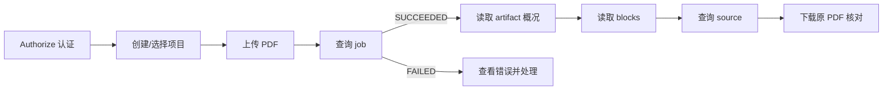

# 投标审查系统：中文接口使用手册

适用版本：1.0.0。由当前应用的 OpenAPI 自动生成。

先读 [业务流程与接口](业务流程与接口.md)，理解谁在什么场景调用接口，再查本手册的参数。

在线调试：[Swagger](http://127.0.0.1:18080/docs)；机器可读规范：[OpenAPI JSON](openapi.json)。

本系统当前支持**投标材料工程基础和人工业务闭环**：上传 PDF 保留修订、核对原文、人工整理并确认要求、发布基线和正式材料集、登记问题、指派整改、由另一人复核，再逐项作出审核决定。
完整业务场景和连续调用例子见项目 `docs/业务流程与接口.md`。当前 `review_mode=HUMAN`；可选云模型生成要求候选、带引用的证据问答与逐项检查建议，人工采纳后仍须走确认或整改流程。模型默认关闭；正式材料支持Milvus稀疏/稠密混合召回、RRF及本地重排。更正影响由人工关联与处理，不自动作最终判断。

### 第一次使用

1. 点击右上角 **Authorize**，填入项目本地 `.env` 中的 `BID_BOOTSTRAP_API_KEY` 的值；只填值，不加 `Bearer`。
2. 创建项目，记下返回的 `id`，它就是 `project_id`。
3. 上传 PDF，记下 `document_id`、`revision_id`、`job_id`。
4. 查询任务；`status=SUCCEEDED` 后取得 `artifact_id`。
5. 查询解析产物和文字块，再用来源接口获取页码、矩形位置和原件地址。
   可选：在“12 解析质量核对”确认所选页文字可用，配置模型后通过“13 AI要求候选”异步生成建议，再人工编辑采纳为草稿。未配置模型仍可手工整理。
6. 在“08 要求与基线”登记并确认要求，发布基线；在“09 正式响应材料”明确本轮正式文件。
7. 在“10 问题与整改”登记冲突并指定负责人；整改后由另一人复核，在“11 人工审查结论”完成逐项确认并查看报告。

### 五种 ID 分别是什么

| 名称 | 含义 | 从哪里取得 |
|---|---|---|
| `project_id` | 一次投标工作的资料空间 | 创建/列出项目 |
| `document_id` | 一份逻辑文档，例如技术响应书；多个修订共用 | 上传新文档 |
| `revision_id` | 某一次不可变的 PDF 文件版本 | 上传或列出修订 |
| `job_id` | 后台处理这份文件的任务 | 上传接口 |
| `artifact_id` | 某修订按某解析配置生成的结果 | 查询成功任务 |

`block_id` 是某个产物内部的文字块编号，必须与其 `artifact_id` 配套使用。示例 ID 只说明格式，实际调用时请替换为接口真实返回的 ID。

### 需要正确理解的状态

- HTTP **202**：系统已接收上传并登记任务，请继续查询任务；不表示解析已经完成。
- `SUCCEEDED`：相应技术任务已完成；解析任务生成文字产物，要求抽取任务生成候选，均不表示投标业务满足要求。
- `NEEDS_REVIEW`：产物需要人工检查；MinerU 是否运行 OCR 由实际解析模式决定，不能据此证明没有漏字或表格语义正确。
- `formal_review_ready=false`：解析结果尚不支持自动审查。人工业务、正式材料检索和可选要求候选抽取可以引用文字块，但必须回看原件；辅助检查与更正影响仍需人工核对，不提供自动合规结论。
- `review_epoch`：当前要求基线和正式材料集组合的版本号。重新发布会使旧提交和审核决定过期；历史记录保留。
- `REVIEW_COMPLETE`：本轮全部要求已经人工确认，相关问题均独立复核，且没有未发布的要求修改；不是模型自动给出的合规结论。

项目业务接口需要 `X-API-Key` 或有效浏览器登录 Cookie。网页登录入口为 `/workspace`；Cookie 由登录接口设置，写请求还必须带与本站一致的 `Origin`，不能手工把 API Key 填进 Cookie。健康检查、登录及退出不要求已有会话。找不到对象和无权访问对象统一返回 **404**。

## 推荐调用顺序



业务闭环：登记要求 → 人工确认 → 发布基线 → 选择正式材料 → 登记问题 → 负责人整改 → 另一人复核 → 逐项审核 → 查看报告。

## 参数位置怎么区分

| 位置 | 含义 | 如何填写 |
|---|---|---|
| path | URL 路径中的占位符，例如 `{project_id}` | 使用上一步真实返回的 ID |
| query | URL 问号后的筛选或分页参数 | 例如 `?page=3&offset=0&limit=100` |
| header | HTTP 请求头 | `X-API-Key` 负责认证，`Idempotency-Key` 负责业务写入去重 |
| JSON body | JSON 请求体 | 创建项目时填写 `{"name":"项目名称"}` |
| multipart/form-data | 文件加表单字段 | 上传 PDF 时选择 file，并填写 title/kind 等 |

## 全部接口

| 方法 | 路径 | 用途 |
|---|---|---|
| POST | `/api/v1/projects` | 创建一次投标工作的项目空间 |
| GET | `/api/v1/projects` | 列出我有权限访问的项目 |
| GET | `/api/v1/me` | 查询我是谁，取得成员授权用的用户 ID |
| POST | `/api/v1/projects/{project_id}/members` | 把已有用户加入项目或调整协作角色 |
| GET | `/api/v1/projects/{project_id}/members` | 查看可协作的项目成员与角色 |
| GET | `/api/v1/projects/{project_id}/workspace` | 查看项目工作台和当前审查输入版本 |
| POST | `/api/v1/projects/{project_id}/documents` | 上传一份新 PDF 文档并登记解析任务 |
| POST | `/api/v1/documents/{document_id}/revisions` | 为已有文档上传新 PDF 修订并保留历史 |
| GET | `/api/v1/documents/{document_id}/revisions` | 查看一份文档的全部历史修订 |
| GET | `/api/v1/jobs/{job_id}` | 查询后台解析任务状态及产物 ID |
| GET | `/api/v1/artifacts/{artifact_id}` | 查看解析概况、页数和质量提示 |
| GET | `/api/v1/artifacts/{artifact_id}/blocks` | 按页和分页条件读取文字来源块 |
| GET | `/api/v1/artifacts/{artifact_id}/blocks/{block_id}/source` | 把某段文字定位到具体文件版本、页码和坐标 |
| GET | `/api/v1/revisions/{revision_id}/original` | 预览或下载某个历史修订的原始 PDF |
| POST | `/api/v1/projects/{project_id}/requirements` | 从招标原文登记一条待确认要求 |
| GET | `/api/v1/projects/{project_id}/requirements` | 查看全部要求的最新草稿或确认版 |
| POST | `/api/v1/projects/{project_id}/requirements/{requirement_id}/revisions` | 因更正或录入错误新增要求修订 |
| GET | `/api/v1/projects/{project_id}/requirements/{requirement_id}/revisions` | 追溯一条要求的全部历史修订 |
| POST | `/api/v1/projects/{project_id}/requirements/{requirement_id}/confirm` | 人工确认最新要求正文及出处 |
| POST | `/api/v1/projects/{project_id}/baselines` | 发布本次审查采用的不可变要求基线 |
| GET | `/api/v1/projects/{project_id}/baselines` | 查看历次基线及各自冻结的要求 |
| POST | `/api/v1/projects/{project_id}/material-sets` | 明确选择本次正式响应文件和附件 |
| GET | `/api/v1/projects/{project_id}/material-sets` | 追溯历次审查使用的正式材料快照 |
| POST | `/api/v1/projects/{project_id}/issues` | 登记一条审查问题并指派整改任务 |
| GET | `/api/v1/projects/{project_id}/issues` | 查看问题、整改进展及旧结论是否过期 |
| GET | `/api/v1/projects/{project_id}/tasks` | 查看本项目整改待办与复核记录 |
| POST | `/api/v1/projects/{project_id}/tasks/{task_id}/transitions` | 负责人开始整改或提交修改后的正式证据 |
| GET | `/api/v1/projects/{project_id}/tasks/{task_id}/submissions` | 追溯任务历次整改提交及其材料依据 |
| POST | `/api/v1/projects/{project_id}/tasks/{task_id}/decisions` | 由另一人复核当前整改提交，验收或退回 |
| POST | `/api/v1/projects/{project_id}/requirement-decisions` | 对当前要求逐项记录人工最终决定 |
| GET | `/api/v1/projects/{project_id}/requirement-decisions` | 查看逐项审核决定的完整历史 |
| GET | `/api/v1/projects/{project_id}/review-report` | 查看本轮人工审查覆盖、未解决问题和完成状态 |
| GET | `/health/live` | 检查 API 进程是否存活 |
| GET | `/health/ready` | 检查数据库和基础表是否就绪 |
| GET | `/api/v1/auth/session` | 恢复网页当前登录身份 |
| POST | `/api/v1/auth/session` | 使用已有账号密钥登录网页 |
| DELETE | `/api/v1/auth/session` | 退出并撤销当前浏览器会话 |
| GET | `/api/v1/projects/{project_id}/workbench` | 读取真实项目完整工作台 |
| GET | `/api/v1/projects/{project_id}/member-candidates` | 按姓名查找可加入项目的已有账号 |
| GET | `/api/v1/projects/{project_id}/review-report/export` | 下载当前人工审查报告 Markdown |
| GET | `/api/v1/artifacts/{artifact_id}/quality` | 按页查看解析质量提示和人工核对进度 |
| POST | `/api/v1/artifacts/{artifact_id}/pages/{page}/quality-reviews` | 回看原件后追加一条逐页质量核对记录 |
| GET | `/api/v1/artifacts/{artifact_id}/pages/{page}/quality-reviews` | 追溯一页历次人工质量核对意见 |
| GET | `/api/v1/extraction/config` | 查看模型抽取是否配置及原文处理目的地 |
| POST | `/api/v1/projects/{project_id}/extraction-runs` | 从已核对的招标页面发起要求候选抽取 |
| GET | `/api/v1/projects/{project_id}/extraction-runs` | 查看项目最近的候选抽取任务 |
| GET | `/api/v1/projects/{project_id}/extraction-runs/{run_id}` | 查询单个要求抽取任务的状态与批次进度 |
| POST | `/api/v1/projects/{project_id}/extraction-runs/{run_id}/retry` | 明确重试失败的抽取任务并保留完成批次 |
| POST | `/api/v1/projects/{project_id}/extraction-runs/{run_id}/cancel` | 取消活动抽取任务并阻止后续候选发布 |
| GET | `/api/v1/projects/{project_id}/requirement-candidates` | 分页阅读模型候选、出处与人工处理状态 |
| POST | `/api/v1/projects/{project_id}/requirement-candidates/{candidate_id}/decisions` | 人工修改并采纳候选为要求草稿，或说明原因忽略 |
| POST | `/api/v1/revisions/{revision_id}/parse` | 用当前解析配置重新解析原 PDF，保留旧产物与引用 |
| GET | `/api/v1/projects/{project_id}/retrieval` | 查看当前正式材料集的索引状态 |
| POST | `/api/v1/projects/{project_id}/retrieval/indexes` | 为当前正式材料构建可追溯检索索引 |
| POST | `/api/v1/projects/{project_id}/retrieval/search` | 查找当前正式材料里的原文证据 |
| POST | `/api/v1/projects/{project_id}/tasks/{task_id}/assignment` | 转派整改任务或调整期限 |
| POST | `/api/v1/projects/{project_id}/issues/{issue_id}/lifecycle` | 撤销误报问题或恢复整改 |
| POST | `/api/v1/projects/{project_id}/requirements/{requirement_id}/lifecycle` | 退休失效要求或恢复要求 |
| POST | `/api/v1/projects/{project_id}/members/{user_id}/remove` | 移除已交接成员的项目权限 |
| POST | `/api/v1/projects/{project_id}/change-impacts` | 把更正原文关联到受影响要求 |
| GET | `/api/v1/projects/{project_id}/change-impacts` | 查看更正影响与处理记录 |
| POST | `/api/v1/projects/{project_id}/change-impacts/{impact_id}/decision` | 记录更正已修订或人工确认不需修改 |
| GET | `/api/v1/projects/{project_id}/catalog/{resource}` | 分页筛选项目资料、要求、任务或审计 |
| GET | `/api/v1/account` | 查看自己的密钥版本与有效会话 |
| POST | `/api/v1/account/key` | 轮换本人访问密钥并撤销全部会话 |
| POST | `/api/v1/account/sessions/{session_id}/revoke` | 撤销本人的一个浏览器会话 |
| GET | `/api/v1/notifications` | 查看本人仍有项目权限的站内通知 |
| POST | `/api/v1/notifications/{notification_id}/read` | 将本人通知标记为已读 |
| POST | `/api/v1/projects/{project_id}/conversions` | 保留DOCX原件并异步渲染为不可变PDF |
| GET | `/api/v1/projects/{project_id}/conversions` | 查看最近的DOCX转换状态和PDF修订 |
| GET | `/api/v1/projects/{project_id}/conversions/{conversion_id}/original` | 下载转换前的DOCX原件 |
| POST | `/api/v1/projects/{project_id}/conversions/{conversion_id}/retry` | 明确重试失败的DOCX转换 |
| GET | `/api/v1/assistant/config` | 确认辅助检查的模型与内容处理目的地 |
| POST | `/api/v1/projects/{project_id}/assistant-runs` | 异步生成有引用的证据问答或逐项检查建议 |
| GET | `/api/v1/projects/{project_id}/assistant-runs` | 查看辅助建议及输入过期状态 |
| POST | `/api/v1/projects/{project_id}/assistant-runs/{run_id}/control` | 取消或明确重试辅助检查 |
| POST | `/api/v1/projects/{project_id}/assistant-runs/{run_id}/adopt` | 人工编辑并采纳疑似问题为整改任务 |
| GET | `/api/v1/projects/{project_id}/operations` | 查看本项目后台任务与检索容量 |
| GET | `/api/v1/projects/{project_id}/operations/metrics` | 读取本项目可监控的计数指标 |
| GET | `/api/v1/projects/{project_id}/review-report/export.json` | 导出含冻结依据的JSON审查快照 |
| GET | `/api/v1/projects/{project_id}/review-report/export.csv` | 导出逐项覆盖清单CSV |
| GET | `/api/v1/projects/{project_id}/review-report/print` | 打开可打印及保存PDF的报告版式 |

## 1. 创建一次投标工作的项目空间

`POST /api/v1/projects`

**用途**：为一次投标工作建立资料空间，例如“某信息化系统采购项目”。

**请求**：JSON 格式，填写 `name`；当前用户自动成为项目 OWNER。

**返回**：201 和 `{id, name}`。把这里的 `id` 作为后续上传接口的 `project_id`。

**注意**：项目名称不是唯一键；再次调用会创建另一个项目。本接口当前没有 Idempotency-Key 去重。

**认证**：使用 `X-API-Key` 或浏览器登录 Cookie；Cookie 写入还须同源 `Origin`。

**参数说明**

| 名称 | 位置 | 必填 | 类型 | 限制/默认 | 说明 |
|---|---|---|---|---|---|
| `Idempotency-Key` | header | 否 | string / null | — | 可选创建去重键。网页始终提供；同键同内容重试复用原项目，不同内容返回 409。旧客户端可省略。 |

**请求体：`application/json`**

| 字段 | 必填 | 类型 | 限制/默认 | 说明 |
|---|---|---|---|---|
| `name` | 是 | string | 最短字符数=1；最长字符数=200 | 本次投标工作的名称，建议写采购项目名称。首尾空格会去掉；纯空白名称会返回 422。 |

```json
{
  "name": "上海12345平台二期投标材料检查"
}
```

**HTTP 返回**

| 状态码 | 含义 |
|---|---|
| 201 | 项目已创建；返回的 id 用作后续 project_id。 |
| 401 | 缺少或无效的 API Key，或浏览器会话已撤销/过期。网页重新登录；接口客户端通过 X-API-Key 认证。 |
| 409 | 幂等键内容冲突，或要求修订/任务状态/epoch 已变化。刷新工作台和任务并重新核对；重试沿用原键原内容，新动作换新键。 |
| 422 | 参数或请求体校验失败，例如缺少必填字段、枚举值错误、分页超界、幂等键长度不符或名称为纯空白。查看 detail 中的 loc 和 msg。 |

**成功返回字段**（数组接口描述的是每一个元素）

| 字段 | 类型 | 说明 |
|---|---|---|
| `id` | string | 项目 ID。上传文档时填入路径参数 project_id。 |
| `name` | string | 项目名称。 |

**格式示例**：以下示例 ID 需要替换为实际值，不代表现有数据库记录。

```json
{
  "id": "11111111-1111-4111-8111-111111111111",
  "name": "上海12345平台二期投标材料检查"
}
```

## 2. 列出我有权限访问的项目

`GET /api/v1/projects`

**用途**：找回当前用户有权限访问的项目 ID 和名称。

**参数**：无额外参数，身份由 X-API-Key 确定。

**返回**：200 和数组；没有项目时为 `[]`。当前没有分页，也没有约定排序。不返回其他用户的私有项目。

**认证**：使用 `X-API-Key` 或浏览器登录 Cookie；Cookie 写入还须同源 `Origin`。

**HTTP 返回**

| 状态码 | 含义 |
|---|---|
| 200 | 项目数组；没有可访问项目时为 []。 |
| 401 | 缺少或无效的 API Key，或浏览器会话已撤销/过期。网页重新登录；接口客户端通过 X-API-Key 认证。 |

**成功返回字段**（数组接口描述的是每一个元素）

| 字段 | 类型 | 说明 |
|---|---|---|
| `id` | string | 项目 ID。上传文档时填入路径参数 project_id。 |
| `name` | string | 项目名称。 |

**格式示例**：以下示例 ID 需要替换为实际值，不代表现有数据库记录。

```json
[
  {
    "id": "11111111-1111-4111-8111-111111111111",
    "name": "上海12345平台二期投标材料检查"
  }
]
```

## 3. 查询我是谁，取得成员授权用的用户 ID

`GET /api/v1/me`

**业务场景**：负责人要把同事加入投标项目，需要同事的用户 ID。

**使用人/前置条件**：任意已配置 API Key 的用户。

**处理与结果**：返回本密钥对应的 ID 和姓名，不返回密钥本身。

**下一步**：同事把自己的 ID 告知项目负责人，再由负责人添加成员。

**调用约定**：所有接口需要 X-API-Key 或已登录的浏览器 Cookie；Cookie 写入还须同源 Origin。写操作还需要 Idempotency-Key；网络重试沿用原键和原请求体，新业务动作换新键。404 同时表示对象不存在或不属于可访问项目。409 表示版本、状态或幂等冲突，须先刷新核对。当前所有业务判断由人完成。

**认证**：使用 `X-API-Key` 或浏览器登录 Cookie；Cookie 写入还须同源 `Origin`。

**HTTP 返回**

| 状态码 | 含义 |
|---|---|
| 200 | Successful Response |
| 401 | 缺少或无效的 API Key，或浏览器会话已撤销/过期。网页重新登录；接口客户端通过 X-API-Key 认证。 |

**成功返回字段**（数组接口描述的是每一个元素）

| 字段 | 类型 | 说明 |
|---|---|---|
| `id` | string | 当前 API Key 或浏览器会话对应的用户 ID，不返回密钥或 hash。 |
| `name` | string | 当前用户显示名称。 |

**格式示例**：以下示例 ID 需要替换为实际值，不代表现有数据库记录。

```json
{
  "id": "示例",
  "name": "示例"
}
```

## 4. 把已有用户加入项目或调整协作角色

`POST /api/v1/projects/{project_id}/members`

**业务场景**：投标负责人组织编写人、审查人及只读观察者，形成责任分工。

**使用人/前置条件**：仅项目 OWNER；目标账号须先通过 CLI bootstrap 创建。

**处理与结果**：按用户 ID 设置项目角色；不能通过本接口变更 OWNER，已有整改任务的负责人须保留 EDITOR 角色。

**下一步**：EDITOR 录入资料和整改，REVIEWER 确认要求并复核；提交整改的人不能自己复核。

**调用约定**：所有接口需要 X-API-Key 或已登录的浏览器 Cookie；Cookie 写入还须同源 Origin。写操作还需要 Idempotency-Key；网络重试沿用原键和原请求体，新业务动作换新键。404 同时表示对象不存在或不属于可访问项目。409 表示版本、状态或幂等冲突，须先刷新核对。当前所有业务判断由人完成。

**认证**：使用 `X-API-Key` 或浏览器登录 Cookie；Cookie 写入还须同源 `Origin`。

**参数说明**

| 名称 | 位置 | 必填 | 类型 | 限制/默认 | 说明 |
|---|---|---|---|---|---|
| `project_id` | path | 是 | string | — | 投标项目 ID，从创建项目接口取得。 |
| `Idempotency-Key` | header | 是 | string | 最短字符数=16；最长字符数=128 | 本次业务操作的幂等键，建议 UUID。重试保持键和请求体不变；新操作换新键。 |

**请求体：`application/json`**

| 字段 | 必填 | 类型 | 限制/默认 | 说明 |
|---|---|---|---|---|
| `expected_role` | 否 | string / null | — | 修改已有角色时携带当前角色，若已被其他人修改返回409；首次添加可省略。 |
| `user_id` | 是 | string | — | 已在系统中创建的用户 ID。用户可通过 /api/v1/me 查询自己的 ID。 |
| `role` | 是 | string | 可选值=EDITOR, REVIEWER, READER | EDITOR 编写/整改；REVIEWER 确认要求、登记问题和复核；READER 只读。只有项目 OWNER 可设置。 |

```json
{
  "expected_role": "示例",
  "user_id": "示例",
  "role": "EDITOR"
}
```

**HTTP 返回**

| 状态码 | 含义 |
|---|---|
| 200 | Successful Response |
| 401 | 缺少或无效的 API Key，或浏览器会话已撤销/过期。网页重新登录；接口客户端通过 X-API-Key 认证。 |
| 403 | 当前成员角色不能执行该动作、尝试复核自己的整改，或 Cookie 写请求缺少本站 Origin。具体条件见各接口。 |
| 404 | 对象不存在，或当前用户没有项目访问权限。检查 ID 和所属项目；两种情况都使用 404。 |
| 409 | 幂等键内容冲突，或要求修订/任务状态/epoch 已变化。刷新工作台和任务并重新核对；重试沿用原键原内容，新动作换新键。 |
| 422 | 参数或请求体校验失败，例如缺少必填字段、枚举值错误、分页超界、幂等键长度不符或名称为纯空白。查看 detail 中的 loc 和 msg。 |

**成功返回字段**（数组接口描述的是每一个元素）

| 字段 | 类型 | 说明 |
|---|---|---|
| `user_id` | string | 用户 ID。 |
| `name` | string | 用户显示名。 |
| `role` | string | 项目角色：OWNER/EDITOR/REVIEWER/READER。 |

**格式示例**：以下示例 ID 需要替换为实际值，不代表现有数据库记录。

```json
{
  "user_id": "示例",
  "name": "示例",
  "role": "示例"
}
```

## 5. 查看可协作的项目成员与角色

`GET /api/v1/projects/{project_id}/members`

**业务场景**：审查人登记问题前要选择整改负责人，负责人要检查谁具有复核权限。

**使用人/前置条件**：任意项目成员。

**处理与结果**：返回本项目成员及 OWNER/EDITOR/REVIEWER/READER 角色，不暴露其他项目成员或任何 API Key。

**下一步**：登记问题时只能选择本项目的 OWNER 或 EDITOR 为 assignee_id。

**调用约定**：所有接口需要 X-API-Key 或已登录的浏览器 Cookie；Cookie 写入还须同源 Origin。写操作还需要 Idempotency-Key；网络重试沿用原键和原请求体，新业务动作换新键。404 同时表示对象不存在或不属于可访问项目。409 表示版本、状态或幂等冲突，须先刷新核对。当前所有业务判断由人完成。

**认证**：使用 `X-API-Key` 或浏览器登录 Cookie；Cookie 写入还须同源 `Origin`。

**参数说明**

| 名称 | 位置 | 必填 | 类型 | 限制/默认 | 说明 |
|---|---|---|---|---|---|
| `project_id` | path | 是 | string | — | 投标项目 ID，从创建项目接口取得。 |

**HTTP 返回**

| 状态码 | 含义 |
|---|---|
| 200 | Successful Response |
| 401 | 缺少或无效的 API Key，或浏览器会话已撤销/过期。网页重新登录；接口客户端通过 X-API-Key 认证。 |
| 404 | 对象不存在，或当前用户没有项目访问权限。检查 ID 和所属项目；两种情况都使用 404。 |
| 422 | 参数或请求体校验失败，例如缺少必填字段、枚举值错误、分页超界、幂等键长度不符或名称为纯空白。查看 detail 中的 loc 和 msg。 |

**成功返回字段**（数组接口描述的是每一个元素）

| 字段 | 类型 | 说明 |
|---|---|---|
| `user_id` | string | 用户 ID。 |
| `name` | string | 用户显示名。 |
| `role` | string | 项目角色：OWNER/EDITOR/REVIEWER/READER。 |

**格式示例**：以下示例 ID 需要替换为实际值，不代表现有数据库记录。

```json
[
  {
    "user_id": "示例",
    "name": "示例",
    "role": "示例"
  }
]
```

## 6. 查看项目工作台和当前审查输入版本

`GET /api/v1/projects/{project_id}/workspace`

**业务场景**：进入项目后，确认当前审查哪版要求、哪套响应材料，以及自己能做什么。

**使用人/前置条件**：任意项目成员。

**处理与结果**：返回我的角色、当前基线/材料集 ID、review_epoch、要求/问题数量和未发布修改提示；不把问题总数冒充待办数。

**下一步**：写入前保存 review_epoch；若返回 409，刷新工作台并重新核对材料。

**调用约定**：所有接口需要 X-API-Key 或已登录的浏览器 Cookie；Cookie 写入还须同源 Origin。写操作还需要 Idempotency-Key；网络重试沿用原键和原请求体，新业务动作换新键。404 同时表示对象不存在或不属于可访问项目。409 表示版本、状态或幂等冲突，须先刷新核对。当前所有业务判断由人完成。

**认证**：使用 `X-API-Key` 或浏览器登录 Cookie；Cookie 写入还须同源 `Origin`。

**参数说明**

| 名称 | 位置 | 必填 | 类型 | 限制/默认 | 说明 |
|---|---|---|---|---|---|
| `project_id` | path | 是 | string | — | 投标项目 ID，从创建项目接口取得。 |

**HTTP 返回**

| 状态码 | 含义 |
|---|---|
| 200 | Successful Response |
| 401 | 缺少或无效的 API Key，或浏览器会话已撤销/过期。网页重新登录；接口客户端通过 X-API-Key 认证。 |
| 404 | 对象不存在，或当前用户没有项目访问权限。检查 ID 和所属项目；两种情况都使用 404。 |
| 422 | 参数或请求体校验失败，例如缺少必填字段、枚举值错误、分页超界、幂等键长度不符或名称为纯空白。查看 detail 中的 loc 和 msg。 |

**成功返回字段**（数组接口描述的是每一个元素）

| 字段 | 类型 | 说明 |
|---|---|---|
| `project_id` | string | 投标项目 ID。 |
| `name` | string | 项目名称。 |
| `my_role` | string | 当前用户的项目角色。 |
| `review_epoch` | integer | 当前有效业务输入版本。发布要求基线/材料集会递增，写操作须携带所见值。 |
| `current_baseline_id` | string / null | 当前要求基线；尚未发布为 null。 |
| `current_material_set_id` | string / null | 当前正式材料集；尚未发布为 null。 |
| `requirement_count` | integer | 已录入逻辑要求数。 |
| `issue_count` | integer | 历史登记的问题总数，不等于当前未解决数。 |
| `pending_requirement_changes` | boolean | 存在未纳入当前基线的新要求/新修订；需确认并重新发布基线。 |
| `review_mode` | string | 最终判断仍由人工完成；可选模型仅建议要求候选，不自动确认要求或审查响应。 |

**格式示例**：以下示例 ID 需要替换为实际值，不代表现有数据库记录。

```json
{
  "project_id": "示例",
  "name": "示例",
  "my_role": "示例",
  "review_epoch": 1,
  "current_baseline_id": "示例",
  "current_material_set_id": "示例",
  "requirement_count": 1,
  "issue_count": 1,
  "pending_requirement_changes": false,
  "review_mode": "HUMAN"
}
```

## 7. 上传一份新 PDF 文档并登记解析任务

`POST /api/v1/projects/{project_id}/documents`

**用途**：在已有项目下新增一份逻辑文档，并保存它的第 1 个 PDF 修订、后台任务及待投递事件。

**填写方式**：`multipart/form-data`。选择 `file`，填写 `title` 和 `kind`，请求头填写 `Idempotency-Key`。

**文件类型**：TENDER=招标文件；AMENDMENT=更正公告；RESPONSE=投标响应；EVIDENCE=证明材料。目前这些类型用于分类存储，上传更正公告不会自动修改要求或触发变更分析。

**返回**：202，保存 document_id、revision_id、job_id。随后查询任务，成功后取得 artifact_id。

**重复请求**：同一用户、项目和新增文档操作内，同键且内容/元数据相同返回原响应；同键但内容或元数据不同返回 409。换一个键会创建另一份逻辑文档，即使文件名或字节相同。

**文件校验**：默认最大 50 MiB；只检查接收格式，损坏、加密、超过默认 300 页等问题可能在后台任务中失败。202 不保证最终解析成功。

**source_url**：仅记录材料来源地址，不会替你从这个网址下载文件；仍须上传 file。

**认证**：使用 `X-API-Key` 或浏览器登录 Cookie；Cookie 写入还须同源 `Origin`。

**参数说明**

| 名称 | 位置 | 必填 | 类型 | 限制/默认 | 说明 |
|---|---|---|---|---|---|
| `project_id` | path | 是 | string | — | 项目 ID，从创建或列出项目接口取得；不是项目名称。 |
| `Idempotency-Key` | header | 是 | string | 最短字符数=16；最长字符数=128 | 一次上传操作的去重凭据，建议使用随机 UUID。网络重试沿用同键和同内容；业务内容改变使用新键。它不是 X-API-Key，也不是文件名。 |

**请求体：`multipart/form-data`**

| 字段 | 必填 | 类型 | 限制/默认 | 说明 |
|---|---|---|---|---|
| `file` | 是 | string | — | 本机选择的 PDF 文件。默认最大 50 MiB；必须是真实 PDF 内容。此阶段不接收 DOCX。 |
| `title` | 是 | string | 最短字符数=1；最长字符数=200 | 这份逻辑文档的显示名称，例如某项目招标文件；1–200 字符且不能为纯空白。 |
| `kind` | 是 | string | 可选值=TENDER, AMENDMENT, RESPONSE, EVIDENCE | 材料类型：TENDER 招标文件；AMENDMENT 更正公告；RESPONSE 投标响应；EVIDENCE 证明材料。更正类型当前只作分类存储。 |
| `source_url` | 否 | string (uri) / null | — | 可选的 HTTP/HTTPS 来源地址，仅保存出处，不访问该地址，也不能替代 file 上传。 |

**HTTP 返回**

| 状态码 | 含义 |
|---|---|
| 202 | 已接收或命中幂等记录；请保存 job_id 并继续查询处理状态。 |
| 401 | 缺少或无效的 API Key，或浏览器会话已撤销/过期。网页重新登录；接口客户端通过 X-API-Key 认证。 |
| 403 | 当前成员角色不能执行该动作、尝试复核自己的整改，或 Cookie 写请求缺少本站 Origin。具体条件见各接口。 |
| 404 | 对象不存在，或当前用户没有项目访问权限。检查 ID 和所属项目；两种情况都使用 404。 |
| 409 | 幂等键内容冲突，或要求修订/任务状态/epoch 已变化。刷新工作台和任务并重新核对；重试沿用原键原内容，新动作换新键。 |
| 413 | 上传字节数超过配置上限，默认 50 MiB（52,428,800 字节）。分拆文件或调整服务配置。 |
| 415 | 文件内容不符合接口要求。PDF接口需要真实PDF字节，DOCX须使用转换接口并通过容器、宏和外部资源检查；更改扩展名无效。 |
| 422 | 参数或请求体校验失败，例如缺少必填字段、枚举值错误、分页超界、幂等键长度不符或名称为纯空白。查看 detail 中的 loc 和 msg。 |

**成功返回字段**（数组接口描述的是每一个元素）

| 字段 | 类型 | 说明 |
|---|---|---|
| `document_id` | string | 逻辑文档 ID。一份文档的多个修订共用此 ID；上传新修订时使用它。 |
| `revision_id` | string | 本次文件的不可变修订 ID。下载原件时使用它。 |
| `revision_no` | integer | 同一逻辑文档内从 1 开始递增的修订号。它不是项目的总文档数。 |
| `job_id` | string | 后台文字层解析任务 ID。用 GET /api/v1/jobs/{job_id} 查询处理状态。 |
| `sha256` | string | 上传原始 PDF 字节的 SHA-256，用于验证原件一致性；不是文字内容摘要。 |
| `reused` | boolean | true：上传新修订时发现同一文档已有完全相同的文件，复用旧修订和任务。幂等键重放返回原响应，reused 也保持原值，因此 false 不代表这次一定新增记录。 |

**格式示例**：以下示例 ID 需要替换为实际值，不代表现有数据库记录。

```json
{
  "document_id": "22222222-2222-4222-8222-222222222222",
  "revision_id": "33333333-3333-4333-8333-333333333333",
  "revision_no": 1,
  "job_id": "44444444-4444-4444-8444-444444444444",
  "sha256": "e62549d0c0326992b008c73ebdc6e14934e485b1adbdd6a1a79aee3ab9f5c4f6",
  "reused": false
}
```

## 8. 为已有文档上传新 PDF 修订并保留历史

`POST /api/v1/documents/{document_id}/revisions`

**用途**：给一份已有逻辑文档增加新 PDF 版本，例如“技术响应书修改版”。document_id 保持不变，新的文件生成新的 revision_id 和递增 revision_no。

**请求**：选择 file，传 Idempotency-Key，可选 source_url。标题和材料类型沿用原逻辑文档，不在此修改。

**去重**：同一文档内，如 PDF 原始字节 SHA-256 与历史某修订相同，复用该修订和已有任务，返回 reused=true；不保证是最新修订。若幂等键命中原请求，返回原响应，reused 字段也保留原值。

**返回**：202。旧修订仍可查询和下载；新上传不会覆盖旧文件。当前没有“自动选为正式投标版本”的行为。

**权限与后续**：需要 OWNER/EDITOR；用 job_id 查询后台处理，再读取产物。

**认证**：使用 `X-API-Key` 或浏览器登录 Cookie；Cookie 写入还须同源 `Origin`。

**参数说明**

| 名称 | 位置 | 必填 | 类型 | 限制/默认 | 说明 |
|---|---|---|---|---|---|
| `document_id` | path | 是 | string | — | 逻辑文档 ID，从上传新文档接口取得；多个修订共用此 ID。 |
| `Idempotency-Key` | header | 是 | string | 最短字符数=16；最长字符数=128 | 一次上传操作的去重凭据，建议使用随机 UUID。网络重试沿用同键和同内容；业务内容改变使用新键。它不是 X-API-Key，也不是文件名。 |

**请求体：`multipart/form-data`**

| 字段 | 必填 | 类型 | 限制/默认 | 说明 |
|---|---|---|---|---|
| `file` | 是 | string | — | 这份逻辑文档的新 PDF 内容。完全相同的历史字节会复用旧修订。默认最大 50 MiB。 |
| `source_url` | 否 | string (uri) / null | — | 可选的新修订来源网址，只记录出处，不下载文件。 |

**HTTP 返回**

| 状态码 | 含义 |
|---|---|
| 202 | 返回新修订/任务，或同文档相同字节对应的历史修订/任务。 |
| 401 | 缺少或无效的 API Key，或浏览器会话已撤销/过期。网页重新登录；接口客户端通过 X-API-Key 认证。 |
| 403 | 当前成员角色不能执行该动作、尝试复核自己的整改，或 Cookie 写请求缺少本站 Origin。具体条件见各接口。 |
| 404 | 对象不存在，或当前用户没有项目访问权限。检查 ID 和所属项目；两种情况都使用 404。 |
| 409 | 幂等键内容冲突，或要求修订/任务状态/epoch 已变化。刷新工作台和任务并重新核对；重试沿用原键原内容，新动作换新键。 |
| 413 | 上传字节数超过配置上限，默认 50 MiB（52,428,800 字节）。分拆文件或调整服务配置。 |
| 415 | 文件内容不符合接口要求。PDF接口需要真实PDF字节，DOCX须使用转换接口并通过容器、宏和外部资源检查；更改扩展名无效。 |
| 422 | 参数或请求体校验失败，例如缺少必填字段、枚举值错误、分页超界、幂等键长度不符或名称为纯空白。查看 detail 中的 loc 和 msg。 |

**成功返回字段**（数组接口描述的是每一个元素）

| 字段 | 类型 | 说明 |
|---|---|---|
| `document_id` | string | 逻辑文档 ID。一份文档的多个修订共用此 ID；上传新修订时使用它。 |
| `revision_id` | string | 本次文件的不可变修订 ID。下载原件时使用它。 |
| `revision_no` | integer | 同一逻辑文档内从 1 开始递增的修订号。它不是项目的总文档数。 |
| `job_id` | string | 后台文字层解析任务 ID。用 GET /api/v1/jobs/{job_id} 查询处理状态。 |
| `sha256` | string | 上传原始 PDF 字节的 SHA-256，用于验证原件一致性；不是文字内容摘要。 |
| `reused` | boolean | true：上传新修订时发现同一文档已有完全相同的文件，复用旧修订和任务。幂等键重放返回原响应，reused 也保持原值，因此 false 不代表这次一定新增记录。 |

**格式示例**：以下示例 ID 需要替换为实际值，不代表现有数据库记录。

```json
{
  "document_id": "22222222-2222-4222-8222-222222222222",
  "revision_id": "33333333-3333-4333-8333-333333333333",
  "revision_no": 1,
  "job_id": "44444444-4444-4444-8444-444444444444",
  "sha256": "e62549d0c0326992b008c73ebdc6e14934e485b1adbdd6a1a79aee3ab9f5c4f6",
  "reused": false
}
```

## 9. 查看一份文档的全部历史修订

`GET /api/v1/documents/{document_id}/revisions`

**用途**：查看一份逻辑文档有哪些历史 PDF 版本，确认每个版本的修订号、文件 hash 和处理状态。

**返回**：200，按 revision_no 从小到大排列的数组。字段 id 是 revision_id，不是 document_id。

**状态**：NEEDS_REVIEW 表示解析完成但质量待检查；不能据此判断材料是否满足招标要求。created_at 是 UTC 时间，当前无时区后缀。

**边界**：本接口不返回 job_id；日常调用请保存上传响应中的 job_id。当前列表不分页。

**认证**：使用 `X-API-Key` 或浏览器登录 Cookie；Cookie 写入还须同源 `Origin`。

**参数说明**

| 名称 | 位置 | 必填 | 类型 | 限制/默认 | 说明 |
|---|---|---|---|---|---|
| `document_id` | path | 是 | string | — | 逻辑文档 ID，从上传新文档接口取得；多个修订共用此 ID。 |

**HTTP 返回**

| 状态码 | 含义 |
|---|---|
| 200 | 按 revision_no 升序返回；每条 id 都是文件修订 ID。 |
| 401 | 缺少或无效的 API Key，或浏览器会话已撤销/过期。网页重新登录；接口客户端通过 X-API-Key 认证。 |
| 404 | 对象不存在，或当前用户没有项目访问权限。检查 ID 和所属项目；两种情况都使用 404。 |
| 422 | 参数或请求体校验失败，例如缺少必填字段、枚举值错误、分页超界、幂等键长度不符或名称为纯空白。查看 detail 中的 loc 和 msg。 |

**成功返回字段**（数组接口描述的是每一个元素）

| 字段 | 类型 | 说明 |
|---|---|---|
| `id` | string | 不可变修订 ID，可作为下载原件接口的 revision_id。 |
| `revision_no` | integer | 文档内修订号，按此字段升序返回。 |
| `sha256` | string | 该修订原始 PDF 字节的 SHA-256。 |
| `status` | string | 文件处理状态：UPLOADED 已接收；PARSING 处理中；NEEDS_REVIEW 已解析但待人工质量核对；RETRY_WAIT 等待重试；PARSE_FAILED 处理失败。 |
| `created_at` | string (date-time) | 修订登记时间，使用 UTC。当前返回值不带时区后缀，请按 UTC 解释；北京时间需加 8 小时。 |

**格式示例**：以下示例 ID 需要替换为实际值，不代表现有数据库记录。

```json
[
  {
    "id": "33333333-3333-4333-8333-333333333333",
    "revision_no": 1,
    "sha256": "e62549d0c0326992b008c73ebdc6e14934e485b1adbdd6a1a79aee3ab9f5c4f6",
    "status": "NEEDS_REVIEW",
    "created_at": "2026-10-19T08:19:43"
  }
]
```

## 10. 查询后台解析任务状态及产物 ID

`GET /api/v1/jobs/{job_id}`

**用途**：跟踪上传后后台处理的结果。建议每 1–2 秒查询一次，收到 SUCCEEDED 或 FAILED 后停止轮询；可按网络情况放慢频率。

| status | 含义 | 调用方下一步 |
|---|---|---|
| QUEUED | 已登记，等待 Worker | 继续等待 |
| RUNNING | Worker 已领取并处理 | 继续等待 |
| RETRY_WAIT | 暂时失败，等待自动重试 | 继续等待，观察 error_code |
| SUCCEEDED | 技术处理完成 | 使用 artifact_id 查询产物 |
| FAILED | 最终失败 | 查看 error_code/error_detail，检查材料或运维原因 |

attempt 是已领取执行次数，初始 0。PDF任务没有百分比进度；失败后可通过修订的重新解析接口明确重试。要求抽取另有取消/重试接口。若任务长期排队，需检查 dispatcher、Redis 和 Worker。

**不要混淆**：HTTP 200 表示成功查到了任务，即使任务自身 status=FAILED。SUCCEEDED 也不是投标业务审核通过。

**认证**：使用 `X-API-Key` 或浏览器登录 Cookie；Cookie 写入还须同源 `Origin`。

**参数说明**

| 名称 | 位置 | 必填 | 类型 | 限制/默认 | 说明 |
|---|---|---|---|---|---|
| `job_id` | path | 是 | string | — | 后台任务 ID，使用上传响应的 job_id。 |

**HTTP 返回**

| 状态码 | 含义 |
|---|---|
| 200 | 任务当前状态。HTTP 200 与任务自身是否成功是两回事。 |
| 401 | 缺少或无效的 API Key，或浏览器会话已撤销/过期。网页重新登录；接口客户端通过 X-API-Key 认证。 |
| 404 | 对象不存在，或当前用户没有项目访问权限。检查 ID 和所属项目；两种情况都使用 404。 |
| 422 | 参数或请求体校验失败，例如缺少必填字段、枚举值错误、分页超界、幂等键长度不符或名称为纯空白。查看 detail 中的 loc 和 msg。 |

**成功返回字段**（数组接口描述的是每一个元素）

| 字段 | 类型 | 说明 |
|---|---|---|
| `id` | string | 执行任务 ID，对应上传或要求抽取接口返回的 job_id。 |
| `status` | string | QUEUED 排队；RUNNING 处理中；RETRY_WAIT 等待自动重试；SUCCEEDED 本次技术处理完成；FAILED 最终失败；CANCELLED 抽取任务已取消。SUCCEEDED 不表示投标满足要求。 |
| `attempt` | integer | Worker 实际领取任务的次数。排队尚未执行时为 0，首次执行为 1；不是当前进度百分比。 |
| `artifact_id` | string / null | PDF解析成功后的产物 ID；要求抽取任务使用专门的 extraction-runs 接口查看候选，此字段可以为空。 |
| `error_code` | string / null | 最近错误代码：PDF_REJECTED 文件不可处理；PROCESSING_ERROR 解析异常；LEASE_EXPIRED 租约过期；MODEL_* 或 EXTRACTION_* 表示候选抽取错误，具体看抽取任务接口。无错误或成功后为 null。 |
| `error_detail` | string / null | 可用于定位失败原因的简短信息。不会返回完整文档、密钥或服务器存储路径。 |
| `formal_review_ready` | boolean | 当前固定为 false：解析生成文字或OCR来源，要求模型只建议候选，均不具备自动审查能力；人工引用时须核对原件。 |

**格式示例**：以下示例 ID 需要替换为实际值，不代表现有数据库记录。

```json
{
  "id": "44444444-4444-4444-8444-444444444444",
  "status": "SUCCEEDED",
  "attempt": 1,
  "artifact_id": "55555555-5555-4555-8555-555555555555",
  "error_code": null,
  "error_detail": null,
  "formal_review_ready": false
}
```

## 11. 查看解析概况、页数和质量提示

`GET /api/v1/artifacts/{artifact_id}`

**用途**：读取某个成功任务的解析概况：文件修订、页数、来源块数、解析配置和质量提示。

**前置**：从成功任务取得 artifact_id。无权限或 ID 不存在返回 404。

**当前产物**：新任务默认使用MinerU4.0.12 Flash/auto，自动选择文字或OCR；历史pdfplumber-probe-v1仍按原配置读取。block_count不是要求数，MinerU块可能是段落、列表或整表。所有结果为 NEEDS_REVIEW、formal_review_ready=false。

**质量提示**：NO_EXTRACTABLE_TEXT 可能表示扫描件没有文字层；PAGES_NEED_ATTENTION 表示部分页待检查。即使技术任务成功，也可能没有可用文字。下一步查询 blocks，并回到原件检查。

**认证**：使用 `X-API-Key` 或浏览器登录 Cookie；Cookie 写入还须同源 `Origin`。

**参数说明**

| 名称 | 位置 | 必填 | 类型 | 限制/默认 | 说明 |
|---|---|---|---|---|---|
| `artifact_id` | path | 是 | string | — | 解析产物 ID，使用成功任务返回的 artifact_id。 |

**HTTP 返回**

| 状态码 | 含义 |
|---|---|
| 200 | 文字层解析产物概况；质量状态当前仍为待检查。 |
| 401 | 缺少或无效的 API Key，或浏览器会话已撤销/过期。网页重新登录；接口客户端通过 X-API-Key 认证。 |
| 404 | 对象不存在，或当前用户没有项目访问权限。检查 ID 和所属项目；两种情况都使用 404。 |
| 422 | 参数或请求体校验失败，例如缺少必填字段、枚举值错误、分页超界、幂等键长度不符或名称为纯空白。查看 detail 中的 loc 和 msg。 |

**成功返回字段**（数组接口描述的是每一个元素）

| 字段 | 类型 | 说明 |
|---|---|---|
| `id` | string | 解析产物 ID。一个产物代表某个文件修订使用某套解析配置生成的结果。 |
| `revision_id` | string | 该产物来源的不可变文件修订 ID。 |
| `revision_sha256` | string | 来源 PDF 原始字节的 SHA-256，可用于核对引用版本。 |
| `parser_profile` | string | 解析配置版本；默认mineru-4.0.12-flash-auto-v1，历史产物保留旧配置，重解析不覆盖原件或引用。 |
| `page_count` | integer | 原 PDF 的实际页数，包含无文字层页面。 |
| `block_count` | integer | 生成的文字来源块总数。MinerU以段落/列表/表格等顶层块承载正文，旧探针通常按行；不是要求数量或RAG chunk数量。 |
| `quality_status` | string | 当前固定为 NEEDS_REVIEW，表示需要检查解析质量，不是人工审查已通过。 |
| `quality_flags` | 数组<string> | 质量提示代码。MINERU_FLASH/BASIC 为档位；NATIVE_TEXT_MODE/OCR_PERFORMED为实际模式；TABLE_TEXT_FLATTENED表示表格文字已展平；旧探针提示仍保留。NO_EXTRACTABLE_TEXT及PAGES_NEED_ATTENTION须人工检查。 |
| `formal_review_ready` | boolean | 当前固定为 false；产物存在不代表自动模型可判断投标满足，人工仍需核对原件。 |

**格式示例**：以下示例 ID 需要替换为实际值，不代表现有数据库记录。

```json
{
  "id": "55555555-5555-4555-8555-555555555555",
  "revision_id": "33333333-3333-4333-8333-333333333333",
  "revision_sha256": "e62549d0c0326992b008c73ebdc6e14934e485b1adbdd6a1a79aee3ab9f5c4f6",
  "parser_profile": "pdfplumber-probe-v1",
  "page_count": 65,
  "block_count": 1806,
  "quality_status": "NEEDS_REVIEW",
  "quality_flags": [
    "PROVISIONAL_TEXT_LAYER_ONLY",
    "TABLE_STRUCTURE_NOT_VALIDATED",
    "OCR_NOT_PERFORMED"
  ],
  "formal_review_ready": false
}
```

## 12. 按页和分页条件读取文字来源块

`GET /api/v1/artifacts/{artifact_id}/blocks`

**用途**：分页读取提取的文字与位置，为人工阅读、来源核对和后续检索准备数据。

**查询参数**：page 可指定 PDF 实际页（从 1 开始）；offset 表示过滤后跳过多少条，默认 0；limit 为本次最多条数，默认 100，上限 200。

**返回**：200 和数组，按 block_id 升序。没有匹配项或超出结果范围时返回 []；并不表示产物不存在。当前无 total/next_cursor 字段，翻页时可将 offset 增加 limit，直到返回数量小于 limit。

**坐标**：bbox=[左,上,右,下]，单位 PDF point（1/72 英寸），原点在左上；不是像素。PDF 实际页序与印刷页码可能不同。

**下一步**：选定 block_id，连同 artifact_id 调用 source，取得原件地址及版本 hash。

**认证**：使用 `X-API-Key` 或浏览器登录 Cookie；Cookie 写入还须同源 `Origin`。

**参数说明**

| 名称 | 位置 | 必填 | 类型 | 限制/默认 | 说明 |
|---|---|---|---|---|---|
| `artifact_id` | path | 是 | string | — | 解析产物 ID，使用成功任务返回的 artifact_id。 |
| `page` | query | 否 | integer / null | — | 可选：只读 PDF 的某个实际页，从 1 开始。省略则跨页查询；超出页数时返回空数组。 |
| `offset` | query | 否 | integer | 默认=0；最小=0 | 在 page 过滤及排序后跳过的文字块数，默认 0。不是页码。 |
| `limit` | query | 否 | integer | 默认=100；最小=1；最大=200 | 本次最多返回的块数，默认 100，范围 1–200。下一批可将 offset 增加 limit。 |

**HTTP 返回**

| 状态码 | 含义 |
|---|---|
| 200 | 文字块数组，包含原文、实际页序和 PDF 坐标；没有匹配项返回 []。 |
| 401 | 缺少或无效的 API Key，或浏览器会话已撤销/过期。网页重新登录；接口客户端通过 X-API-Key 认证。 |
| 404 | 对象不存在，或当前用户没有项目访问权限。检查 ID 和所属项目；两种情况都使用 404。 |
| 422 | 参数或请求体校验失败，例如缺少必填字段、枚举值错误、分页超界、幂等键长度不符或名称为纯空白。查看 detail 中的 loc 和 msg。 |

**成功返回字段**（数组接口描述的是每一个元素）

| 字段 | 类型 | 说明 |
|---|---|---|
| `block_id` | string | 当前产物内的块 ID，例如 p0003-b0004 为第 3 页第 4 个文字块。只能与本 artifact_id 配合使用。 |
| `page` | integer | PDF 实际页序号，从 1 开始；可能与页面印刷的页码不相同。 |
| `bbox` | 数组<number> | 文字在该 PDF 页上的矩形位置：[左、上、右、下]。单位为 PDF point（1/72 英寸），原点在页面左上角；不是屏幕像素，前端缩放时需要换算。 |
| `text` | string | 提取出的该块原文。用于阅读及来源验证，不是模型生成的回答。 |
| `text_hash` | string | 该块 text 按 UTF-8 编码计算的 SHA-256，用于检查文字是否改变。 |

**格式示例**：以下示例 ID 需要替换为实际值，不代表现有数据库记录。

```json
[
  {
    "block_id": "p0003-b0004",
    "page": 3,
    "bbox": [
      79.4,
      159.783,
      523.025,
      170.283
    ],
    "text": "测试示例：投标文件应在约定截止时间前提交。",
    "text_hash": "aaaaaaaaaaaaaaaaaaaaaaaaaaaaaaaaaaaaaaaaaaaaaaaaaaaaaaaaaaaaaaaa"
  }
]
```

## 13. 把某段文字定位到具体文件版本、页码和坐标

`GET /api/v1/artifacts/{artifact_id}/blocks/{block_id}/source`

**用途**：把一个文字块完整回溯到“哪份文件版本、哪一页、哪个矩形位置”，用于引用核验。

**参数关系**：artifact_id 和 block_id 必须来自同一产物；只有 block_id 无法跨产物唯一定位。

**返回**：quote 为提取原文，text_hash 为其 UTF-8 SHA-256；revision_sha256 为原 PDF 字节 hash，二者用途不同。original_url 指向这份修订的原件下载接口。

**查看原件**：下载时仍需认证。已在本站工作台登录的浏览器会自动附带 Cookie，可直接打开 original_url；未登录浏览器可能得到 401。API 客户端用 X-API-Key 获取 PDF，再按 page/bbox 定位。

**边界**：来源存在只证明文字从哪里提取，尚不表示该文字是满足某条要求的有效证据。

**认证**：使用 `X-API-Key` 或浏览器登录 Cookie；Cookie 写入还须同源 `Origin`。

**参数说明**

| 名称 | 位置 | 必填 | 类型 | 限制/默认 | 说明 |
|---|---|---|---|---|---|
| `artifact_id` | path | 是 | string | — | 解析产物 ID，使用成功任务返回的 artifact_id。 |
| `block_id` | path | 是 | string | — | 当前产物内的文字块 ID，从文字块列表取得，必须与 artifact_id 配套。 |

**HTTP 返回**

| 状态码 | 含义 |
|---|---|
| 200 | 可核对的原文引用信息，含原件下载相对地址。 |
| 401 | 缺少或无效的 API Key，或浏览器会话已撤销/过期。网页重新登录；接口客户端通过 X-API-Key 认证。 |
| 404 | 对象不存在，或当前用户没有项目访问权限。检查 ID 和所属项目；两种情况都使用 404。 |
| 422 | 参数或请求体校验失败，例如缺少必填字段、枚举值错误、分页超界、幂等键长度不符或名称为纯空白。查看 detail 中的 loc 和 msg。 |

**成功返回字段**（数组接口描述的是每一个元素）

| 字段 | 类型 | 说明 |
|---|---|---|
| `artifact_id` | string | 该来源块所属的解析产物 ID。 |
| `revision_id` | string | 该块对应的不可变原文件修订 ID。 |
| `revision_sha256` | string | 原文件 SHA-256，用于确保引用和下载原件属于同一版本。 |
| `block_id` | string | 产物内部的来源块 ID。 |
| `page` | integer | PDF 实际页序号，从 1 开始。 |
| `bbox` | 数组<number> | 文字在该 PDF 页上的矩形位置：[左、上、右、下]。单位为 PDF point（1/72 英寸），原点在页面左上角；不是屏幕像素，前端缩放时需要换算。 |
| `coordinate_system` | string | 坐标系名称：PDF point 为单位，页面左上角为原点。 |
| `quote` | string | 该来源块的完整提取原文，与文字块列表的 text 对应。 |
| `text_hash` | string | quote 的 UTF-8 SHA-256，与同一块的 text_hash 相同。 |
| `original_url` | string | 下载这个修订原 PDF 的相对接口地址。需有效浏览器登录 Cookie 或 X-API-Key 认证。 |

**格式示例**：以下示例 ID 需要替换为实际值，不代表现有数据库记录。

```json
{
  "artifact_id": "55555555-5555-4555-8555-555555555555",
  "revision_id": "33333333-3333-4333-8333-333333333333",
  "revision_sha256": "e62549d0c0326992b008c73ebdc6e14934e485b1adbdd6a1a79aee3ab9f5c4f6",
  "block_id": "p0003-b0004",
  "page": 3,
  "bbox": [
    79.4,
    159.783,
    523.025,
    170.283
  ],
  "coordinate_system": "pdf_points_top_left",
  "quote": "测试示例：投标文件应在约定截止时间前提交。",
  "text_hash": "aaaaaaaaaaaaaaaaaaaaaaaaaaaaaaaaaaaaaaaaaaaaaaaaaaaaaaaaaaaaaaaa",
  "original_url": "/api/v1/revisions/33333333-3333-4333-8333-333333333333/original"
}
```

## 14. 预览或下载某个历史修订的原始 PDF

`GET /api/v1/revisions/{revision_id}/original`

**用途**：查看或下载指定不可变修订的原始 PDF。适合核对引用是否对应正确版本。

**返回**：200，Content-Type 为 application/pdf，内容是文件字节而非 JSON；Content-Disposition 为 inline，支持客户端预览。文件名使用 revision_id。

**前置**：需要有效 X-API-Key 和该修订所在项目的访问权限；可从上传结果或修订列表取得 revision_id。

**错误**：无权限或修订不存在返回 404；数据库有记录但存储文件缺失返回 503。下载历史修订不会自动替换成最新文件。

**认证**：使用 `X-API-Key` 或浏览器登录 Cookie；Cookie 写入还须同源 `Origin`。

**参数说明**

| 名称 | 位置 | 必填 | 类型 | 限制/默认 | 说明 |
|---|---|---|---|---|---|
| `revision_id` | path | 是 | string | — | 不可变文件修订 ID，从上传或修订列表取得。 |

**HTTP 返回**

| 状态码 | 含义 |
|---|---|
| 200 | 原始 PDF 文件字节，不是 JSON；历史修订不会替换为最新文件。 |
| 401 | 缺少或无效的 API Key，或浏览器会话已撤销/过期。网页重新登录；接口客户端通过 X-API-Key 认证。 |
| 404 | 对象不存在，或当前用户没有项目访问权限。检查 ID 和所属项目；两种情况都使用 404。 |
| 422 | 参数或请求体校验失败，例如缺少必填字段、枚举值错误、分页超界、幂等键长度不符或名称为纯空白。查看 detail 中的 loc 和 msg。 |
| 503 | 依赖暂时不可用。就绪检查可能是数据库/表不可用；原件下载可能是数据库记录存在但文件缺失。 |

**成功返回是 PDF 文件字节，没有 JSON 字段。**

## 15. 从招标原文登记一条待确认要求

`POST /api/v1/projects/{project_id}/requirements`

**业务场景**：编写人读到招标文件“故障响应不得超过2小时”，把它登记为一项可核对要求。

**使用人/前置条件**：OWNER/EDITOR；先上传并解析招标或更正 PDF，取得原文块。

**处理与结果**：创建逻辑要求和第 1 版草稿，服务端回查并冻结原文/页码/坐标/hash；客户端不能伪造引文。

**下一步**：由 OWNER/REVIEWER 确认该要求，再发布到要求基线。

**调用约定**：所有接口需要 X-API-Key 或已登录的浏览器 Cookie；Cookie 写入还须同源 Origin。写操作还需要 Idempotency-Key；网络重试沿用原键和原请求体，新业务动作换新键。404 同时表示对象不存在或不属于可访问项目。409 表示版本、状态或幂等冲突，须先刷新核对。当前所有业务判断由人完成。

**认证**：使用 `X-API-Key` 或浏览器登录 Cookie；Cookie 写入还须同源 `Origin`。

**参数说明**

| 名称 | 位置 | 必填 | 类型 | 限制/默认 | 说明 |
|---|---|---|---|---|---|
| `project_id` | path | 是 | string | — | 投标项目 ID，从创建项目接口取得。 |
| `Idempotency-Key` | header | 是 | string | 最短字符数=16；最长字符数=128 | 本次业务操作的幂等键，建议 UUID。重试保持键和请求体不变；新操作换新键。 |

**请求体：`application/json`**

| 字段 | 必填 | 类型 | 限制/默认 | 说明 |
|---|---|---|---|---|
| `title` | 是 | string | 最短字符数=1；最长字符数=200 | 要求标题，例如故障响应时限。 |
| `text` | 是 | string | 最短字符数=1；最长字符数=8000 | 可单独核对的一项招标要求，保持原意。 |
| `category` | 是 | string | 可选值=TECHNICAL, QUALIFICATION, DELIVERY, FORMAT, OTHER | 要求类别：技术、资质、交付、格式或其他。 |
| `priority` | 是 | string | 可选值=MANDATORY, SCORING, GENERAL | 重要性，须按招标文件定义人工确认，不能仅凭符号猜测。 |
| `sources` | 是 | 数组<object> | 最少项数=1；最多项数=20 | 至少一个本项目招标/更正文件的原文位置；服务端保存完整来源快照。 |

```json
{
  "title": "故障响应时限",
  "text": "故障响应时间不得超过2小时。",
  "category": "TECHNICAL",
  "priority": "MANDATORY",
  "sources": [
    {
      "artifact_id": "示例",
      "block_id": "示例"
    }
  ]
}
```

**HTTP 返回**

| 状态码 | 含义 |
|---|---|
| 201 | Successful Response |
| 401 | 缺少或无效的 API Key，或浏览器会话已撤销/过期。网页重新登录；接口客户端通过 X-API-Key 认证。 |
| 403 | 当前成员角色不能执行该动作、尝试复核自己的整改，或 Cookie 写请求缺少本站 Origin。具体条件见各接口。 |
| 404 | 对象不存在，或当前用户没有项目访问权限。检查 ID 和所属项目；两种情况都使用 404。 |
| 409 | 幂等键内容冲突，或要求修订/任务状态/epoch 已变化。刷新工作台和任务并重新核对；重试沿用原键原内容，新动作换新键。 |
| 422 | 参数或请求体校验失败，例如缺少必填字段、枚举值错误、分页超界、幂等键长度不符或名称为纯空白。查看 detail 中的 loc 和 msg。 |

**成功返回字段**（数组接口描述的是每一个元素）

| 字段 | 类型 | 说明 |
|---|---|---|
| `requirement_id` | string | 逻辑要求 ID。 |
| `revision_id` | string | 该要求不可变修订 ID。正文修改会创建新 ID。 |
| `revision_no` | integer | 该逻辑要求内递增的修订号。 |
| `title` | string | 要求标题。 |
| `text` | string | 本修订的完整要求正文。 |
| `category` | string | 要求类别。 |
| `priority` | string | 人工标定的重要性。 |
| `status` | string | DRAFT 待确认；CONFIRMED 已确认可纳入基线。确认不等于投标响应满足。 |
| `sources` | 数组<object> | 要求出处的不可变引用快照。 |
| `created_by` | string | 创建本修订的用户 ID。 |
| `confirmed_by` | string / null | 确认人 ID；草稿为 null。 |
| `created_at` | string (date-time) | UTC 创建时间，当前无时区后缀。 |

**格式示例**：以下示例 ID 需要替换为实际值，不代表现有数据库记录。

```json
{
  "requirement_id": "示例",
  "revision_id": "示例",
  "revision_no": 1,
  "title": "示例",
  "text": "示例",
  "category": "示例",
  "priority": "示例",
  "status": "示例",
  "sources": [
    {
      "artifact_id": "示例",
      "block_id": "示例",
      "revision_id": "示例",
      "document_id": "示例",
      "document_kind": "示例",
      "revision_sha256": "示例",
      "page": 1,
      "bbox": [
        79.4,
        159.783,
        523.025,
        170.283
      ],
      "quote": "示例",
      "text_hash": "示例",
      "submission_role": "示例"
    }
  ],
  "created_by": "示例",
  "confirmed_by": "示例",
  "created_at": "2026-10-19T09:00:00"
}
```

## 16. 查看全部要求的最新草稿或确认版

`GET /api/v1/projects/{project_id}/requirements`

**业务场景**：负责人检查哪些招标要求已经整理、哪些仍待确认。

**使用人/前置条件**：任意项目成员。

**处理与结果**：每个逻辑要求只返回最新修订，包含来源和确认状态；最新草稿可能尚未纳入当前审查基线。

**下一步**：需要知道实际审查的是哪版时，查询基线；需要修改时，携带这里的 revision_no。

**调用约定**：所有接口需要 X-API-Key 或已登录的浏览器 Cookie；Cookie 写入还须同源 Origin。写操作还需要 Idempotency-Key；网络重试沿用原键和原请求体，新业务动作换新键。404 同时表示对象不存在或不属于可访问项目。409 表示版本、状态或幂等冲突，须先刷新核对。当前所有业务判断由人完成。

**认证**：使用 `X-API-Key` 或浏览器登录 Cookie；Cookie 写入还须同源 `Origin`。

**参数说明**

| 名称 | 位置 | 必填 | 类型 | 限制/默认 | 说明 |
|---|---|---|---|---|---|
| `project_id` | path | 是 | string | — | 投标项目 ID，从创建项目接口取得。 |

**HTTP 返回**

| 状态码 | 含义 |
|---|---|
| 200 | Successful Response |
| 401 | 缺少或无效的 API Key，或浏览器会话已撤销/过期。网页重新登录；接口客户端通过 X-API-Key 认证。 |
| 404 | 对象不存在，或当前用户没有项目访问权限。检查 ID 和所属项目；两种情况都使用 404。 |
| 422 | 参数或请求体校验失败，例如缺少必填字段、枚举值错误、分页超界、幂等键长度不符或名称为纯空白。查看 detail 中的 loc 和 msg。 |

**成功返回字段**（数组接口描述的是每一个元素）

| 字段 | 类型 | 说明 |
|---|---|---|
| `requirement_id` | string | 逻辑要求 ID。 |
| `revision_id` | string | 该要求不可变修订 ID。正文修改会创建新 ID。 |
| `revision_no` | integer | 该逻辑要求内递增的修订号。 |
| `title` | string | 要求标题。 |
| `text` | string | 本修订的完整要求正文。 |
| `category` | string | 要求类别。 |
| `priority` | string | 人工标定的重要性。 |
| `status` | string | DRAFT 待确认；CONFIRMED 已确认可纳入基线。确认不等于投标响应满足。 |
| `sources` | 数组<object> | 要求出处的不可变引用快照。 |
| `created_by` | string | 创建本修订的用户 ID。 |
| `confirmed_by` | string / null | 确认人 ID；草稿为 null。 |
| `created_at` | string (date-time) | UTC 创建时间，当前无时区后缀。 |

**格式示例**：以下示例 ID 需要替换为实际值，不代表现有数据库记录。

```json
[
  {
    "requirement_id": "示例",
    "revision_id": "示例",
    "revision_no": 1,
    "title": "示例",
    "text": "示例",
    "category": "示例",
    "priority": "示例",
    "status": "示例",
    "sources": [
      {
        "artifact_id": "示例",
        "block_id": "示例",
        "revision_id": "示例",
        "document_id": "示例",
        "document_kind": "示例",
        "revision_sha256": "示例",
        "page": 1,
        "bbox": [
          79.4,
          159.783,
          523.025,
          170.283
        ],
        "quote": "示例",
        "text_hash": "示例",
        "submission_role": "示例"
      }
    ],
    "created_by": "示例",
    "confirmed_by": "示例",
    "created_at": "2026-10-19T09:00:00"
  }
]
```

## 17. 因更正或录入错误新增要求修订

`POST /api/v1/projects/{project_id}/requirements/{requirement_id}/revisions`

**业务场景**：招标更正或人工录入错误需要修改要求，但历史审查依据不能消失。

**使用人/前置条件**：OWNER/EDITOR；携带所见最新 expected_revision_no。

**处理与结果**：创建新的 DRAFT 修订；旧确认、旧基线及旧结论均保留。并发修改返回 409。当前报告会提示未发布的要求变化。

**下一步**：重新确认要求并发布新基线，旧审查决定和已验收整改会显示需重新核对。

**调用约定**：所有接口需要 X-API-Key 或已登录的浏览器 Cookie；Cookie 写入还须同源 Origin。写操作还需要 Idempotency-Key；网络重试沿用原键和原请求体，新业务动作换新键。404 同时表示对象不存在或不属于可访问项目。409 表示版本、状态或幂等冲突，须先刷新核对。当前所有业务判断由人完成。

**认证**：使用 `X-API-Key` 或浏览器登录 Cookie；Cookie 写入还须同源 `Origin`。

**参数说明**

| 名称 | 位置 | 必填 | 类型 | 限制/默认 | 说明 |
|---|---|---|---|---|---|
| `project_id` | path | 是 | string | — | 投标项目 ID，从创建项目接口取得。 |
| `requirement_id` | path | 是 | string | — | 逻辑要求 ID。多次修订仍属于同一要求。 |
| `Idempotency-Key` | header | 是 | string | 最短字符数=16；最长字符数=128 | 本次业务操作的幂等键，建议 UUID。重试保持键和请求体不变；新操作换新键。 |

**请求体：`application/json`**

| 字段 | 必填 | 类型 | 限制/默认 | 说明 |
|---|---|---|---|---|
| `title` | 是 | string | 最短字符数=1；最长字符数=200 | 要求标题，例如故障响应时限。 |
| `text` | 是 | string | 最短字符数=1；最长字符数=8000 | 可单独核对的一项招标要求，保持原意。 |
| `category` | 是 | string | 可选值=TECHNICAL, QUALIFICATION, DELIVERY, FORMAT, OTHER | 要求类别：技术、资质、交付、格式或其他。 |
| `priority` | 是 | string | 可选值=MANDATORY, SCORING, GENERAL | 重要性，须按招标文件定义人工确认，不能仅凭符号猜测。 |
| `sources` | 是 | 数组<object> | 最少项数=1；最多项数=20 | 至少一个本项目招标/更正文件的原文位置；服务端保存完整来源快照。 |
| `expected_revision_no` | 是 | integer | 最小=1.0 | 当前最新修订号。与数据库不一致返回 409，防止覆盖其他人的修改。 |

```json
{
  "title": "故障响应时限",
  "text": "故障响应时间不得超过2小时。",
  "category": "TECHNICAL",
  "priority": "MANDATORY",
  "sources": [
    {
      "artifact_id": "示例",
      "block_id": "示例"
    }
  ],
  "expected_revision_no": 1
}
```

**HTTP 返回**

| 状态码 | 含义 |
|---|---|
| 201 | Successful Response |
| 401 | 缺少或无效的 API Key，或浏览器会话已撤销/过期。网页重新登录；接口客户端通过 X-API-Key 认证。 |
| 403 | 当前成员角色不能执行该动作、尝试复核自己的整改，或 Cookie 写请求缺少本站 Origin。具体条件见各接口。 |
| 404 | 对象不存在，或当前用户没有项目访问权限。检查 ID 和所属项目；两种情况都使用 404。 |
| 409 | 幂等键内容冲突，或要求修订/任务状态/epoch 已变化。刷新工作台和任务并重新核对；重试沿用原键原内容，新动作换新键。 |
| 422 | 参数或请求体校验失败，例如缺少必填字段、枚举值错误、分页超界、幂等键长度不符或名称为纯空白。查看 detail 中的 loc 和 msg。 |

**成功返回字段**（数组接口描述的是每一个元素）

| 字段 | 类型 | 说明 |
|---|---|---|
| `requirement_id` | string | 逻辑要求 ID。 |
| `revision_id` | string | 该要求不可变修订 ID。正文修改会创建新 ID。 |
| `revision_no` | integer | 该逻辑要求内递增的修订号。 |
| `title` | string | 要求标题。 |
| `text` | string | 本修订的完整要求正文。 |
| `category` | string | 要求类别。 |
| `priority` | string | 人工标定的重要性。 |
| `status` | string | DRAFT 待确认；CONFIRMED 已确认可纳入基线。确认不等于投标响应满足。 |
| `sources` | 数组<object> | 要求出处的不可变引用快照。 |
| `created_by` | string | 创建本修订的用户 ID。 |
| `confirmed_by` | string / null | 确认人 ID；草稿为 null。 |
| `created_at` | string (date-time) | UTC 创建时间，当前无时区后缀。 |

**格式示例**：以下示例 ID 需要替换为实际值，不代表现有数据库记录。

```json
{
  "requirement_id": "示例",
  "revision_id": "示例",
  "revision_no": 1,
  "title": "示例",
  "text": "示例",
  "category": "示例",
  "priority": "示例",
  "status": "示例",
  "sources": [
    {
      "artifact_id": "示例",
      "block_id": "示例",
      "revision_id": "示例",
      "document_id": "示例",
      "document_kind": "示例",
      "revision_sha256": "示例",
      "page": 1,
      "bbox": [
        79.4,
        159.783,
        523.025,
        170.283
      ],
      "quote": "示例",
      "text_hash": "示例",
      "submission_role": "示例"
    }
  ],
  "created_by": "示例",
  "confirmed_by": "示例",
  "created_at": "2026-10-19T09:00:00"
}
```

## 18. 追溯一条要求的全部历史修订

`GET /api/v1/projects/{project_id}/requirements/{requirement_id}/revisions`

**业务场景**：更正公告改变了响应时限，需要解释原来为什么按旧要求审查。

**使用人/前置条件**：任意项目成员。

**处理与结果**：按修订号返回正文、原始来源和确认人；旧基线和问题仍引用旧修订，不会被新正文覆盖。

**下一步**：修改要求使用新增修订接口；新修订经确认并重新发布基线后才成为当前审查依据。

**调用约定**：所有接口需要 X-API-Key 或已登录的浏览器 Cookie；Cookie 写入还须同源 Origin。写操作还需要 Idempotency-Key；网络重试沿用原键和原请求体，新业务动作换新键。404 同时表示对象不存在或不属于可访问项目。409 表示版本、状态或幂等冲突，须先刷新核对。当前所有业务判断由人完成。

**认证**：使用 `X-API-Key` 或浏览器登录 Cookie；Cookie 写入还须同源 `Origin`。

**参数说明**

| 名称 | 位置 | 必填 | 类型 | 限制/默认 | 说明 |
|---|---|---|---|---|---|
| `project_id` | path | 是 | string | — | 投标项目 ID，从创建项目接口取得。 |
| `requirement_id` | path | 是 | string | — | 逻辑要求 ID。多次修订仍属于同一要求。 |

**HTTP 返回**

| 状态码 | 含义 |
|---|---|
| 200 | Successful Response |
| 401 | 缺少或无效的 API Key，或浏览器会话已撤销/过期。网页重新登录；接口客户端通过 X-API-Key 认证。 |
| 404 | 对象不存在，或当前用户没有项目访问权限。检查 ID 和所属项目；两种情况都使用 404。 |
| 422 | 参数或请求体校验失败，例如缺少必填字段、枚举值错误、分页超界、幂等键长度不符或名称为纯空白。查看 detail 中的 loc 和 msg。 |

**成功返回字段**（数组接口描述的是每一个元素）

| 字段 | 类型 | 说明 |
|---|---|---|
| `requirement_id` | string | 逻辑要求 ID。 |
| `revision_id` | string | 该要求不可变修订 ID。正文修改会创建新 ID。 |
| `revision_no` | integer | 该逻辑要求内递增的修订号。 |
| `title` | string | 要求标题。 |
| `text` | string | 本修订的完整要求正文。 |
| `category` | string | 要求类别。 |
| `priority` | string | 人工标定的重要性。 |
| `status` | string | DRAFT 待确认；CONFIRMED 已确认可纳入基线。确认不等于投标响应满足。 |
| `sources` | 数组<object> | 要求出处的不可变引用快照。 |
| `created_by` | string | 创建本修订的用户 ID。 |
| `confirmed_by` | string / null | 确认人 ID；草稿为 null。 |
| `created_at` | string (date-time) | UTC 创建时间，当前无时区后缀。 |

**格式示例**：以下示例 ID 需要替换为实际值，不代表现有数据库记录。

```json
[
  {
    "requirement_id": "示例",
    "revision_id": "示例",
    "revision_no": 1,
    "title": "示例",
    "text": "示例",
    "category": "示例",
    "priority": "示例",
    "status": "示例",
    "sources": [
      {
        "artifact_id": "示例",
        "block_id": "示例",
        "revision_id": "示例",
        "document_id": "示例",
        "document_kind": "示例",
        "revision_sha256": "示例",
        "page": 1,
        "bbox": [
          79.4,
          159.783,
          523.025,
          170.283
        ],
        "quote": "示例",
        "text_hash": "示例",
        "submission_role": "示例"
      }
    ],
    "created_by": "示例",
    "confirmed_by": "示例",
    "created_at": "2026-10-19T09:00:00"
  }
]
```

## 19. 人工确认最新要求正文及出处

`POST /api/v1/projects/{project_id}/requirements/{requirement_id}/confirm`

**业务场景**：审查人核对录入的“2小时”是否准确，有没有漏掉适用范围或例外。

**使用人/前置条件**：OWNER/REVIEWER；确认的是当前最新 revision_no。

**处理与结果**：将最新 DRAFT 标为 CONFIRMED 并记录确认人；仅表示招标要求录入正确，不表示投标响应满足。

**下一步**：所有要求最新修订均确认后发布基线；确认本身不会悄悄更换正在审查的版本。

**调用约定**：所有接口需要 X-API-Key 或已登录的浏览器 Cookie；Cookie 写入还须同源 Origin。写操作还需要 Idempotency-Key；网络重试沿用原键和原请求体，新业务动作换新键。404 同时表示对象不存在或不属于可访问项目。409 表示版本、状态或幂等冲突，须先刷新核对。当前所有业务判断由人完成。

**认证**：使用 `X-API-Key` 或浏览器登录 Cookie；Cookie 写入还须同源 `Origin`。

**参数说明**

| 名称 | 位置 | 必填 | 类型 | 限制/默认 | 说明 |
|---|---|---|---|---|---|
| `project_id` | path | 是 | string | — | 投标项目 ID，从创建项目接口取得。 |
| `requirement_id` | path | 是 | string | — | 逻辑要求 ID。多次修订仍属于同一要求。 |
| `Idempotency-Key` | header | 是 | string | 最短字符数=16；最长字符数=128 | 本次业务操作的幂等键，建议 UUID。重试保持键和请求体不变；新操作换新键。 |

**请求体：`application/json`**

| 字段 | 必填 | 类型 | 限制/默认 | 说明 |
|---|---|---|---|---|
| `expected_revision_no` | 是 | integer | 最小=1.0 | 本次确认的最新要求修订号；只能确认当前最新草稿。 |

```json
{
  "expected_revision_no": 1
}
```

**HTTP 返回**

| 状态码 | 含义 |
|---|---|
| 200 | Successful Response |
| 401 | 缺少或无效的 API Key，或浏览器会话已撤销/过期。网页重新登录；接口客户端通过 X-API-Key 认证。 |
| 403 | 当前成员角色不能执行该动作、尝试复核自己的整改，或 Cookie 写请求缺少本站 Origin。具体条件见各接口。 |
| 404 | 对象不存在，或当前用户没有项目访问权限。检查 ID 和所属项目；两种情况都使用 404。 |
| 409 | 幂等键内容冲突，或要求修订/任务状态/epoch 已变化。刷新工作台和任务并重新核对；重试沿用原键原内容，新动作换新键。 |
| 422 | 参数或请求体校验失败，例如缺少必填字段、枚举值错误、分页超界、幂等键长度不符或名称为纯空白。查看 detail 中的 loc 和 msg。 |

**成功返回字段**（数组接口描述的是每一个元素）

| 字段 | 类型 | 说明 |
|---|---|---|
| `requirement_id` | string | 逻辑要求 ID。 |
| `revision_id` | string | 该要求不可变修订 ID。正文修改会创建新 ID。 |
| `revision_no` | integer | 该逻辑要求内递增的修订号。 |
| `title` | string | 要求标题。 |
| `text` | string | 本修订的完整要求正文。 |
| `category` | string | 要求类别。 |
| `priority` | string | 人工标定的重要性。 |
| `status` | string | DRAFT 待确认；CONFIRMED 已确认可纳入基线。确认不等于投标响应满足。 |
| `sources` | 数组<object> | 要求出处的不可变引用快照。 |
| `created_by` | string | 创建本修订的用户 ID。 |
| `confirmed_by` | string / null | 确认人 ID；草稿为 null。 |
| `created_at` | string (date-time) | UTC 创建时间，当前无时区后缀。 |

**格式示例**：以下示例 ID 需要替换为实际值，不代表现有数据库记录。

```json
{
  "requirement_id": "示例",
  "revision_id": "示例",
  "revision_no": 1,
  "title": "示例",
  "text": "示例",
  "category": "示例",
  "priority": "示例",
  "status": "示例",
  "sources": [
    {
      "artifact_id": "示例",
      "block_id": "示例",
      "revision_id": "示例",
      "document_id": "示例",
      "document_kind": "示例",
      "revision_sha256": "示例",
      "page": 1,
      "bbox": [
        79.4,
        159.783,
        523.025,
        170.283
      ],
      "quote": "示例",
      "text_hash": "示例",
      "submission_role": "示例"
    }
  ],
  "created_by": "示例",
  "confirmed_by": "示例",
  "created_at": "2026-10-19T09:00:00"
}
```

## 20. 发布本次审查采用的不可变要求基线

`POST /api/v1/projects/{project_id}/baselines`

**业务场景**：审查启动前，团队统一“这次到底按哪版招标要求检查”。

**使用人/前置条件**：OWNER/REVIEWER；全部最新要求已确认，携带工作台 epoch 和上一基线 ID。

**处理与结果**：要求 ID 列表必须完整且不重复；冻结全部最新确认版，增加 review_epoch。旧基线和结论保留，但旧决定不会继续冒充当前结果。

**下一步**：选择正式材料集，然后登记问题或逐项作出人工审核决定。

**调用约定**：所有接口需要 X-API-Key 或已登录的浏览器 Cookie；Cookie 写入还须同源 Origin。写操作还需要 Idempotency-Key；网络重试沿用原键和原请求体，新业务动作换新键。404 同时表示对象不存在或不属于可访问项目。409 表示版本、状态或幂等冲突，须先刷新核对。当前所有业务判断由人完成。

**认证**：使用 `X-API-Key` 或浏览器登录 Cookie；Cookie 写入还须同源 `Origin`。

**参数说明**

| 名称 | 位置 | 必填 | 类型 | 限制/默认 | 说明 |
|---|---|---|---|---|---|
| `project_id` | path | 是 | string | — | 投标项目 ID，从创建项目接口取得。 |
| `Idempotency-Key` | header | 是 | string | 最短字符数=16；最长字符数=128 | 本次业务操作的幂等键，建议 UUID。重试保持键和请求体不变；新操作换新键。 |

**请求体：`application/json`**

| 字段 | 必填 | 类型 | 限制/默认 | 说明 |
|---|---|---|---|---|
| `name` | 否 | string | 默认=要求基线；最长字符数=200 | 基线名称，例如首次确认版。 |
| `expected_epoch` | 是 | integer | 最小=0.0 | 工作台当前 review_epoch；版本变化后须刷新。 |
| `expected_current_baseline_id` | 否 | string / null | — | 预期上一基线 ID；首次发布为 null。 |
| `requirement_revision_ids` | 是 | 数组<string> | 最少项数=0；最多项数=1000 | 当前全部有效要求的最新已确认修订ID，不能遗漏、重复或包含草稿。所有要求均退休后允许发布空基线，但报告不会判定已完成。 |

```json
{
  "name": "要求基线",
  "expected_epoch": 1,
  "expected_current_baseline_id": "示例",
  "requirement_revision_ids": []
}
```

**HTTP 返回**

| 状态码 | 含义 |
|---|---|
| 201 | Successful Response |
| 401 | 缺少或无效的 API Key，或浏览器会话已撤销/过期。网页重新登录；接口客户端通过 X-API-Key 认证。 |
| 403 | 当前成员角色不能执行该动作、尝试复核自己的整改，或 Cookie 写请求缺少本站 Origin。具体条件见各接口。 |
| 404 | 对象不存在，或当前用户没有项目访问权限。检查 ID 和所属项目；两种情况都使用 404。 |
| 409 | 幂等键内容冲突，或要求修订/任务状态/epoch 已变化。刷新工作台和任务并重新核对；重试沿用原键原内容，新动作换新键。 |
| 422 | 参数或请求体校验失败，例如缺少必填字段、枚举值错误、分页超界、幂等键长度不符或名称为纯空白。查看 detail 中的 loc 和 msg。 |

**成功返回字段**（数组接口描述的是每一个元素）

| 字段 | 类型 | 说明 |
|---|---|---|
| `id` | string | 发布后的不可变基线 ID。 |
| `project_id` | string | 所属项目 ID。 |
| `version` | integer | 项目内基线版本号。 |
| `name` | string | 基线名称。 |
| `parent_id` | string / null | 上一基线 ID，首版为 null。 |
| `requirements` | 数组<object> | 基线冻结的全部要求修订及来源。 |
| `created_by` | string | 发布人 ID。 |
| `created_at` | string (date-time) | UTC 发布时间。 |

**格式示例**：以下示例 ID 需要替换为实际值，不代表现有数据库记录。

```json
{
  "id": "示例",
  "project_id": "示例",
  "version": 1,
  "name": "示例",
  "parent_id": "示例",
  "requirements": [
    {
      "requirement_id": "示例",
      "revision_id": "示例",
      "revision_no": 1,
      "title": "示例",
      "text": "示例",
      "category": "示例",
      "priority": "示例",
      "status": "示例",
      "sources": [
        {
          "artifact_id": "示例",
          "block_id": "示例",
          "revision_id": "示例",
          "document_id": "示例",
          "document_kind": "示例",
          "revision_sha256": "示例",
          "page": 1,
          "bbox": [
            79.4,
            159.783,
            523.025,
            170.283
          ],
          "quote": "示例",
          "text_hash": "示例",
          "submission_role": "示例"
        }
      ],
      "created_by": "示例",
      "confirmed_by": "示例",
      "created_at": "2026-10-19T09:00:00"
    }
  ],
  "created_by": "示例",
  "created_at": "2026-10-19T09:00:00"
}
```

## 21. 查看历次基线及各自冻结的要求

`GET /api/v1/projects/{project_id}/baselines`

**业务场景**：复盘一个旧问题时，需要还原当时采用的招标要求，而不是最新草稿。

**使用人/前置条件**：任意项目成员。

**处理与结果**：按版本递增返回基线、父基线和完整要求来源；这些内容不会被后续编辑替换。当前基线 ID 从工作台取得。

**下一步**：对照问题中的 baseline_id 和 requirement_revision_id 还原当时依据。

**调用约定**：所有接口需要 X-API-Key 或已登录的浏览器 Cookie；Cookie 写入还须同源 Origin。写操作还需要 Idempotency-Key；网络重试沿用原键和原请求体，新业务动作换新键。404 同时表示对象不存在或不属于可访问项目。409 表示版本、状态或幂等冲突，须先刷新核对。当前所有业务判断由人完成。

**认证**：使用 `X-API-Key` 或浏览器登录 Cookie；Cookie 写入还须同源 `Origin`。

**参数说明**

| 名称 | 位置 | 必填 | 类型 | 限制/默认 | 说明 |
|---|---|---|---|---|---|
| `project_id` | path | 是 | string | — | 投标项目 ID，从创建项目接口取得。 |

**HTTP 返回**

| 状态码 | 含义 |
|---|---|
| 200 | Successful Response |
| 401 | 缺少或无效的 API Key，或浏览器会话已撤销/过期。网页重新登录；接口客户端通过 X-API-Key 认证。 |
| 404 | 对象不存在，或当前用户没有项目访问权限。检查 ID 和所属项目；两种情况都使用 404。 |
| 422 | 参数或请求体校验失败，例如缺少必填字段、枚举值错误、分页超界、幂等键长度不符或名称为纯空白。查看 detail 中的 loc 和 msg。 |

**成功返回字段**（数组接口描述的是每一个元素）

| 字段 | 类型 | 说明 |
|---|---|---|
| `id` | string | 发布后的不可变基线 ID。 |
| `project_id` | string | 所属项目 ID。 |
| `version` | integer | 项目内基线版本号。 |
| `name` | string | 基线名称。 |
| `parent_id` | string / null | 上一基线 ID，首版为 null。 |
| `requirements` | 数组<object> | 基线冻结的全部要求修订及来源。 |
| `created_by` | string | 发布人 ID。 |
| `created_at` | string (date-time) | UTC 发布时间。 |

**格式示例**：以下示例 ID 需要替换为实际值，不代表现有数据库记录。

```json
[
  {
    "id": "示例",
    "project_id": "示例",
    "version": 1,
    "name": "示例",
    "parent_id": "示例",
    "requirements": [
      {
        "requirement_id": "示例",
        "revision_id": "示例",
        "revision_no": 1,
        "title": "示例",
        "text": "示例",
        "category": "示例",
        "priority": "示例",
        "status": "示例",
        "sources": [
          {
            "artifact_id": "示例",
            "block_id": "示例",
            "revision_id": "示例",
            "document_id": "示例",
            "document_kind": "示例",
            "revision_sha256": "示例",
            "page": 1,
            "bbox": [
              79.4,
              159.783,
              523.025,
              170.283
            ],
            "quote": "示例",
            "text_hash": "示例",
            "submission_role": "示例"
          }
        ],
        "created_by": "示例",
        "confirmed_by": "示例",
        "created_at": "2026-10-19T09:00:00"
      }
    ],
    "created_by": "示例",
    "created_at": "2026-10-19T09:00:00"
  }
]
```

## 22. 明确选择本次正式响应文件和附件

`POST /api/v1/projects/{project_id}/material-sets`

**业务场景**：资料库里既有旧响应书、模板，又有最终版；必须确定本次检查哪一套。

**使用人/前置条件**：OWNER/EDITOR；文件已解析，携带工作台 epoch 和上一材料集 ID。

**处理与结果**：冻结修订、hash、解析配置及提交角色；至少一份正式 RESPONSE，同一逻辑文档只能选一个版本。发布会增加 epoch，旧结论需重核。

**下一步**：审查和整改引用本材料集的原文；REFERENCE 只能辅助阅读，不能证明正式响应已满足。

**调用约定**：所有接口需要 X-API-Key 或已登录的浏览器 Cookie；Cookie 写入还须同源 Origin。写操作还需要 Idempotency-Key；网络重试沿用原键和原请求体，新业务动作换新键。404 同时表示对象不存在或不属于可访问项目。409 表示版本、状态或幂等冲突，须先刷新核对。当前所有业务判断由人完成。

**认证**：使用 `X-API-Key` 或浏览器登录 Cookie；Cookie 写入还须同源 `Origin`。

**参数说明**

| 名称 | 位置 | 必填 | 类型 | 限制/默认 | 说明 |
|---|---|---|---|---|---|
| `project_id` | path | 是 | string | — | 投标项目 ID，从创建项目接口取得。 |
| `Idempotency-Key` | header | 是 | string | 最短字符数=16；最长字符数=128 | 本次业务操作的幂等键，建议 UUID。重试保持键和请求体不变；新操作换新键。 |

**请求体：`application/json`**

| 字段 | 必填 | 类型 | 限制/默认 | 说明 |
|---|---|---|---|---|
| `name` | 否 | string | 默认=正式响应材料；最长字符数=200 | 本套材料的名称。 |
| `expected_epoch` | 是 | integer | 最小=0.0 | 工作台当前 review_epoch。 |
| `expected_current_material_set_id` | 否 | string / null | — | 预期当前材料集 ID；首次为 null。 |
| `items` | 是 | 数组<object> | 最少项数=1；最多项数=200 | 显式选择文件和角色；至少一份 FORMAL_RESPONSE，不能自动选最后上传的文件。 |

```json
{
  "name": "正式响应材料",
  "expected_epoch": 1,
  "expected_current_material_set_id": "示例",
  "items": [
    {
      "artifact_id": "示例",
      "submission_role": "FORMAL_RESPONSE"
    }
  ]
}
```

**HTTP 返回**

| 状态码 | 含义 |
|---|---|
| 201 | Successful Response |
| 401 | 缺少或无效的 API Key，或浏览器会话已撤销/过期。网页重新登录；接口客户端通过 X-API-Key 认证。 |
| 403 | 当前成员角色不能执行该动作、尝试复核自己的整改，或 Cookie 写请求缺少本站 Origin。具体条件见各接口。 |
| 404 | 对象不存在，或当前用户没有项目访问权限。检查 ID 和所属项目；两种情况都使用 404。 |
| 409 | 幂等键内容冲突，或要求修订/任务状态/epoch 已变化。刷新工作台和任务并重新核对；重试沿用原键原内容，新动作换新键。 |
| 422 | 参数或请求体校验失败，例如缺少必填字段、枚举值错误、分页超界、幂等键长度不符或名称为纯空白。查看 detail 中的 loc 和 msg。 |

**成功返回字段**（数组接口描述的是每一个元素）

| 字段 | 类型 | 说明 |
|---|---|---|
| `id` | string | 不可变材料集 ID。 |
| `project_id` | string | 项目 ID。 |
| `version` | integer | 项目内材料集版本号。 |
| `name` | string | 材料集名称。 |
| `items` | 数组<object> | 冻结的文件修订、解析配置和提交角色。 |
| `created_by` | string | 发布人 ID。 |
| `created_at` | string (date-time) | UTC 发布时间。 |

**格式示例**：以下示例 ID 需要替换为实际值，不代表现有数据库记录。

```json
{
  "id": "示例",
  "project_id": "示例",
  "version": 1,
  "name": "示例",
  "items": [
    {
      "artifact_id": "示例",
      "submission_role": "FORMAL_RESPONSE",
      "revision_id": "示例",
      "document_id": "示例",
      "title": "示例",
      "document_kind": "示例",
      "sha256": "示例",
      "parser_profile": "示例"
    }
  ],
  "created_by": "示例",
  "created_at": "2026-10-19T09:00:00"
}
```

## 23. 追溯历次审查使用的正式材料快照

`GET /api/v1/projects/{project_id}/material-sets`

**业务场景**：复核人需要确认整改提交引用的是最终响应书，而不是旧模板或事后覆盖的文件。

**使用人/前置条件**：任意项目成员。

**处理与结果**：按版本递增返回各套材料的文件修订、原件 hash 和角色。上传新文件不会自动替换现有材料集，必须显式发布。

**下一步**：核对任务 submission.material_set_id；如果与工作台当前值不同，重新提交整改再复核。

**调用约定**：所有接口需要 X-API-Key 或已登录的浏览器 Cookie；Cookie 写入还须同源 Origin。写操作还需要 Idempotency-Key；网络重试沿用原键和原请求体，新业务动作换新键。404 同时表示对象不存在或不属于可访问项目。409 表示版本、状态或幂等冲突，须先刷新核对。当前所有业务判断由人完成。

**认证**：使用 `X-API-Key` 或浏览器登录 Cookie；Cookie 写入还须同源 `Origin`。

**参数说明**

| 名称 | 位置 | 必填 | 类型 | 限制/默认 | 说明 |
|---|---|---|---|---|---|
| `project_id` | path | 是 | string | — | 投标项目 ID，从创建项目接口取得。 |

**HTTP 返回**

| 状态码 | 含义 |
|---|---|
| 200 | Successful Response |
| 401 | 缺少或无效的 API Key，或浏览器会话已撤销/过期。网页重新登录；接口客户端通过 X-API-Key 认证。 |
| 404 | 对象不存在，或当前用户没有项目访问权限。检查 ID 和所属项目；两种情况都使用 404。 |
| 422 | 参数或请求体校验失败，例如缺少必填字段、枚举值错误、分页超界、幂等键长度不符或名称为纯空白。查看 detail 中的 loc 和 msg。 |

**成功返回字段**（数组接口描述的是每一个元素）

| 字段 | 类型 | 说明 |
|---|---|---|
| `id` | string | 不可变材料集 ID。 |
| `project_id` | string | 项目 ID。 |
| `version` | integer | 项目内材料集版本号。 |
| `name` | string | 材料集名称。 |
| `items` | 数组<object> | 冻结的文件修订、解析配置和提交角色。 |
| `created_by` | string | 发布人 ID。 |
| `created_at` | string (date-time) | UTC 发布时间。 |

**格式示例**：以下示例 ID 需要替换为实际值，不代表现有数据库记录。

```json
[
  {
    "id": "示例",
    "project_id": "示例",
    "version": 1,
    "name": "示例",
    "items": [
      {
        "artifact_id": "示例",
        "submission_role": "FORMAL_RESPONSE",
        "revision_id": "示例",
        "document_id": "示例",
        "title": "示例",
        "document_kind": "示例",
        "sha256": "示例",
        "parser_profile": "示例"
      }
    ],
    "created_by": "示例",
    "created_at": "2026-10-19T09:00:00"
  }
]
```

## 24. 登记一条审查问题并指派整改任务

`POST /api/v1/projects/{project_id}/issues`

**业务场景**：审查人发现招标要求2小时，正式响应书却写4小时，需要明确问题及责任人。

**使用人/前置条件**：OWNER/REVIEWER；已发布当前基线和材料集，负责人是本项目 OWNER/EDITOR。

**处理与结果**：冻结当时要求和证据，创建一条问题及唯一 TODO 任务。冲突必须有正式材料原文；缺失问题可无引文，但须说明核对范围。

**下一步**：负责人查看任务，START 后修改文件，再发布新版材料集并 SUBMIT 整改。

**调用约定**：所有接口需要 X-API-Key 或已登录的浏览器 Cookie；Cookie 写入还须同源 Origin。写操作还需要 Idempotency-Key；网络重试沿用原键和原请求体，新业务动作换新键。404 同时表示对象不存在或不属于可访问项目。409 表示版本、状态或幂等冲突，须先刷新核对。当前所有业务判断由人完成。

**认证**：使用 `X-API-Key` 或浏览器登录 Cookie；Cookie 写入还须同源 `Origin`。

**参数说明**

| 名称 | 位置 | 必填 | 类型 | 限制/默认 | 说明 |
|---|---|---|---|---|---|
| `project_id` | path | 是 | string | — | 投标项目 ID，从创建项目接口取得。 |
| `Idempotency-Key` | header | 是 | string | 最短字符数=16；最长字符数=128 | 本次业务操作的幂等键，建议 UUID。重试保持键和请求体不变；新操作换新键。 |

**请求体：`application/json`**

| 字段 | 必填 | 类型 | 限制/默认 | 说明 |
|---|---|---|---|---|
| `expected_epoch` | 是 | integer | 最小=0.0 | 当前工作台 epoch，保证问题登记在所见的基线和材料版本上。 |
| `requirement_revision_id` | 是 | string | — | 当前基线中的要求修订 ID。 |
| `title` | 是 | string | 最短字符数=1；最长字符数=200 | 问题标题。 |
| `description` | 是 | string | 最短字符数=1；最长字符数=8000 | 人工核对依据，例如要求2小时而响应为4小时。 |
| `kind` | 是 | string | 可选值=CONFLICT, MISSING_RESPONSE, MISSING_EVIDENCE, OTHER | 冲突、缺少响应、缺少证明或其他。 |
| `severity` | 是 | string | 可选值=HIGH, MEDIUM, LOW | 人工标记的问题优先级。 |
| `assignee_id` | 是 | string | — | 整改负责人 ID，必须是本项目 OWNER 或 EDITOR。 |
| `due_date` | 否 | string (date) / null | — | 可选整改期限，格式 YYYY-MM-DD。 |
| `evidence` | 否 | 数组<object> | 最多项数=20 | 响应证据。CONFLICT 必须附至少一处正式材料原文；缺失问题可为空并在描述中说明核对范围。 |

```json
{
  "expected_epoch": 1,
  "requirement_revision_id": "示例",
  "title": "响应时限与招标要求冲突",
  "description": "示例",
  "kind": "CONFLICT",
  "severity": "HIGH",
  "assignee_id": "示例",
  "due_date": "2026-10-19",
  "evidence": [
    {
      "artifact_id": "示例",
      "block_id": "示例"
    }
  ]
}
```

**HTTP 返回**

| 状态码 | 含义 |
|---|---|
| 201 | Successful Response |
| 401 | 缺少或无效的 API Key，或浏览器会话已撤销/过期。网页重新登录；接口客户端通过 X-API-Key 认证。 |
| 403 | 当前成员角色不能执行该动作、尝试复核自己的整改，或 Cookie 写请求缺少本站 Origin。具体条件见各接口。 |
| 404 | 对象不存在，或当前用户没有项目访问权限。检查 ID 和所属项目；两种情况都使用 404。 |
| 409 | 幂等键内容冲突，或要求修订/任务状态/epoch 已变化。刷新工作台和任务并重新核对；重试沿用原键原内容，新动作换新键。 |
| 422 | 参数或请求体校验失败，例如缺少必填字段、枚举值错误、分页超界、幂等键长度不符或名称为纯空白。查看 detail 中的 loc 和 msg。 |

**成功返回字段**（数组接口描述的是每一个元素）

| 字段 | 类型 | 说明 |
|---|---|---|
| `id` | string | 人工登记的问题 ID。 |
| `requirement_id` | string | 问题对应的逻辑要求。 |
| `requirement_revision_id` | string | 登记问题时的要求修订，历史不覆盖。 |
| `baseline_id` | string | 登记问题时的基线。 |
| `material_set_id` | string | 登记问题时的材料集。 |
| `epoch` | integer | 登记时 epoch。 |
| `title` | string | 问题标题。 |
| `description` | string | 人工核对的依据和缺口。 |
| `kind` | string | 问题类型。 |
| `severity` | string | 问题优先级。 |
| `evidence` | 数组<object> | 登记时响应材料的来源。 |
| `status` | string | OPEN 待整改；RESOLVED 当前版本已复核验收；NEEDS_RECHECK 旧验收已过期。 |
| `freshness` | string | 原始问题是否仍是当前输入；旧问题历史可为 STALE，但整改可在新版本完成。 |
| `task` | object | 对应的整改任务，一条问题只建一条任务，补件后继续使用。 |

**格式示例**：以下示例 ID 需要替换为实际值，不代表现有数据库记录。

```json
{
  "id": "示例",
  "requirement_id": "示例",
  "requirement_revision_id": "示例",
  "baseline_id": "示例",
  "material_set_id": "示例",
  "epoch": 1,
  "title": "示例",
  "description": "示例",
  "kind": "示例",
  "severity": "示例",
  "evidence": [
    {
      "artifact_id": "示例",
      "block_id": "示例",
      "revision_id": "示例",
      "document_id": "示例",
      "document_kind": "示例",
      "revision_sha256": "示例",
      "page": 1,
      "bbox": [
        79.4,
        159.783,
        523.025,
        170.283
      ],
      "quote": "示例",
      "text_hash": "示例",
      "submission_role": "示例"
    }
  ],
  "status": "示例",
  "freshness": "示例",
  "task": {
    "id": "示例",
    "issue_id": "示例",
    "requirement_id": "示例",
    "assignee_id": "示例",
    "due_date": "2026-10-19",
    "status": "示例",
    "effective_status": "示例",
    "freshness": "示例",
    "version": 1,
    "current_submission": {
      "id": "示例",
      "task_version": 1,
      "requirement_revision_id": "示例",
      "baseline_id": "示例",
      "material_set_id": "示例",
      "epoch": 1,
      "note": "示例",
      "evidence": [
        {
          "artifact_id": "示例",
          "block_id": "示例",
          "revision_id": "示例",
          "document_id": "示例",
          "document_kind": "示例",
          "revision_sha256": "示例",
          "page": 1,
          "bbox": [
            79.4,
            159.783,
            523.025,
            170.283
          ],
          "quote": "示例",
          "text_hash": "示例",
          "submission_role": "示例"
        }
      ],
      "submitted_by": "示例",
      "created_at": "2026-10-19T09:00:00"
    },
    "decisions": [
      {
        "id": "示例",
        "submission_id": "示例",
        "decision": "示例",
        "note": "示例",
        "decided_by": "示例",
        "task_version": 1,
        "created_at": "2026-10-19T09:00:00"
      }
    ]
  }
}
```

## 25. 查看问题、整改进展及旧结论是否过期

`GET /api/v1/projects/{project_id}/issues`

**业务场景**：项目负责人跟踪仍未解决的问题，审查人回看原始冲突依据。

**使用人/前置条件**：任意项目成员。

**处理与结果**：返回全部历史问题和对应任务。旧问题原文保持原样；整改可引用新材料。RESOLVED 只用于当前输入已验收的结果，旧验收变为 NEEDS_RECHECK。

**下一步**：根据任务负责人和 effective_status 推动整改；完整覆盖率查看 review-report。

**调用约定**：所有接口需要 X-API-Key 或已登录的浏览器 Cookie；Cookie 写入还须同源 Origin。写操作还需要 Idempotency-Key；网络重试沿用原键和原请求体，新业务动作换新键。404 同时表示对象不存在或不属于可访问项目。409 表示版本、状态或幂等冲突，须先刷新核对。当前所有业务判断由人完成。

**认证**：使用 `X-API-Key` 或浏览器登录 Cookie；Cookie 写入还须同源 `Origin`。

**参数说明**

| 名称 | 位置 | 必填 | 类型 | 限制/默认 | 说明 |
|---|---|---|---|---|---|
| `project_id` | path | 是 | string | — | 投标项目 ID，从创建项目接口取得。 |

**HTTP 返回**

| 状态码 | 含义 |
|---|---|
| 200 | Successful Response |
| 401 | 缺少或无效的 API Key，或浏览器会话已撤销/过期。网页重新登录；接口客户端通过 X-API-Key 认证。 |
| 404 | 对象不存在，或当前用户没有项目访问权限。检查 ID 和所属项目；两种情况都使用 404。 |
| 422 | 参数或请求体校验失败，例如缺少必填字段、枚举值错误、分页超界、幂等键长度不符或名称为纯空白。查看 detail 中的 loc 和 msg。 |

**成功返回字段**（数组接口描述的是每一个元素）

| 字段 | 类型 | 说明 |
|---|---|---|
| `id` | string | 人工登记的问题 ID。 |
| `requirement_id` | string | 问题对应的逻辑要求。 |
| `requirement_revision_id` | string | 登记问题时的要求修订，历史不覆盖。 |
| `baseline_id` | string | 登记问题时的基线。 |
| `material_set_id` | string | 登记问题时的材料集。 |
| `epoch` | integer | 登记时 epoch。 |
| `title` | string | 问题标题。 |
| `description` | string | 人工核对的依据和缺口。 |
| `kind` | string | 问题类型。 |
| `severity` | string | 问题优先级。 |
| `evidence` | 数组<object> | 登记时响应材料的来源。 |
| `status` | string | OPEN 待整改；RESOLVED 当前版本已复核验收；NEEDS_RECHECK 旧验收已过期。 |
| `freshness` | string | 原始问题是否仍是当前输入；旧问题历史可为 STALE，但整改可在新版本完成。 |
| `task` | object | 对应的整改任务，一条问题只建一条任务，补件后继续使用。 |

**格式示例**：以下示例 ID 需要替换为实际值，不代表现有数据库记录。

```json
[
  {
    "id": "示例",
    "requirement_id": "示例",
    "requirement_revision_id": "示例",
    "baseline_id": "示例",
    "material_set_id": "示例",
    "epoch": 1,
    "title": "示例",
    "description": "示例",
    "kind": "示例",
    "severity": "示例",
    "evidence": [
      {
        "artifact_id": "示例",
        "block_id": "示例",
        "revision_id": "示例",
        "document_id": "示例",
        "document_kind": "示例",
        "revision_sha256": "示例",
        "page": 1,
        "bbox": [
          79.4,
          159.783,
          523.025,
          170.283
        ],
        "quote": "示例",
        "text_hash": "示例",
        "submission_role": "示例"
      }
    ],
    "status": "示例",
    "freshness": "示例",
    "task": {
      "id": "示例",
      "issue_id": "示例",
      "requirement_id": "示例",
      "assignee_id": "示例",
      "due_date": "2026-10-19",
      "status": "示例",
      "effective_status": "示例",
      "freshness": "示例",
      "version": 1,
      "current_submission": {
        "id": "示例",
        "task_version": 1,
        "requirement_revision_id": "示例",
        "baseline_id": "示例",
        "material_set_id": "示例",
        "epoch": 1,
        "note": "示例",
        "evidence": [
          {
            "artifact_id": "示例",
            "block_id": "示例",
            "revision_id": "示例",
            "document_id": "示例",
            "document_kind": "示例",
            "revision_sha256": "示例",
            "page": 1,
            "bbox": [
              79.4,
              159.783,
              523.025,
              170.283
            ],
            "quote": "示例",
            "text_hash": "示例",
            "submission_role": "示例"
          }
        ],
        "submitted_by": "示例",
        "created_at": "2026-10-19T09:00:00"
      },
      "decisions": [
        {
          "id": "示例",
          "submission_id": "示例",
          "decision": "示例",
          "note": "示例",
          "decided_by": "示例",
          "task_version": 1,
          "created_at": "2026-10-19T09:00:00"
        }
      ]
    }
  }
]
```

## 26. 查看本项目整改待办与复核记录

`GET /api/v1/projects/{project_id}/tasks`

**业务场景**：编写人查看自己负责哪些问题，复核人查看哪些整改已经提交。

**使用人/前置条件**：任意项目成员；当前首版返回项目全部任务，由 assignee_id 识别负责人。

**处理与结果**：返回状态、version、最近提交和全部复核决定。effective_status 反映当前输入是否变化，持久化历史状态不被删除。

**下一步**：负责人使用 version 发起 START/SUBMIT，复核人使用当前 submission.id 和 version 作出决定。

**调用约定**：所有接口需要 X-API-Key 或已登录的浏览器 Cookie；Cookie 写入还须同源 Origin。写操作还需要 Idempotency-Key；网络重试沿用原键和原请求体，新业务动作换新键。404 同时表示对象不存在或不属于可访问项目。409 表示版本、状态或幂等冲突，须先刷新核对。当前所有业务判断由人完成。

**认证**：使用 `X-API-Key` 或浏览器登录 Cookie；Cookie 写入还须同源 `Origin`。

**参数说明**

| 名称 | 位置 | 必填 | 类型 | 限制/默认 | 说明 |
|---|---|---|---|---|---|
| `project_id` | path | 是 | string | — | 投标项目 ID，从创建项目接口取得。 |

**HTTP 返回**

| 状态码 | 含义 |
|---|---|
| 200 | Successful Response |
| 401 | 缺少或无效的 API Key，或浏览器会话已撤销/过期。网页重新登录；接口客户端通过 X-API-Key 认证。 |
| 404 | 对象不存在，或当前用户没有项目访问权限。检查 ID 和所属项目；两种情况都使用 404。 |
| 422 | 参数或请求体校验失败，例如缺少必填字段、枚举值错误、分页超界、幂等键长度不符或名称为纯空白。查看 detail 中的 loc 和 msg。 |

**成功返回字段**（数组接口描述的是每一个元素）

| 字段 | 类型 | 说明 |
|---|---|---|
| `id` | string | 整改任务 ID。 |
| `issue_id` | string | 对应的审查问题 ID。 |
| `requirement_id` | string | 逻辑要求 ID，新修订仍沿用此关系。 |
| `assignee_id` | string | 整改负责人。 |
| `due_date` | string (date) / null | 整改期限。 |
| `status` | string | 持久化状态：TODO/IN_PROGRESS/SUBMITTED/ACCEPTED/RETURNED/CANCELLED。CANCELLED由问题撤销产生。 |
| `effective_status` | string | 当前业务状态；已提交或已验收的结果遇到输入版本变化时为 NEEDS_RECHECK，历史状态保留。 |
| `freshness` | string | CURRENT 或 STALE，相对于项目当前基线、材料集与 epoch。 |
| `version` | integer | 乐观锁版本，执行下一个动作时作为 expected_version。 |
| `current_submission` | object / null | 最近一次整改提交；尚未提交为 null。 |
| `decisions` | 数组<object> | 此任务全部人工复核记录，按任务版本递增。 |

**格式示例**：以下示例 ID 需要替换为实际值，不代表现有数据库记录。

```json
[
  {
    "id": "示例",
    "issue_id": "示例",
    "requirement_id": "示例",
    "assignee_id": "示例",
    "due_date": "2026-10-19",
    "status": "示例",
    "effective_status": "示例",
    "freshness": "示例",
    "version": 1,
    "current_submission": {
      "id": "示例",
      "task_version": 1,
      "requirement_revision_id": "示例",
      "baseline_id": "示例",
      "material_set_id": "示例",
      "epoch": 1,
      "note": "示例",
      "evidence": [
        {
          "artifact_id": "示例",
          "block_id": "示例",
          "revision_id": "示例",
          "document_id": "示例",
          "document_kind": "示例",
          "revision_sha256": "示例",
          "page": 1,
          "bbox": [
            79.4,
            159.783,
            523.025,
            170.283
          ],
          "quote": "示例",
          "text_hash": "示例",
          "submission_role": "示例"
        }
      ],
      "submitted_by": "示例",
      "created_at": "2026-10-19T09:00:00"
    },
    "decisions": [
      {
        "id": "示例",
        "submission_id": "示例",
        "decision": "示例",
        "note": "示例",
        "decided_by": "示例",
        "task_version": 1,
        "created_at": "2026-10-19T09:00:00"
      }
    ]
  }
]
```

## 27. 负责人开始整改或提交修改后的正式证据

`POST /api/v1/projects/{project_id}/tasks/{task_id}/transitions`

**业务场景**：编写人接受“4小时改为2小时”的整改任务，完成修改后交给别人复核。

**使用人/前置条件**：仅任务负责人且仍有 OWNER/EDITOR 角色；带 expected_version 和 expected_epoch。

**处理与结果**：START 将待办/退回任务转为处理中；SUBMIT 必须有说明和当前正式材料引文。过期的已提交/已验收任务也要 START 后重新提交。

**下一步**：另一位 OWNER/REVIEWER 对 current_submission.id 作出 ACCEPT/RETURN；提交本身不等于问题解决。

**调用约定**：所有接口需要 X-API-Key 或已登录的浏览器 Cookie；Cookie 写入还须同源 Origin。写操作还需要 Idempotency-Key；网络重试沿用原键和原请求体，新业务动作换新键。404 同时表示对象不存在或不属于可访问项目。409 表示版本、状态或幂等冲突，须先刷新核对。当前所有业务判断由人完成。

**认证**：使用 `X-API-Key` 或浏览器登录 Cookie；Cookie 写入还须同源 `Origin`。

**参数说明**

| 名称 | 位置 | 必填 | 类型 | 限制/默认 | 说明 |
|---|---|---|---|---|---|
| `project_id` | path | 是 | string | — | 投标项目 ID，从创建项目接口取得。 |
| `task_id` | path | 是 | string | — | 整改任务 ID，从登记问题或任务列表取得。 |
| `Idempotency-Key` | header | 是 | string | 最短字符数=16；最长字符数=128 | 本次业务操作的幂等键，建议 UUID。重试保持键和请求体不变；新操作换新键。 |

**请求体：`application/json`**

| 字段 | 必填 | 类型 | 限制/默认 | 说明 |
|---|---|---|---|---|
| `action` | 是 | string | 可选值=START, SUBMIT | START 领取开始/退回后重做；SUBMIT 提交整改。只允许任务负责人操作。 |
| `expected_version` | 是 | integer | 最小=1.0 | 任务当前 version，防止并发重复状态变更。 |
| `expected_epoch` | 是 | integer | 最小=0.0 | 工作台当前 review_epoch；材料或要求基线变化后必须刷新核对再操作。 |
| `note` | 否 | string | 默认=；最长字符数=8000 | SUBMIT 必须说明修改内容；START 可省略。 |
| `evidence` | 否 | 数组<object> | 最多项数=20 | SUBMIT 必须引用当前正式材料集中的修改后原文，不能引用仅参考材料。 |

```json
{
  "action": "START",
  "expected_version": 1,
  "expected_epoch": 1,
  "note": "",
  "evidence": [
    {
      "artifact_id": "示例",
      "block_id": "示例"
    }
  ]
}
```

**HTTP 返回**

| 状态码 | 含义 |
|---|---|
| 200 | Successful Response |
| 401 | 缺少或无效的 API Key，或浏览器会话已撤销/过期。网页重新登录；接口客户端通过 X-API-Key 认证。 |
| 403 | 当前成员角色不能执行该动作、尝试复核自己的整改，或 Cookie 写请求缺少本站 Origin。具体条件见各接口。 |
| 404 | 对象不存在，或当前用户没有项目访问权限。检查 ID 和所属项目；两种情况都使用 404。 |
| 409 | 幂等键内容冲突，或要求修订/任务状态/epoch 已变化。刷新工作台和任务并重新核对；重试沿用原键原内容，新动作换新键。 |
| 422 | 参数或请求体校验失败，例如缺少必填字段、枚举值错误、分页超界、幂等键长度不符或名称为纯空白。查看 detail 中的 loc 和 msg。 |

**成功返回字段**（数组接口描述的是每一个元素）

| 字段 | 类型 | 说明 |
|---|---|---|
| `id` | string | 整改任务 ID。 |
| `issue_id` | string | 对应的审查问题 ID。 |
| `requirement_id` | string | 逻辑要求 ID，新修订仍沿用此关系。 |
| `assignee_id` | string | 整改负责人。 |
| `due_date` | string (date) / null | 整改期限。 |
| `status` | string | 持久化状态：TODO/IN_PROGRESS/SUBMITTED/ACCEPTED/RETURNED/CANCELLED。CANCELLED由问题撤销产生。 |
| `effective_status` | string | 当前业务状态；已提交或已验收的结果遇到输入版本变化时为 NEEDS_RECHECK，历史状态保留。 |
| `freshness` | string | CURRENT 或 STALE，相对于项目当前基线、材料集与 epoch。 |
| `version` | integer | 乐观锁版本，执行下一个动作时作为 expected_version。 |
| `current_submission` | object / null | 最近一次整改提交；尚未提交为 null。 |
| `decisions` | 数组<object> | 此任务全部人工复核记录，按任务版本递增。 |

**格式示例**：以下示例 ID 需要替换为实际值，不代表现有数据库记录。

```json
{
  "id": "示例",
  "issue_id": "示例",
  "requirement_id": "示例",
  "assignee_id": "示例",
  "due_date": "2026-10-19",
  "status": "示例",
  "effective_status": "示例",
  "freshness": "示例",
  "version": 1,
  "current_submission": {
    "id": "示例",
    "task_version": 1,
    "requirement_revision_id": "示例",
    "baseline_id": "示例",
    "material_set_id": "示例",
    "epoch": 1,
    "note": "示例",
    "evidence": [
      {
        "artifact_id": "示例",
        "block_id": "示例",
        "revision_id": "示例",
        "document_id": "示例",
        "document_kind": "示例",
        "revision_sha256": "示例",
        "page": 1,
        "bbox": [
          79.4,
          159.783,
          523.025,
          170.283
        ],
        "quote": "示例",
        "text_hash": "示例",
        "submission_role": "示例"
      }
    ],
    "submitted_by": "示例",
    "created_at": "2026-10-19T09:00:00"
  },
  "decisions": [
    {
      "id": "示例",
      "submission_id": "示例",
      "decision": "示例",
      "note": "示例",
      "decided_by": "示例",
      "task_version": 1,
      "created_at": "2026-10-19T09:00:00"
    }
  ]
}
```

## 28. 追溯任务历次整改提交及其材料依据

`GET /api/v1/projects/{project_id}/tasks/{task_id}/submissions`

**业务场景**：整改被退回或材料多次补充后，需要解释每次提交改了什么、复核的是哪一版。

**使用人/前置条件**：任意项目成员。

**处理与结果**：按任务版本返回所有不可变提交，包含当时基线、材料集、原文引证、说明和提交人，不只返回最后一次。

**下一步**：将提交 ID 与任务 decisions 中的 submission_id 对照，还原退回和验收过程。

**调用约定**：所有接口需要 X-API-Key 或已登录的浏览器 Cookie；Cookie 写入还须同源 Origin。写操作还需要 Idempotency-Key；网络重试沿用原键和原请求体，新业务动作换新键。404 同时表示对象不存在或不属于可访问项目。409 表示版本、状态或幂等冲突，须先刷新核对。当前所有业务判断由人完成。

**认证**：使用 `X-API-Key` 或浏览器登录 Cookie；Cookie 写入还须同源 `Origin`。

**参数说明**

| 名称 | 位置 | 必填 | 类型 | 限制/默认 | 说明 |
|---|---|---|---|---|---|
| `project_id` | path | 是 | string | — | 投标项目 ID，从创建项目接口取得。 |
| `task_id` | path | 是 | string | — | 整改任务 ID，从登记问题或任务列表取得。 |

**HTTP 返回**

| 状态码 | 含义 |
|---|---|
| 200 | Successful Response |
| 401 | 缺少或无效的 API Key，或浏览器会话已撤销/过期。网页重新登录；接口客户端通过 X-API-Key 认证。 |
| 404 | 对象不存在，或当前用户没有项目访问权限。检查 ID 和所属项目；两种情况都使用 404。 |
| 422 | 参数或请求体校验失败，例如缺少必填字段、枚举值错误、分页超界、幂等键长度不符或名称为纯空白。查看 detail 中的 loc 和 msg。 |

**成功返回字段**（数组接口描述的是每一个元素）

| 字段 | 类型 | 说明 |
|---|---|---|
| `id` | string | 不可变整改提交 ID。 |
| `task_version` | integer | 提交时的任务版本。 |
| `requirement_revision_id` | string | 本次整改依据的当前要求修订。 |
| `baseline_id` | string | 提交时要求基线。 |
| `material_set_id` | string | 提交时正式材料集。 |
| `epoch` | integer | 提交时 review_epoch。输入变化后此提交需要重新确认。 |
| `note` | string | 整改说明。 |
| `evidence` | 数组<object> | 修改后正式材料的引用。 |
| `submitted_by` | string | 实际提交人 ID。 |
| `created_at` | string (date-time) | UTC 提交时间。 |

**格式示例**：以下示例 ID 需要替换为实际值，不代表现有数据库记录。

```json
[
  {
    "id": "示例",
    "task_version": 1,
    "requirement_revision_id": "示例",
    "baseline_id": "示例",
    "material_set_id": "示例",
    "epoch": 1,
    "note": "示例",
    "evidence": [
      {
        "artifact_id": "示例",
        "block_id": "示例",
        "revision_id": "示例",
        "document_id": "示例",
        "document_kind": "示例",
        "revision_sha256": "示例",
        "page": 1,
        "bbox": [
          79.4,
          159.783,
          523.025,
          170.283
        ],
        "quote": "示例",
        "text_hash": "示例",
        "submission_role": "示例"
      }
    ],
    "submitted_by": "示例",
    "created_at": "2026-10-19T09:00:00"
  }
]
```

## 29. 由另一人复核当前整改提交，验收或退回

`POST /api/v1/projects/{project_id}/tasks/{task_id}/decisions`

**业务场景**：审查人重新打开修改后的响应书核对2小时承诺，决定是否通过整改。

**使用人/前置条件**：OWNER/REVIEWER 且不是该次整改提交人；任务必须为 SUBMITTED。

**处理与结果**：校验任务 version、submission_id 及基线/材料/epoch。输入变更拒绝旧提交验收。ACCEPT 解决当前问题，RETURN 交回负责人并保留意见。

**下一步**：问题解决后还需要逐项最终审核决定，不能把“没有未解决问题”直接当作所有要求已审查。

**调用约定**：所有接口需要 X-API-Key 或已登录的浏览器 Cookie；Cookie 写入还须同源 Origin。写操作还需要 Idempotency-Key；网络重试沿用原键和原请求体，新业务动作换新键。404 同时表示对象不存在或不属于可访问项目。409 表示版本、状态或幂等冲突，须先刷新核对。当前所有业务判断由人完成。

**认证**：使用 `X-API-Key` 或浏览器登录 Cookie；Cookie 写入还须同源 `Origin`。

**参数说明**

| 名称 | 位置 | 必填 | 类型 | 限制/默认 | 说明 |
|---|---|---|---|---|---|
| `project_id` | path | 是 | string | — | 投标项目 ID，从创建项目接口取得。 |
| `task_id` | path | 是 | string | — | 整改任务 ID，从登记问题或任务列表取得。 |
| `Idempotency-Key` | header | 是 | string | 最短字符数=16；最长字符数=128 | 本次业务操作的幂等键，建议 UUID。重试保持键和请求体不变；新操作换新键。 |

**请求体：`application/json`**

| 字段 | 必填 | 类型 | 限制/默认 | 说明 |
|---|---|---|---|---|
| `expected_version` | 是 | integer | 最小=1.0 | 当前任务 version。 |
| `submission_id` | 是 | string | — | 本次复核的 current_submission.id，不能误验收旧提交。 |
| `decision` | 是 | string | 可选值=ACCEPT, RETURN | ACCEPT 验收；RETURN 退回。只允许 OWNER/REVIEWER，且不能验收或退回自己提交的整改。 |
| `note` | 是 | string | 最短字符数=1；最长字符数=8000 | 复核意见，无论通过或退回都必须填写。 |

```json
{
  "expected_version": 1,
  "submission_id": "示例",
  "decision": "ACCEPT",
  "note": "示例"
}
```

**HTTP 返回**

| 状态码 | 含义 |
|---|---|
| 200 | Successful Response |
| 401 | 缺少或无效的 API Key，或浏览器会话已撤销/过期。网页重新登录；接口客户端通过 X-API-Key 认证。 |
| 403 | 当前成员角色不能执行该动作、尝试复核自己的整改，或 Cookie 写请求缺少本站 Origin。具体条件见各接口。 |
| 404 | 对象不存在，或当前用户没有项目访问权限。检查 ID 和所属项目；两种情况都使用 404。 |
| 409 | 幂等键内容冲突，或要求修订/任务状态/epoch 已变化。刷新工作台和任务并重新核对；重试沿用原键原内容，新动作换新键。 |
| 422 | 参数或请求体校验失败，例如缺少必填字段、枚举值错误、分页超界、幂等键长度不符或名称为纯空白。查看 detail 中的 loc 和 msg。 |

**成功返回字段**（数组接口描述的是每一个元素）

| 字段 | 类型 | 说明 |
|---|---|---|
| `id` | string | 整改任务 ID。 |
| `issue_id` | string | 对应的审查问题 ID。 |
| `requirement_id` | string | 逻辑要求 ID，新修订仍沿用此关系。 |
| `assignee_id` | string | 整改负责人。 |
| `due_date` | string (date) / null | 整改期限。 |
| `status` | string | 持久化状态：TODO/IN_PROGRESS/SUBMITTED/ACCEPTED/RETURNED/CANCELLED。CANCELLED由问题撤销产生。 |
| `effective_status` | string | 当前业务状态；已提交或已验收的结果遇到输入版本变化时为 NEEDS_RECHECK，历史状态保留。 |
| `freshness` | string | CURRENT 或 STALE，相对于项目当前基线、材料集与 epoch。 |
| `version` | integer | 乐观锁版本，执行下一个动作时作为 expected_version。 |
| `current_submission` | object / null | 最近一次整改提交；尚未提交为 null。 |
| `decisions` | 数组<object> | 此任务全部人工复核记录，按任务版本递增。 |

**格式示例**：以下示例 ID 需要替换为实际值，不代表现有数据库记录。

```json
{
  "id": "示例",
  "issue_id": "示例",
  "requirement_id": "示例",
  "assignee_id": "示例",
  "due_date": "2026-10-19",
  "status": "示例",
  "effective_status": "示例",
  "freshness": "示例",
  "version": 1,
  "current_submission": {
    "id": "示例",
    "task_version": 1,
    "requirement_revision_id": "示例",
    "baseline_id": "示例",
    "material_set_id": "示例",
    "epoch": 1,
    "note": "示例",
    "evidence": [
      {
        "artifact_id": "示例",
        "block_id": "示例",
        "revision_id": "示例",
        "document_id": "示例",
        "document_kind": "示例",
        "revision_sha256": "示例",
        "page": 1,
        "bbox": [
          79.4,
          159.783,
          523.025,
          170.283
        ],
        "quote": "示例",
        "text_hash": "示例",
        "submission_role": "示例"
      }
    ],
    "submitted_by": "示例",
    "created_at": "2026-10-19T09:00:00"
  },
  "decisions": [
    {
      "id": "示例",
      "submission_id": "示例",
      "decision": "示例",
      "note": "示例",
      "decided_by": "示例",
      "task_version": 1,
      "created_at": "2026-10-19T09:00:00"
    }
  ]
}
```

## 30. 对当前要求逐项记录人工最终决定

`POST /api/v1/projects/{project_id}/requirement-decisions`

**业务场景**：即便没发现问题，也必须记录这条要求是否真正检查过及检查依据。

**使用人/前置条件**：OWNER/REVIEWER；要求在当前基线内，携带当前 epoch。

**处理与结果**：确认满足须有正式材料证据且所有相关问题已由他人复核；确认有问题须先登记可整改的问题；不适用须说明理由。每次决定追加保留。

**下一步**：查询 review-report 看逐项覆盖率。新基线或新材料发布后，旧决定保留但不再计入当前覆盖率。

**调用约定**：所有接口需要 X-API-Key 或已登录的浏览器 Cookie；Cookie 写入还须同源 Origin。写操作还需要 Idempotency-Key；网络重试沿用原键和原请求体，新业务动作换新键。404 同时表示对象不存在或不属于可访问项目。409 表示版本、状态或幂等冲突，须先刷新核对。当前所有业务判断由人完成。

**认证**：使用 `X-API-Key` 或浏览器登录 Cookie；Cookie 写入还须同源 `Origin`。

**参数说明**

| 名称 | 位置 | 必填 | 类型 | 限制/默认 | 说明 |
|---|---|---|---|---|---|
| `project_id` | path | 是 | string | — | 投标项目 ID，从创建项目接口取得。 |
| `Idempotency-Key` | header | 是 | string | 最短字符数=16；最长字符数=128 | 本次业务操作的幂等键，建议 UUID。重试保持键和请求体不变；新操作换新键。 |

**请求体：`application/json`**

| 字段 | 必填 | 类型 | 限制/默认 | 说明 |
|---|---|---|---|---|
| `expected_epoch` | 是 | integer | 最小=0.0 | 项目当前 epoch。 |
| `requirement_revision_id` | 是 | string | — | 当前基线内的要求修订。 |
| `decision` | 是 | string | 可选值=CONFIRMED_SATISFIED, CONFIRMED_ISSUE, NOT_APPLICABLE | 人工确认满足、确认有问题、确认不适用。不是模型自动结论。 |
| `note` | 是 | string | 最短字符数=1；最长字符数=8000 | 人工审核意见；不适用必须说明原因。 |
| `evidence` | 否 | 数组<object> | 最多项数=20 | 确认满足必须提供正式材料引用；其他决定可按实际情况提供。 |

```json
{
  "expected_epoch": 1,
  "requirement_revision_id": "示例",
  "decision": "CONFIRMED_SATISFIED",
  "note": "示例",
  "evidence": [
    {
      "artifact_id": "示例",
      "block_id": "示例"
    }
  ]
}
```

**HTTP 返回**

| 状态码 | 含义 |
|---|---|
| 201 | Successful Response |
| 401 | 缺少或无效的 API Key，或浏览器会话已撤销/过期。网页重新登录；接口客户端通过 X-API-Key 认证。 |
| 403 | 当前成员角色不能执行该动作、尝试复核自己的整改，或 Cookie 写请求缺少本站 Origin。具体条件见各接口。 |
| 404 | 对象不存在，或当前用户没有项目访问权限。检查 ID 和所属项目；两种情况都使用 404。 |
| 409 | 幂等键内容冲突，或要求修订/任务状态/epoch 已变化。刷新工作台和任务并重新核对；重试沿用原键原内容，新动作换新键。 |
| 422 | 参数或请求体校验失败，例如缺少必填字段、枚举值错误、分页超界、幂等键长度不符或名称为纯空白。查看 detail 中的 loc 和 msg。 |

**成功返回字段**（数组接口描述的是每一个元素）

| 字段 | 类型 | 说明 |
|---|---|---|
| `id` | string | 不可变人工审核记录 ID。 |
| `requirement_id` | string | 逻辑要求 ID。 |
| `requirement_revision_id` | string | 审核的具体要求修订。 |
| `baseline_id` | string | 对应基线。 |
| `material_set_id` | string | 对应正式材料集。 |
| `epoch` | integer | 决定适用的项目输入版本。 |
| `sequence` | integer | 该逻辑要求内递增的决定序号，不能靠同秒时间排序。 |
| `review_version` | integer | 该要求的问题代次；新增问题会递增，之前的满足决定必须重新确认。 |
| `decision` | string | 人工确认满足/有问题/不适用。 |
| `note` | string | 审核意见。 |
| `evidence` | 数组<object> | 审核依据的正式材料引用。 |
| `decided_by` | string | 审核人 ID。 |
| `created_at` | string (date-time) | UTC 审核时间。 |

**格式示例**：以下示例 ID 需要替换为实际值，不代表现有数据库记录。

```json
{
  "id": "示例",
  "requirement_id": "示例",
  "requirement_revision_id": "示例",
  "baseline_id": "示例",
  "material_set_id": "示例",
  "epoch": 1,
  "sequence": 1,
  "review_version": 1,
  "decision": "示例",
  "note": "示例",
  "evidence": [
    {
      "artifact_id": "示例",
      "block_id": "示例",
      "revision_id": "示例",
      "document_id": "示例",
      "document_kind": "示例",
      "revision_sha256": "示例",
      "page": 1,
      "bbox": [
        79.4,
        159.783,
        523.025,
        170.283
      ],
      "quote": "示例",
      "text_hash": "示例",
      "submission_role": "示例"
    }
  ],
  "decided_by": "示例",
  "created_at": "2026-10-19T09:00:00"
}
```

## 31. 查看逐项审核决定的完整历史

`GET /api/v1/projects/{project_id}/requirement-decisions`

**业务场景**：需求或材料变更后，需要追溯为什么上一轮认为满足、由谁确认、引用什么证据。

**使用人/前置条件**：任意项目成员。

**处理与结果**：返回本项目所有人工决定，同一要求按 sequence 递增；包含已过期决定，不应直接累加为当前完成数量。

**下一步**：当前有效结论及是否仍有未解决问题，以 review-report 为准；本接口用于审计和复盘。

**调用约定**：所有接口需要 X-API-Key 或已登录的浏览器 Cookie；Cookie 写入还须同源 Origin。写操作还需要 Idempotency-Key；网络重试沿用原键和原请求体，新业务动作换新键。404 同时表示对象不存在或不属于可访问项目。409 表示版本、状态或幂等冲突，须先刷新核对。当前所有业务判断由人完成。

**认证**：使用 `X-API-Key` 或浏览器登录 Cookie；Cookie 写入还须同源 `Origin`。

**参数说明**

| 名称 | 位置 | 必填 | 类型 | 限制/默认 | 说明 |
|---|---|---|---|---|---|
| `project_id` | path | 是 | string | — | 投标项目 ID，从创建项目接口取得。 |

**HTTP 返回**

| 状态码 | 含义 |
|---|---|
| 200 | Successful Response |
| 401 | 缺少或无效的 API Key，或浏览器会话已撤销/过期。网页重新登录；接口客户端通过 X-API-Key 认证。 |
| 404 | 对象不存在，或当前用户没有项目访问权限。检查 ID 和所属项目；两种情况都使用 404。 |
| 422 | 参数或请求体校验失败，例如缺少必填字段、枚举值错误、分页超界、幂等键长度不符或名称为纯空白。查看 detail 中的 loc 和 msg。 |

**成功返回字段**（数组接口描述的是每一个元素）

| 字段 | 类型 | 说明 |
|---|---|---|
| `id` | string | 不可变人工审核记录 ID。 |
| `requirement_id` | string | 逻辑要求 ID。 |
| `requirement_revision_id` | string | 审核的具体要求修订。 |
| `baseline_id` | string | 对应基线。 |
| `material_set_id` | string | 对应正式材料集。 |
| `epoch` | integer | 决定适用的项目输入版本。 |
| `sequence` | integer | 该逻辑要求内递增的决定序号，不能靠同秒时间排序。 |
| `review_version` | integer | 该要求的问题代次；新增问题会递增，之前的满足决定必须重新确认。 |
| `decision` | string | 人工确认满足/有问题/不适用。 |
| `note` | string | 审核意见。 |
| `evidence` | 数组<object> | 审核依据的正式材料引用。 |
| `decided_by` | string | 审核人 ID。 |
| `created_at` | string (date-time) | UTC 审核时间。 |

**格式示例**：以下示例 ID 需要替换为实际值，不代表现有数据库记录。

```json
[
  {
    "id": "示例",
    "requirement_id": "示例",
    "requirement_revision_id": "示例",
    "baseline_id": "示例",
    "material_set_id": "示例",
    "epoch": 1,
    "sequence": 1,
    "review_version": 1,
    "decision": "示例",
    "note": "示例",
    "evidence": [
      {
        "artifact_id": "示例",
        "block_id": "示例",
        "revision_id": "示例",
        "document_id": "示例",
        "document_kind": "示例",
        "revision_sha256": "示例",
        "page": 1,
        "bbox": [
          79.4,
          159.783,
          523.025,
          170.283
        ],
        "quote": "示例",
        "text_hash": "示例",
        "submission_role": "示例"
      }
    ],
    "decided_by": "示例",
    "created_at": "2026-10-19T09:00:00"
  }
]
```

## 32. 查看本轮人工审查覆盖、未解决问题和完成状态

`GET /api/v1/projects/{project_id}/review-report`

**业务场景**：投标负责人在提交前核实是否每条要求都有人检查，是否仍有整改未复核。

**使用人/前置条件**：任意项目成员。

**处理与结果**：按当前基线/材料/epoch 汇总逐项结论，未登记问题不等于已审查。缺输入显示 NOT_READY，有未发布要求修改也不能显示完成。

**下一步**：针对 UNREVIEWED/NEEDS_REVIEW 补充人工决定，针对 ISSUES_OPEN 继续整改。本报告为人工工作流状态，不是模型合规保证。

**调用约定**：所有接口需要 X-API-Key 或已登录的浏览器 Cookie；Cookie 写入还须同源 Origin。写操作还需要 Idempotency-Key；网络重试沿用原键和原请求体，新业务动作换新键。404 同时表示对象不存在或不属于可访问项目。409 表示版本、状态或幂等冲突，须先刷新核对。当前所有业务判断由人完成。

**认证**：使用 `X-API-Key` 或浏览器登录 Cookie；Cookie 写入还须同源 `Origin`。

**参数说明**

| 名称 | 位置 | 必填 | 类型 | 限制/默认 | 说明 |
|---|---|---|---|---|---|
| `project_id` | path | 是 | string | — | 投标项目 ID，从创建项目接口取得。 |

**HTTP 返回**

| 状态码 | 含义 |
|---|---|
| 200 | Successful Response |
| 401 | 缺少或无效的 API Key，或浏览器会话已撤销/过期。网页重新登录；接口客户端通过 X-API-Key 认证。 |
| 404 | 对象不存在，或当前用户没有项目访问权限。检查 ID 和所属项目；两种情况都使用 404。 |
| 422 | 参数或请求体校验失败，例如缺少必填字段、枚举值错误、分页超界、幂等键长度不符或名称为纯空白。查看 detail 中的 loc 和 msg。 |

**成功返回字段**（数组接口描述的是每一个元素）

| 字段 | 类型 | 说明 |
|---|---|---|
| `project_id` | string | 项目 ID。 |
| `baseline_id` | string / null | 报告对应的当前基线。 |
| `material_set_id` | string / null | 报告对应的当前材料集。 |
| `review_epoch` | integer | 报告读取的业务输入 epoch。 |
| `review_mode` | string | 人工审查，不包含自动 RAG/模型判断。 |
| `status` | string | NOT_READY 缺基线/材料；ISSUES_OPEN 有未解决问题；IN_REVIEW 尚有要求未确认；REVIEW_COMPLETE 本快照的人工审查已完成。 |
| `manual_review_complete` | boolean | 只有全部要求有当前人工确认且没有未解决问题时为 true；没有问题记录不等于审查完成。 |
| `pending_requirement_changes` | boolean | 有尚未纳入基线的要求修改时为 true，阻止项目显示人工审查完成。 |
| `requirement_count` | integer | 当前基线的要求数。 |
| `reviewed_count` | integer | 已在当前输入下人工确认满足/不适用且无未解决问题的要求数。 |
| `unresolved_issue_count` | integer | 当前基线逻辑要求关联的未解决问题数，包含需重审的旧验收。 |
| `requirements` | 数组<object> | 逐项人工审查覆盖和问题状态。 |

**格式示例**：以下示例 ID 需要替换为实际值，不代表现有数据库记录。

```json
{
  "project_id": "示例",
  "baseline_id": "示例",
  "material_set_id": "示例",
  "review_epoch": 1,
  "review_mode": "HUMAN",
  "status": "示例",
  "manual_review_complete": false,
  "pending_requirement_changes": false,
  "requirement_count": 1,
  "reviewed_count": 1,
  "unresolved_issue_count": 1,
  "requirements": [
    {
      "requirement_id": "示例",
      "requirement_revision_id": "示例",
      "title": "示例",
      "status": "示例",
      "unresolved_issue_count": 1,
      "current_decision": {
        "id": "示例",
        "requirement_id": "示例",
        "requirement_revision_id": "示例",
        "baseline_id": "示例",
        "material_set_id": "示例",
        "epoch": 1,
        "sequence": 1,
        "review_version": 1,
        "decision": "示例",
        "note": "示例",
        "evidence": [
          {
            "artifact_id": "示例",
            "block_id": "示例",
            "revision_id": "示例",
            "document_id": "示例",
            "document_kind": "示例",
            "revision_sha256": "示例",
            "page": 1,
            "bbox": [
              79.4,
              159.783,
              523.025,
              170.283
            ],
            "quote": "示例",
            "text_hash": "示例",
            "submission_role": "示例"
          }
        ],
        "decided_by": "示例",
        "created_at": "2026-10-19T09:00:00"
      }
    }
  ]
}
```

## 33. 检查 API 进程是否存活

`GET /health/live`

**用途**：检查 API 进程是否还能响应 HTTP，供容器或监控使用。

**前置条件**：无；不需要 API Key。返回 200 和 `status=ok` 只说明进程在运行，不检查数据库、Redis、Worker 或文件存储。

**下一步**：检查数据库与基础表是否就绪，调用 `/health/ready`。

**认证**：不需要认证。

**HTTP 返回**

| 状态码 | 含义 |
|---|---|
| 200 | API 能响应 HTTP；不代表数据库或 Worker 可用。 |

**成功返回字段**（数组接口描述的是每一个元素）

| 字段 | 类型 | 说明 |
|---|---|---|
| `status` | string | ok：API 进程能够响应 HTTP 请求。 |

**格式示例**：以下示例 ID 需要替换为实际值，不代表现有数据库记录。

```json
{
  "status": "ok"
}
```

## 34. 检查数据库和基础表是否就绪

`GET /health/ready`

**用途**：确认数据库可连接，并且迁移创建的用户、项目业务字段和人工审核记录表可以查询。

**返回**：200 表示这两个检查通过；503 表示数据库或表结构不可用。无需 API Key。

**边界**：它不检测 Redis、Worker 或文档解析质量；`formal_review_ready=false` 是当前功能阶段说明，不是数据库异常。

**认证**：不需要认证。

**HTTP 返回**

| 状态码 | 含义 |
|---|---|
| 200 | 数据库连接及核心表查询通过；自动模型审查尚未开放。 |
| 503 | 依赖暂时不可用。就绪检查可能是数据库/表不可用；原件下载可能是数据库记录存在但文件缺失。 |

**成功返回字段**（数组接口描述的是每一个元素）

| 字段 | 类型 | 说明 |
|---|---|---|
| `status` | string | ready：数据库可连接且核心业务表可查询。 |
| `stage` | string | 当前阶段 human-review-workflow：文档工程和人工审查闭环。 |
| `formal_review_ready` | boolean | 当前固定为 false：尚未开放自动模型审查；人工业务已可用。这与数据库是否就绪无关。 |

**格式示例**：以下示例 ID 需要替换为实际值，不代表现有数据库记录。

```json
{
  "status": "ready",
  "stage": "human-review-workflow",
  "formal_review_ready": false
}
```

## 35. 恢复网页当前登录身份

`GET /api/v1/auth/session`

**业务场景**：刷新或重新打开工作台后，网页检查当前账号，不必反复输入访问密钥。有效 Cookie 或 X-API-Key 均可认证；返回当前账号名称和浏览器会话到期时间，不暴露密钥及 Cookie 令牌。会话到期返回 401，页面应回到登录页。此接口不会延长会话，也不会授予任何项目权限；项目可见范围仍取决于项目成员表。API Key 调用没有对应 Cookie 时到期时间为空。

**认证**：使用 `X-API-Key` 或浏览器登录 Cookie；Cookie 写入还须同源 `Origin`。

**HTTP 返回**

| 状态码 | 含义 |
|---|---|
| 200 | Successful Response |
| 401 | 缺少或无效的 API Key，或浏览器会话已撤销/过期。网页重新登录；接口客户端通过 X-API-Key 认证。 |

**成功返回字段**（数组接口描述的是每一个元素）

| 字段 | 类型 | 说明 |
|---|---|---|
| `user` | object | 本次实际登录用户，不包含 API Key 或摘要。 |
| `expires_at` | string (date-time) / null | Cookie 会话的 UTC 到期时间；仅使用 API Key 查询时为空。 |

**格式示例**：以下示例 ID 需要替换为实际值，不代表现有数据库记录。

```json
{
  "user": {
    "id": "示例",
    "name": "示例"
  },
  "expires_at": "2026-10-19T09:00:00"
}
```

## 36. 使用已有账号密钥登录网页

`POST /api/v1/auth/session`

**业务场景**：用户进入我的项目工作台，先确认实际操作身份。管理员事先通过 CLI 创建账号并提供访问密钥。服务端验证后仅在浏览器设置随机 HttpOnly、SameSite=Strict 会话 Cookie，数据库只存其摘要，有效期七天。重复登录撤销此浏览器原会话。请求须来自本站；不创建账号、不返回或保存原始密钥。后续网页写入还会检查 Origin；API Key 接口调用保持兼容。

**认证**：不需要已有会话；登录请求体需要账号访问密钥。

**请求体：`application/json`**

| 字段 | 必填 | 类型 | 限制/默认 | 说明 |
|---|---|---|---|---|
| `api_key` | 是 | string (password) | — | 已有账号的访问密钥，只在本次登录请求传输。不得写入网址或浏览器本地存储；管理员通过 CLI 创建账号。 |

```json
{
  "api_key": "示例"
}
```

**HTTP 返回**

| 状态码 | 含义 |
|---|---|
| 200 | Successful Response |
| 401 | 缺少或无效的 API Key，或浏览器会话已撤销/过期。网页重新登录；接口客户端通过 X-API-Key 认证。 |
| 403 | 当前成员角色不能执行该动作、尝试复核自己的整改，或 Cookie 写请求缺少本站 Origin。具体条件见各接口。 |
| 422 | 参数或请求体校验失败，例如缺少必填字段、枚举值错误、分页超界、幂等键长度不符或名称为纯空白。查看 detail 中的 loc 和 msg。 |

**成功返回字段**（数组接口描述的是每一个元素）

| 字段 | 类型 | 说明 |
|---|---|---|
| `user` | object | 本次实际登录用户，不包含 API Key 或摘要。 |
| `expires_at` | string (date-time) / null | Cookie 会话的 UTC 到期时间；仅使用 API Key 查询时为空。 |

**格式示例**：以下示例 ID 需要替换为实际值，不代表现有数据库记录。

```json
{
  "user": {
    "id": "示例",
    "name": "示例"
  },
  "expires_at": "2026-10-19T09:00:00"
}
```

## 37. 退出并撤销当前浏览器会话

`DELETE /api/v1/auth/session`

**业务场景**：交接电脑或切换账号时退出工作台。仅撤销请求 Cookie 对应的服务端会话并清除浏览器 Cookie，其他浏览器会话和 API Key 不变。已经退出或会话过期也可再次调用并返回成功；必须带本站 Origin 以防第三方页面触发退出。下一次进入受保护页面需要重新登录。此操作不删除项目、文件、历史审查记录，也不会改变成员角色。

**认证**：不需要认证；浏览器退出须同源 `Origin`。

**HTTP 返回**

| 状态码 | 含义 |
|---|---|
| 200 | Successful Response |
| 403 | 当前成员角色不能执行该动作、尝试复核自己的整改，或 Cookie 写请求缺少本站 Origin。具体条件见各接口。 |

**成功返回字段**（数组接口描述的是每一个元素）

| 字段 | 类型 | 说明 |
|---|---|---|
| `logged_out` | boolean | 当前浏览器会话已撤销，其他设备会话不受影响。 |

**格式示例**：以下示例 ID 需要替换为实际值，不代表现有数据库记录。

```json
{
  "logged_out": false
}
```

## 38. 读取真实项目完整工作台

`GET /api/v1/projects/{project_id}/workbench`

**业务场景**：打开一个项目，同时查看资料解析状态、最新要求、实际审查基线、正式材料、问题任务及报告。仅项目成员可读；不属于项目返回 404。内容在同一数据库读取事务内整理，区分最新草稿与冻结基线，保留文件历史修订并标明任务进度。此接口只读，不自动发布材料或要求，也不执行模型判断。后续写入继续使用原业务接口并携带工作台所见的 epoch、任务版本和幂等键。

**认证**：使用 `X-API-Key` 或浏览器登录 Cookie；Cookie 写入还须同源 `Origin`。

**参数说明**

| 名称 | 位置 | 必填 | 类型 | 限制/默认 | 说明 |
|---|---|---|---|---|---|
| `project_id` | path | 是 | string | — | 投标项目 ID，从创建项目接口取得。 |

**HTTP 返回**

| 状态码 | 含义 |
|---|---|
| 200 | Successful Response |
| 401 | 缺少或无效的 API Key，或浏览器会话已撤销/过期。网页重新登录；接口客户端通过 X-API-Key 认证。 |
| 404 | 对象不存在，或当前用户没有项目访问权限。检查 ID 和所属项目；两种情况都使用 404。 |
| 422 | Validation Error |

**成功返回字段**（数组接口描述的是每一个元素）

| 字段 | 类型 | 说明 |
|---|---|---|
| `conversions` | 数组<object> | 最近100条DOCX转换及生成PDF修订状态，原DOCX独立保留。 |
| `change_impacts` | 数组<object> | 更正影响及人工处理记录；待处理影响会阻止报告完成。 |
| `retired_requirements` | 数组<object> | 已退休要求的最后修订，可恢复，历史来源仍保留。 |
| `workspace` | object | 项目名称、当前输入版本与登录人的权限。 |
| `documents` | 数组<object> | 本项目资料及历史修订和解析进度；不会混入其他项目。 |
| `requirements` | 数组<object> | 每条要求的最新录入版，可能尚未进入当前基线。 |
| `baseline` | object / null | 实际审查的当前冻结要求，尚未发布则为空。 |
| `material_set` | object / null | 本轮正式材料快照，上传新文件不会自动替换它。 |
| `issues` | 数组<object> | 历史问题、对应任务和版本失效状态。 |
| `members` | 数组<object> | 本项目成员和角色，用于指派和显示实际操作人。 |
| `report` | object | 在同一数据库读取事务中生成的当前人工覆盖报告。 |

**格式示例**：以下示例 ID 需要替换为实际值，不代表现有数据库记录。

```json
{
  "conversions": [
    {}
  ],
  "change_impacts": [
    {}
  ],
  "retired_requirements": [
    {
      "requirement_id": "示例",
      "revision_id": "示例",
      "revision_no": 1,
      "title": "示例",
      "text": "示例",
      "category": "示例",
      "priority": "示例",
      "status": "示例",
      "sources": [
        {
          "artifact_id": "示例",
          "block_id": "示例",
          "revision_id": "示例",
          "document_id": "示例",
          "document_kind": "示例",
          "revision_sha256": "示例",
          "page": 1,
          "bbox": [
            79.4,
            159.783,
            523.025,
            170.283
          ],
          "quote": "示例",
          "text_hash": "示例",
          "submission_role": "示例"
        }
      ],
      "created_by": "示例",
      "confirmed_by": "示例",
      "created_at": "2026-10-19T09:00:00"
    }
  ],
  "workspace": {
    "project_id": "示例",
    "name": "示例",
    "my_role": "示例",
    "review_epoch": 1,
    "current_baseline_id": "示例",
    "current_material_set_id": "示例",
    "requirement_count": 1,
    "issue_count": 1,
    "pending_requirement_changes": false,
    "review_mode": "HUMAN"
  },
  "documents": [
    {
      "id": "示例",
      "title": "示例",
      "kind": "示例",
      "revisions": [
        {
          "id": "示例",
          "revision_no": 1,
          "created_at": "2026-10-19T09:00:00",
          "byte_size": 1,
          "status": "示例",
          "job_id": "示例",
          "job_status": "示例",
          "error_detail": "示例",
          "artifact_id": "示例",
          "parser_profile": "示例",
          "job_parser_profile": "示例",
          "page_count": 1,
          "block_count": 1
        }
      ]
    }
  ],
  "requirements": [
    {
      "requirement_id": "示例",
      "revision_id": "示例",
      "revision_no": 1,
      "title": "示例",
      "text": "示例",
      "category": "示例",
      "priority": "示例",
      "status": "示例",
      "sources": [
        {
          "artifact_id": "示例",
          "block_id": "示例",
          "revision_id": "示例",
          "document_id": "示例",
          "document_kind": "示例",
          "revision_sha256": "示例",
          "page": 1,
          "bbox": [
            79.4,
            159.783,
            523.025,
            170.283
          ],
          "quote": "示例",
          "text_hash": "示例",
          "submission_role": "示例"
        }
      ],
      "created_by": "示例",
      "confirmed_by": "示例",
      "created_at": "2026-10-19T09:00:00"
    }
  ],
  "baseline": {
    "id": "示例",
    "project_id": "示例",
    "version": 1,
    "name": "示例",
    "parent_id": "示例",
    "requirements": [
      {
        "requirement_id": "示例",
        "revision_id": "示例",
        "revision_no": 1,
        "title": "示例",
        "text": "示例",
        "category": "示例",
        "priority": "示例",
        "status": "示例",
        "sources": [
          {
            "artifact_id": "示例",
            "block_id": "示例",
            "revision_id": "示例",
            "document_id": "示例",
            "document_kind": "示例",
            "revision_sha256": "示例",
            "page": 1,
            "bbox": [
              79.4,
              159.783,
              523.025,
              170.283
            ],
            "quote": "示例",
            "text_hash": "示例",
            "submission_role": "示例"
          }
        ],
        "created_by": "示例",
        "confirmed_by": "示例",
        "created_at": "2026-10-19T09:00:00"
      }
    ],
    "created_by": "示例",
    "created_at": "2026-10-19T09:00:00"
  },
  "material_set": {
    "id": "示例",
    "project_id": "示例",
    "version": 1,
    "name": "示例",
    "items": [
      {
        "artifact_id": "示例",
        "submission_role": "FORMAL_RESPONSE",
        "revision_id": "示例",
        "document_id": "示例",
        "title": "示例",
        "document_kind": "示例",
        "sha256": "示例",
        "parser_profile": "示例"
      }
    ],
    "created_by": "示例",
    "created_at": "2026-10-19T09:00:00"
  },
  "issues": [
    {
      "id": "示例",
      "requirement_id": "示例",
      "requirement_revision_id": "示例",
      "baseline_id": "示例",
      "material_set_id": "示例",
      "epoch": 1,
      "title": "示例",
      "description": "示例",
      "kind": "示例",
      "severity": "示例",
      "evidence": [
        {
          "artifact_id": "示例",
          "block_id": "示例",
          "revision_id": "示例",
          "document_id": "示例",
          "document_kind": "示例",
          "revision_sha256": "示例",
          "page": 1,
          "bbox": [
            79.4,
            159.783,
            523.025,
            170.283
          ],
          "quote": "示例",
          "text_hash": "示例",
          "submission_role": "示例"
        }
      ],
      "status": "示例",
      "freshness": "示例",
      "task": {
        "id": "示例",
        "issue_id": "示例",
        "requirement_id": "示例",
        "assignee_id": "示例",
        "due_date": "2026-10-19",
        "status": "示例",
        "effective_status": "示例",
        "freshness": "示例",
        "version": 1,
        "current_submission": {
          "id": "示例",
          "task_version": 1,
          "requirement_revision_id": "示例",
          "baseline_id": "示例",
          "material_set_id": "示例",
          "epoch": 1,
          "note": "示例",
          "evidence": [
            {
              "artifact_id": "示例",
              "block_id": "示例",
              "revision_id": "示例",
              "document_id": "示例",
              "document_kind": "示例",
              "revision_sha256": "示例",
              "page": 1,
              "bbox": [
                79.4,
                159.783,
                523.025,
                170.283
              ],
              "quote": "示例",
              "text_hash": "示例",
              "submission_role": "示例"
            }
          ],
          "submitted_by": "示例",
          "created_at": "2026-10-19T09:00:00"
        },
        "decisions": [
          {
            "id": "示例",
            "submission_id": "示例",
            "decision": "示例",
            "note": "示例",
            "decided_by": "示例",
            "task_version": 1,
            "created_at": "2026-10-19T09:00:00"
          }
        ]
      }
    }
  ],
  "members": [
    {
      "user_id": "示例",
      "name": "示例",
      "role": "示例"
    }
  ],
  "report": {
    "project_id": "示例",
    "baseline_id": "示例",
    "material_set_id": "示例",
    "review_epoch": 1,
    "review_mode": "HUMAN",
    "status": "示例",
    "manual_review_complete": false,
    "pending_requirement_changes": false,
    "requirement_count": 1,
    "reviewed_count": 1,
    "unresolved_issue_count": 1,
    "requirements": [
      {
        "requirement_id": "示例",
        "requirement_revision_id": "示例",
        "title": "示例",
        "status": "示例",
        "unresolved_issue_count": 1,
        "current_decision": {
          "id": "示例",
          "requirement_id": "示例",
          "requirement_revision_id": "示例",
          "baseline_id": "示例",
          "material_set_id": "示例",
          "epoch": 1,
          "sequence": 1,
          "review_version": 1,
          "decision": "示例",
          "note": "示例",
          "evidence": [
            {
              "artifact_id": "示例",
              "block_id": "示例",
              "revision_id": "示例",
              "document_id": "示例",
              "document_kind": "示例",
              "revision_sha256": "示例",
              "page": 1,
              "bbox": [
                79.4,
                159.783,
                523.025,
                170.283
              ],
              "quote": "示例",
              "text_hash": "示例",
              "submission_role": "示例"
            }
          ],
          "decided_by": "示例",
          "created_at": "2026-10-19T09:00:00"
        }
      }
    ]
  }
}
```

## 39. 按姓名查找可加入项目的已有账号

`GET /api/v1/projects/{project_id}/member-candidates`

**业务场景**：负责人邀请编写人或复核人加入项目，页面按姓名查找管理员已创建的账号，避免人工填写用户 ID。仅本项目 OWNER 可以查询；至少输入两个字符，最多返回三十名。排除已有成员与演示工作区虚拟人物，只返回姓名和 ID，不返回任何访问密钥。选择账号后调用设置成员接口指定角色；找不到账号时应先由管理员通过 CLI 创建，查询本身不会创建或授权账号。

**认证**：使用 `X-API-Key` 或浏览器登录 Cookie；Cookie 写入还须同源 `Origin`。

**参数说明**

| 名称 | 位置 | 必填 | 类型 | 限制/默认 | 说明 |
|---|---|---|---|---|---|
| `project_id` | path | 是 | string | — | 投标项目 ID，从创建项目接口取得。 |
| `q` | query | 是 | string | 最短字符数=2；最长字符数=80 | 目标账号姓名的一部分，按字面包含匹配。 |

**HTTP 返回**

| 状态码 | 含义 |
|---|---|
| 200 | Successful Response |
| 401 | 缺少或无效的 API Key，或浏览器会话已撤销/过期。网页重新登录；接口客户端通过 X-API-Key 认证。 |
| 403 | 当前成员角色不能执行该动作、尝试复核自己的整改，或 Cookie 写请求缺少本站 Origin。具体条件见各接口。 |
| 404 | 对象不存在，或当前用户没有项目访问权限。检查 ID 和所属项目；两种情况都使用 404。 |
| 422 | 参数或请求体校验失败，例如缺少必填字段、枚举值错误、分页超界、幂等键长度不符或名称为纯空白。查看 detail 中的 loc 和 msg。 |

**成功返回字段**（数组接口描述的是每一个元素）

| 字段 | 类型 | 说明 |
|---|---|---|
| `id` | string | 当前 API Key 或浏览器会话对应的用户 ID，不返回密钥或 hash。 |
| `name` | string | 当前用户显示名称。 |

**格式示例**：以下示例 ID 需要替换为实际值，不代表现有数据库记录。

```json
[
  {
    "id": "示例",
    "name": "示例"
  }
]
```

## 40. 下载当前人工审查报告 Markdown

`GET /api/v1/projects/{project_id}/review-report/export`

**业务场景**：负责人需要将本轮人工核对结果保存到本地或交给同事阅读。仅项目成员可下载，报告始终从当前基线、正式材料与有效决定生成，明确列出未完成项和未发布要求变化，不把没有问题当作审查通过。包含冻结文件版本、原件摘要、招标出处、人工意见和证据，便于追溯；不包含访问密钥。导出是当前时点快照，不会锁定后续修改，也不构成模型自动审查或法律合规保证。

**认证**：使用 `X-API-Key` 或浏览器登录 Cookie；Cookie 写入还须同源 `Origin`。

**参数说明**

| 名称 | 位置 | 必填 | 类型 | 限制/默认 | 说明 |
|---|---|---|---|---|---|
| `project_id` | path | 是 | string | — | 投标项目 ID，从创建项目接口取得。 |

**HTTP 返回**

| 状态码 | 含义 |
|---|---|
| 200 | UTF-8 Markdown 文件，含当前范围、要求出处、判断和问题。 |
| 401 | 缺少或无效的 API Key，或浏览器会话已撤销/过期。网页重新登录；接口客户端通过 X-API-Key 认证。 |
| 404 | 对象不存在，或当前用户没有项目访问权限。检查 ID 和所属项目；两种情况都使用 404。 |
| 422 | Validation Error |

**成功返回是 UTF-8 Markdown 报告文件，没有 JSON 字段。**

## 41. 按页查看解析质量提示和人工核对进度

`GET /api/v1/artifacts/{artifact_id}/quality`

**业务场景**：上传 PDF 后，先检查用于整理要求和审查的原文是否明显缺失或乱码。任意项目成员可读。读取冻结解析 JSON 并验证摘要，再按页计算无文字、低文字量、疑似乱码、坐标异常和相邻块重叠提示，展示最近人工核对记录。不会重新解析、修改 block_id 或自动判定表格/阅读顺序正确。没有规则命中也不等于无漏字。下一步打开对应原件，记录页级人工判断；该记录不发布基线、不替代投标业务审查。

**认证**：使用 `X-API-Key` 或浏览器登录 Cookie；Cookie 写入还须同源 `Origin`。

**参数说明**

| 名称 | 位置 | 必填 | 类型 | 限制/默认 | 说明 |
|---|---|---|---|---|---|
| `artifact_id` | path | 是 | string | — | 成功解析后返回的产物 ID；质量记录绑定此不可变产物，不绑定文档最新版本。 |

**HTTP 返回**

| 状态码 | 含义 |
|---|---|
| 200 | Successful Response |
| 401 | 缺少或无效的 API Key，或浏览器会话已撤销/过期。网页重新登录；接口客户端通过 X-API-Key 认证。 |
| 404 | 对象不存在，或当前用户没有项目访问权限。检查 ID 和所属项目；两种情况都使用 404。 |
| 422 | 参数或请求体校验失败，例如缺少必填字段、枚举值错误、分页超界、幂等键长度不符或名称为纯空白。查看 detail 中的 loc 和 msg。 |
| 503 | 依赖暂时不可用。就绪检查可能是数据库/表不可用；原件下载可能是数据库记录存在但文件缺失。 |

**成功返回字段**（数组接口描述的是每一个元素）

| 字段 | 类型 | 说明 |
|---|---|---|
| `artifact_id` | string | 解析产物 ID。 |
| `revision_id` | string | 原始不可变 PDF 修订 ID。 |
| `revision_sha256` | string | 原始 PDF 摘要，用于识别来源。 |
| `artifact_sha256` | string | 冻结解析 JSON 摘要；读取时验证完整性。 |
| `parser_profile` | string | 原解析配置，不会因诊断重新编号或替换。 |
| `diagnostic_profile` | string | 本次规则诊断版本，与解析配置独立。 |
| `original_url` | string | 认证后打开对应原 PDF 的地址；可附加 #page=N 定位。 |
| `page_count` | integer | 总页数。 |
| `warning_page_count` | integer | 有 WARNING 规则提示的页数；即使人工确认空白也保留原提示。 |
| `reviewed_page_count` | integer | 有人工核对记录的页数，包含需要重处理的决定。 |
| `usable_page_count` | integer | 人工标文字可用或真实空白的页数。不是自动质量通过率。 |
| `needs_reprocess_page_count` | integer | 最新人工决定为需要重新处理的页数。 |
| `limitations` | 数组<string> | 规则能力边界，任何人工核对都不改变当前无自动审查的事实。 |
| `pages` | 数组<object> | 按页序排列的指标、规则提示和最近人工记录。 |

**格式示例**：以下示例 ID 需要替换为实际值，不代表现有数据库记录。

```json
{
  "artifact_id": "示例",
  "revision_id": "示例",
  "revision_sha256": "示例",
  "artifact_sha256": "示例",
  "parser_profile": "示例",
  "diagnostic_profile": "示例",
  "original_url": "示例",
  "page_count": 1,
  "warning_page_count": 1,
  "reviewed_page_count": 1,
  "usable_page_count": 1,
  "needs_reprocess_page_count": 1,
  "limitations": [
    "示例"
  ],
  "pages": [
    {
      "page": 1,
      "width": 1.0,
      "height": 1.0,
      "block_count": 1,
      "character_count": 1,
      "findings": [
        {
          "code": "示例",
          "severity": "INFO",
          "message": "示例",
          "suggestion": "示例",
          "affected_block_count": 1,
          "block_ids": [
            "示例"
          ]
        }
      ],
      "latest_review": {
        "id": "示例",
        "artifact_id": "示例",
        "page": 1,
        "version": 1,
        "diagnostic_profile": "示例",
        "decision": "示例",
        "note": "示例",
        "reviewed_by": "示例",
        "reviewer_name": "示例",
        "created_at": "2026-10-19T09:00:00"
      }
    }
  ]
}
```

## 42. 回看原件后追加一条逐页质量核对记录

`POST /api/v1/artifacts/{artifact_id}/pages/{page}/quality-reviews`

**业务场景**：编写人或审查人回看某一页原 PDF，说明文字可用、需要重处理或真实空白。仅 OWNER/EDITOR/REVIEWER 可写，READER 只读。携带本页最近版本和所见规则版本，项目锁内复查权限并追加历史；并发意见变化返回409，幂等重试复用原结果。空文字页不能标文字可用，有提取文字的页不能直接确认为空白。新修订或新解析产物不继承旧核对，不改变业务 epoch、基线或最终审核结论；当前也不会自动启动 OCR。

**认证**：使用 `X-API-Key` 或浏览器登录 Cookie；Cookie 写入还须同源 `Origin`。

**参数说明**

| 名称 | 位置 | 必填 | 类型 | 限制/默认 | 说明 |
|---|---|---|---|---|---|
| `artifact_id` | path | 是 | string | — | 成功解析后返回的产物 ID；质量记录绑定此不可变产物，不绑定文档最新版本。 |
| `page` | path | 是 | integer | 最小=1 | PDF 实际页序，从1开始，必须位于该产物页数内。 |
| `Idempotency-Key` | header | 是 | string | 最短字符数=16；最长字符数=128 | 本次业务操作的幂等键，建议 UUID。重试保持键和请求体不变；新操作换新键。 |

**请求体：`application/json`**

| 字段 | 必填 | 类型 | 限制/默认 | 说明 |
|---|---|---|---|---|
| `expected_version` | 是 | integer | 最小=0.0 | 本页当前人工核对记录版本；未核对为0，防止覆盖别人意见。 |
| `expected_diagnostic_profile` | 是 | string | 最长字符数=80 | 所见诊断规则版本，使用质量报告 diagnostic_profile；变化时返回409要求重看。 |
| `decision` | 是 | string | 可选值=TEXT_USABLE, NEEDS_REPROCESS, BLANK_CONFIRMED | 原件核对后认为文字可用、需要重新处理、或确认本页真实空白。空文字页不能标文字可用，有文字页不能标空白。 |
| `note` | 是 | string | 最短字符数=1；最长字符数=4000 | 人工核对说明；写明原件是否有内容、文字是否有明显遗漏或需怎样处理。 |

```json
{
  "expected_version": 1,
  "expected_diagnostic_profile": "示例",
  "decision": "TEXT_USABLE",
  "note": "示例"
}
```

**HTTP 返回**

| 状态码 | 含义 |
|---|---|
| 201 | Successful Response |
| 401 | 缺少或无效的 API Key，或浏览器会话已撤销/过期。网页重新登录；接口客户端通过 X-API-Key 认证。 |
| 403 | 当前成员角色不能执行该动作、尝试复核自己的整改，或 Cookie 写请求缺少本站 Origin。具体条件见各接口。 |
| 404 | 对象不存在，或当前用户没有项目访问权限。检查 ID 和所属项目；两种情况都使用 404。 |
| 409 | 幂等键内容冲突，或要求修订/任务状态/epoch 已变化。刷新工作台和任务并重新核对；重试沿用原键原内容，新动作换新键。 |
| 422 | 参数或请求体校验失败，例如缺少必填字段、枚举值错误、分页超界、幂等键长度不符或名称为纯空白。查看 detail 中的 loc 和 msg。 |
| 503 | 依赖暂时不可用。就绪检查可能是数据库/表不可用；原件下载可能是数据库记录存在但文件缺失。 |

**成功返回字段**（数组接口描述的是每一个元素）

| 字段 | 类型 | 说明 |
|---|---|---|
| `id` | string | 不可变人工核对记录 ID。 |
| `artifact_id` | string | 核对的解析产物 ID。 |
| `page` | integer | 实际页序号。 |
| `version` | integer | 此产物此页内递增的核对记录版本。 |
| `diagnostic_profile` | string | 操作时所见的诊断规则版本。 |
| `decision` | string | TEXT_USABLE、NEEDS_REPROCESS 或 BLANK_CONFIRMED；人工声明，不代表机器保证。 |
| `note` | string | 核对说明，历史记录不会被覆盖。 |
| `reviewed_by` | string | 实际操作用户 ID。 |
| `reviewer_name` | string | 当前显示名，用于网页展示核对人。 |
| `created_at` | string (date-time) | UTC 记录时间。 |

**格式示例**：以下示例 ID 需要替换为实际值，不代表现有数据库记录。

```json
{
  "id": "示例",
  "artifact_id": "示例",
  "page": 1,
  "version": 1,
  "diagnostic_profile": "示例",
  "decision": "示例",
  "note": "示例",
  "reviewed_by": "示例",
  "reviewer_name": "示例",
  "created_at": "2026-10-19T09:00:00"
}
```

## 43. 追溯一页历次人工质量核对意见

`GET /api/v1/artifacts/{artifact_id}/pages/{page}/quality-reviews`

**业务场景**：同一页曾被标记需要处理，后来又被确认文字可用，需要知道谁在何时改变了判断。任意项目成员可读，返回该不可变解析产物该页的追加记录，按版本从新到旧，可分页。不会把别的文件修订或别的页的记录混入，也不删除早先意见。网页默认展示最近50条；需要更早记录时客户端可增加 offset。新文件的页码即使相同，也必须重新核对，不继承这里的历史决定。

**认证**：使用 `X-API-Key` 或浏览器登录 Cookie；Cookie 写入还须同源 `Origin`。

**参数说明**

| 名称 | 位置 | 必填 | 类型 | 限制/默认 | 说明 |
|---|---|---|---|---|---|
| `artifact_id` | path | 是 | string | — | 成功解析后返回的产物 ID；质量记录绑定此不可变产物，不绑定文档最新版本。 |
| `page` | path | 是 | integer | 最小=1 | PDF 实际页序，从1开始，必须位于该产物页数内。 |
| `offset` | query | 否 | integer | 默认=0；最小=0 | 跳过的历史记录条数。 |
| `limit` | query | 否 | integer | 默认=50；最小=1；最大=100 | 本次最多返回记录数，最大100。 |

**HTTP 返回**

| 状态码 | 含义 |
|---|---|
| 200 | Successful Response |
| 401 | 缺少或无效的 API Key，或浏览器会话已撤销/过期。网页重新登录；接口客户端通过 X-API-Key 认证。 |
| 404 | 对象不存在，或当前用户没有项目访问权限。检查 ID 和所属项目；两种情况都使用 404。 |
| 422 | 参数或请求体校验失败，例如缺少必填字段、枚举值错误、分页超界、幂等键长度不符或名称为纯空白。查看 detail 中的 loc 和 msg。 |

**成功返回字段**（数组接口描述的是每一个元素）

| 字段 | 类型 | 说明 |
|---|---|---|
| `id` | string | 不可变人工核对记录 ID。 |
| `artifact_id` | string | 核对的解析产物 ID。 |
| `page` | integer | 实际页序号。 |
| `version` | integer | 此产物此页内递增的核对记录版本。 |
| `diagnostic_profile` | string | 操作时所见的诊断规则版本。 |
| `decision` | string | TEXT_USABLE、NEEDS_REPROCESS 或 BLANK_CONFIRMED；人工声明，不代表机器保证。 |
| `note` | string | 核对说明，历史记录不会被覆盖。 |
| `reviewed_by` | string | 实际操作用户 ID。 |
| `reviewer_name` | string | 当前显示名，用于网页展示核对人。 |
| `created_at` | string (date-time) | UTC 记录时间。 |

**格式示例**：以下示例 ID 需要替换为实际值，不代表现有数据库记录。

```json
[
  {
    "id": "示例",
    "artifact_id": "示例",
    "page": 1,
    "version": 1,
    "diagnostic_profile": "示例",
    "decision": "示例",
    "note": "示例",
    "reviewed_by": "示例",
    "reviewer_name": "示例",
    "created_at": "2026-10-19T09:00:00"
  }
]
```

## 44. 查看模型抽取是否配置及原文处理目的地

`GET /api/v1/extraction/config`

**业务场景**：开始抽取前，使用人确认已配置服务、模型及原文发送目的地。只返回非敏感状态；配置齐备不代表模型效果已验证。 **下一步**：管理员通过本地环境配置，使用人再明确选择可发送页面；无配置时保留人工整理路径。 业务接口按项目成员隔离，找不到或无权限统一404；写入使用幂等键与项目锁，Cookie写入要求同源Origin。模型不自动发布基线或确认满足，来源仍须人工核对。

**认证**：使用 `X-API-Key` 或浏览器登录 Cookie；Cookie 写入还须同源 `Origin`。

**HTTP 返回**

| 状态码 | 含义 |
|---|---|
| 200 | Successful Response |
| 401 | 缺少或无效的 API Key，或浏览器会话已撤销/过期。网页重新登录；接口客户端通过 X-API-Key 认证。 |

**成功返回字段**（数组接口描述的是每一个元素）

| 字段 | 类型 | 说明 |
|---|---|---|
| `configured` | boolean | 服务已启用且地址、模型、密钥齐备；不代表云模型已实际调用验证。 |
| `provider_origin` | string / null | 处理目的地的协议和主机，不包含密钥或查询参数。 |
| `model` | string / null | 运维配置的模型名称；不在网页选择任意外部地址。 |
| `config_fingerprint` | string / null | 非敏感配置摘要，创建任务时回传，避免界面确认后模型目的地被改变。 |
| `reason` | string | 中文配置说明，无密钥明文。 |

**格式示例**：以下示例 ID 需要替换为实际值，不代表现有数据库记录。

```json
{
  "configured": false,
  "provider_origin": "示例",
  "model": "示例",
  "config_fingerprint": "示例",
  "reason": "示例"
}
```

## 45. 从已核对的招标页面发起要求候选抽取

`POST /api/v1/projects/{project_id}/extraction-runs`

**业务场景**：OWNER/EDITOR选择最新招标/更正产物及最多10个已标记文字可用的页面，并明确同意发送到已配置服务。冻结输入、质量意见及模型配置，登记任务与outbox，不在请求内调用模型。超量明确拒绝而非截断。 **下一步**：查询任务进度；全部批次通过结构和引用检查后，才发布待人工处理的候选。 业务接口按项目成员隔离，找不到或无权限统一404；写入使用幂等键与项目锁，Cookie写入要求同源Origin。模型不自动发布基线或确认满足，来源仍须人工核对。

**认证**：使用 `X-API-Key` 或浏览器登录 Cookie；Cookie 写入还须同源 `Origin`。

**参数说明**

| 名称 | 位置 | 必填 | 类型 | 限制/默认 | 说明 |
|---|---|---|---|---|---|
| `project_id` | path | 是 | string | — | 投标项目 ID，从创建项目接口取得。 |
| `Idempotency-Key` | header | 是 | string | 最短字符数=16；最长字符数=128 | 本次业务操作的幂等键，建议 UUID。重试保持键和请求体不变；新操作换新键。 |

**请求体：`application/json`**

| 字段 | 必填 | 类型 | 限制/默认 | 说明 |
|---|---|---|---|---|
| `artifact_id` | 是 | string | — | 最新招标或更正 PDF 修订的解析产物 ID。 |
| `pages` | 是 | 数组<integer> | 最少项数=1；最多项数=10 | 明确选择1至10个实际页序；每页须有人标记 TEXT_USABLE，不能重复。单次原文最多48000字符、8批。 |
| `expected_config_fingerprint` | 是 | string | 最短字符数=64；最长字符数=64 | 配置接口返回的当前摘要；配置变化须重新确认。 |
| `acknowledge_external_processing` | 是 | boolean | — | 明确同意将所选页面的提取原文发送给页面展示的已配置模型服务；必须为true。 |

```json
{
  "artifact_id": "示例",
  "pages": [
    1
  ],
  "expected_config_fingerprint": "示例",
  "acknowledge_external_processing": true
}
```

**HTTP 返回**

| 状态码 | 含义 |
|---|---|
| 202 | Successful Response |
| 401 | 缺少或无效的 API Key，或浏览器会话已撤销/过期。网页重新登录；接口客户端通过 X-API-Key 认证。 |
| 403 | 当前成员角色不能执行该动作、尝试复核自己的整改，或 Cookie 写请求缺少本站 Origin。具体条件见各接口。 |
| 404 | 对象不存在，或当前用户没有项目访问权限。检查 ID 和所属项目；两种情况都使用 404。 |
| 409 | 幂等键内容冲突，或要求修订/任务状态/epoch 已变化。刷新工作台和任务并重新核对；重试沿用原键原内容，新动作换新键。 |
| 422 | 参数或请求体校验失败，例如缺少必填字段、枚举值错误、分页超界、幂等键长度不符或名称为纯空白。查看 detail 中的 loc 和 msg。 |
| 503 | 依赖暂时不可用。就绪检查可能是数据库/表不可用；原件下载可能是数据库记录存在但文件缺失。 |

**成功返回字段**（数组接口描述的是每一个元素）

| 字段 | 类型 | 说明 |
|---|---|---|
| `id` | string | 抽取业务任务 ID。 |
| `artifact_id` | string | 固定输入解析产物 ID。 |
| `job_id` | string | MySQL/outbox 对应的执行任务 ID。 |
| `status` | string | QUEUED/RUNNING/RETRY_WAIT/SUCCEEDED/FAILED/CANCELLED；成功只表示候选生成完成。 |
| `attempt` | integer | Worker 领取次数，手工重试后重新计数。 |
| `pages` | 数组<integer> | 所选实际页序。 |
| `batch_count` | integer | 按不截断原文块的8000字符预算分批数，最多8。 |
| `completed_batch_count` | integer | 已校验并保存的批次数；重试保留完成批次。 |
| `model` | string | 创建时冻结的模型名称。 |
| `provider_origin` | string | 创建时冻结的模型服务目的地。 |
| `prompt_profile` | string | 冻结的提示词版本。 |
| `input_hash` | string | 输入产物、页级质量意见、模型和提示词配置的摘要。 |
| `freshness` | string | CURRENT或STALE；文件上传新修订或选页质量意见变化时过期，不能直接采纳旧候选。 |
| `error_code` | string / null | 最近错误代码，无失败时为空。 |
| `error_detail` | string / null | 不含密钥、原始失败响应和文档正文的说明。 |
| `usage` | object | 已完成批次的模型用量汇总；服务未返回时为空，不据此估算费用。 |
| `created_at` | string (date-time) | UTC 创建时间。 |
| `completed_at` | string (date-time) / null | 完成、取消或显式失败时的UTC时间；租约耗尽等情况可能为空。 |

**格式示例**：以下示例 ID 需要替换为实际值，不代表现有数据库记录。

```json
{
  "id": "示例",
  "artifact_id": "示例",
  "job_id": "示例",
  "status": "示例",
  "attempt": 1,
  "pages": [
    1
  ],
  "batch_count": 1,
  "completed_batch_count": 1,
  "model": "示例",
  "provider_origin": "示例",
  "prompt_profile": "示例",
  "input_hash": "示例",
  "freshness": "示例",
  "error_code": "示例",
  "error_detail": "示例",
  "usage": {},
  "created_at": "2026-10-19T09:00:00",
  "completed_at": "2026-10-19T09:00:00"
}
```

## 46. 查看项目最近的候选抽取任务

`GET /api/v1/projects/{project_id}/extraction-runs`

**业务场景**：任意成员查看任务状态、完成批次、固定模型和失败原因。按新到旧分页返回，不返回模型密钥、完整输入请求或原始失败响应。已成功但输入变化的任务仍保留并显示过期。 **下一步**：打开具体任务查看进度或候选；失败后由编写成员决定是否重试。 业务接口按项目成员隔离，找不到或无权限统一404；写入使用幂等键与项目锁，Cookie写入要求同源Origin。模型不自动发布基线或确认满足，来源仍须人工核对。

**认证**：使用 `X-API-Key` 或浏览器登录 Cookie；Cookie 写入还须同源 `Origin`。

**参数说明**

| 名称 | 位置 | 必填 | 类型 | 限制/默认 | 说明 |
|---|---|---|---|---|---|
| `project_id` | path | 是 | string | — | 投标项目 ID，从创建项目接口取得。 |
| `offset` | query | 否 | integer | 默认=0；最小=0 | 跳过任务数。 |
| `limit` | query | 否 | integer | 默认=30；最小=1；最大=100 | 最多返回任务数，最大100。 |

**HTTP 返回**

| 状态码 | 含义 |
|---|---|
| 200 | Successful Response |
| 401 | 缺少或无效的 API Key，或浏览器会话已撤销/过期。网页重新登录；接口客户端通过 X-API-Key 认证。 |
| 404 | 对象不存在，或当前用户没有项目访问权限。检查 ID 和所属项目；两种情况都使用 404。 |
| 422 | 参数或请求体校验失败，例如缺少必填字段、枚举值错误、分页超界、幂等键长度不符或名称为纯空白。查看 detail 中的 loc 和 msg。 |

**成功返回字段**（数组接口描述的是每一个元素）

| 字段 | 类型 | 说明 |
|---|---|---|
| `id` | string | 抽取业务任务 ID。 |
| `artifact_id` | string | 固定输入解析产物 ID。 |
| `job_id` | string | MySQL/outbox 对应的执行任务 ID。 |
| `status` | string | QUEUED/RUNNING/RETRY_WAIT/SUCCEEDED/FAILED/CANCELLED；成功只表示候选生成完成。 |
| `attempt` | integer | Worker 领取次数，手工重试后重新计数。 |
| `pages` | 数组<integer> | 所选实际页序。 |
| `batch_count` | integer | 按不截断原文块的8000字符预算分批数，最多8。 |
| `completed_batch_count` | integer | 已校验并保存的批次数；重试保留完成批次。 |
| `model` | string | 创建时冻结的模型名称。 |
| `provider_origin` | string | 创建时冻结的模型服务目的地。 |
| `prompt_profile` | string | 冻结的提示词版本。 |
| `input_hash` | string | 输入产物、页级质量意见、模型和提示词配置的摘要。 |
| `freshness` | string | CURRENT或STALE；文件上传新修订或选页质量意见变化时过期，不能直接采纳旧候选。 |
| `error_code` | string / null | 最近错误代码，无失败时为空。 |
| `error_detail` | string / null | 不含密钥、原始失败响应和文档正文的说明。 |
| `usage` | object | 已完成批次的模型用量汇总；服务未返回时为空，不据此估算费用。 |
| `created_at` | string (date-time) | UTC 创建时间。 |
| `completed_at` | string (date-time) / null | 完成、取消或显式失败时的UTC时间；租约耗尽等情况可能为空。 |

**格式示例**：以下示例 ID 需要替换为实际值，不代表现有数据库记录。

```json
[
  {
    "id": "示例",
    "artifact_id": "示例",
    "job_id": "示例",
    "status": "示例",
    "attempt": 1,
    "pages": [
      1
    ],
    "batch_count": 1,
    "completed_batch_count": 1,
    "model": "示例",
    "provider_origin": "示例",
    "prompt_profile": "示例",
    "input_hash": "示例",
    "freshness": "示例",
    "error_code": "示例",
    "error_detail": "示例",
    "usage": {},
    "created_at": "2026-10-19T09:00:00",
    "completed_at": "2026-10-19T09:00:00"
  }
]
```

## 47. 查询单个要求抽取任务的状态与批次进度

`GET /api/v1/projects/{project_id}/extraction-runs/{run_id}`

**业务场景**：任意项目成员在后台任务运行时查询完成批次和错误。进度统计已成功校验并写入MySQL的批次，不用时间推算百分比。输入版本变化会显示过期。 **下一步**：SUCCEEDED后查询该任务候选；FAILED查看原因，CANCELLED不会再发布候选。 业务接口按项目成员隔离，找不到或无权限统一404；写入使用幂等键与项目锁，Cookie写入要求同源Origin。模型不自动发布基线或确认满足，来源仍须人工核对。

**认证**：使用 `X-API-Key` 或浏览器登录 Cookie；Cookie 写入还须同源 `Origin`。

**参数说明**

| 名称 | 位置 | 必填 | 类型 | 限制/默认 | 说明 |
|---|---|---|---|---|---|
| `project_id` | path | 是 | string | — | 投标项目 ID，从创建项目接口取得。 |
| `run_id` | path | 是 | string | — | 抽取任务 ID，从创建任务或任务列表取得，不是通用 job_id。 |

**HTTP 返回**

| 状态码 | 含义 |
|---|---|
| 200 | Successful Response |
| 401 | 缺少或无效的 API Key，或浏览器会话已撤销/过期。网页重新登录；接口客户端通过 X-API-Key 认证。 |
| 404 | 对象不存在，或当前用户没有项目访问权限。检查 ID 和所属项目；两种情况都使用 404。 |
| 422 | 参数或请求体校验失败，例如缺少必填字段、枚举值错误、分页超界、幂等键长度不符或名称为纯空白。查看 detail 中的 loc 和 msg。 |

**成功返回字段**（数组接口描述的是每一个元素）

| 字段 | 类型 | 说明 |
|---|---|---|
| `id` | string | 抽取业务任务 ID。 |
| `artifact_id` | string | 固定输入解析产物 ID。 |
| `job_id` | string | MySQL/outbox 对应的执行任务 ID。 |
| `status` | string | QUEUED/RUNNING/RETRY_WAIT/SUCCEEDED/FAILED/CANCELLED；成功只表示候选生成完成。 |
| `attempt` | integer | Worker 领取次数，手工重试后重新计数。 |
| `pages` | 数组<integer> | 所选实际页序。 |
| `batch_count` | integer | 按不截断原文块的8000字符预算分批数，最多8。 |
| `completed_batch_count` | integer | 已校验并保存的批次数；重试保留完成批次。 |
| `model` | string | 创建时冻结的模型名称。 |
| `provider_origin` | string | 创建时冻结的模型服务目的地。 |
| `prompt_profile` | string | 冻结的提示词版本。 |
| `input_hash` | string | 输入产物、页级质量意见、模型和提示词配置的摘要。 |
| `freshness` | string | CURRENT或STALE；文件上传新修订或选页质量意见变化时过期，不能直接采纳旧候选。 |
| `error_code` | string / null | 最近错误代码，无失败时为空。 |
| `error_detail` | string / null | 不含密钥、原始失败响应和文档正文的说明。 |
| `usage` | object | 已完成批次的模型用量汇总；服务未返回时为空，不据此估算费用。 |
| `created_at` | string (date-time) | UTC 创建时间。 |
| `completed_at` | string (date-time) / null | 完成、取消或显式失败时的UTC时间；租约耗尽等情况可能为空。 |

**格式示例**：以下示例 ID 需要替换为实际值，不代表现有数据库记录。

```json
{
  "id": "示例",
  "artifact_id": "示例",
  "job_id": "示例",
  "status": "示例",
  "attempt": 1,
  "pages": [
    1
  ],
  "batch_count": 1,
  "completed_batch_count": 1,
  "model": "示例",
  "provider_origin": "示例",
  "prompt_profile": "示例",
  "input_hash": "示例",
  "freshness": "示例",
  "error_code": "示例",
  "error_detail": "示例",
  "usage": {},
  "created_at": "2026-10-19T09:00:00",
  "completed_at": "2026-10-19T09:00:00"
}
```

## 48. 明确重试失败的抽取任务并保留完成批次

`POST /api/v1/projects/{project_id}/extraction-runs/{run_id}/retry`

**业务场景**：OWNER/EDITOR修复临时服务或密钥问题后明确重试。只允许FAILED且输入、配置仍一致；已完成批次保留，未完成批次可能再次调用并计费，超时重发不能保证云端只执行一次。 **下一步**：查看任务进度；文件、质量意见或模型配置变化应新建任务而非复用旧结果。 业务接口按项目成员隔离，找不到或无权限统一404；写入使用幂等键与项目锁，Cookie写入要求同源Origin。模型不自动发布基线或确认满足，来源仍须人工核对。

**认证**：使用 `X-API-Key` 或浏览器登录 Cookie；Cookie 写入还须同源 `Origin`。

**参数说明**

| 名称 | 位置 | 必填 | 类型 | 限制/默认 | 说明 |
|---|---|---|---|---|---|
| `project_id` | path | 是 | string | — | 投标项目 ID，从创建项目接口取得。 |
| `run_id` | path | 是 | string | — | 抽取任务 ID，从创建任务或任务列表取得，不是通用 job_id。 |
| `Idempotency-Key` | header | 是 | string | 最短字符数=16；最长字符数=128 | 本次业务操作的幂等键，建议 UUID。重试保持键和请求体不变；新操作换新键。 |

**请求体：`application/json`**

| 字段 | 必填 | 类型 | 限制/默认 | 说明 |
|---|---|---|---|---|
| `expected_attempt` | 是 | integer | 最小=0.0 | 所见任务 attempt，状态变化须刷新；取消可作用于当前运行代次。 |

```json
{
  "expected_attempt": 1
}
```

**HTTP 返回**

| 状态码 | 含义 |
|---|---|
| 200 | Successful Response |
| 401 | 缺少或无效的 API Key，或浏览器会话已撤销/过期。网页重新登录；接口客户端通过 X-API-Key 认证。 |
| 403 | 当前成员角色不能执行该动作、尝试复核自己的整改，或 Cookie 写请求缺少本站 Origin。具体条件见各接口。 |
| 404 | 对象不存在，或当前用户没有项目访问权限。检查 ID 和所属项目；两种情况都使用 404。 |
| 409 | 幂等键内容冲突，或要求修订/任务状态/epoch 已变化。刷新工作台和任务并重新核对；重试沿用原键原内容，新动作换新键。 |
| 422 | 参数或请求体校验失败，例如缺少必填字段、枚举值错误、分页超界、幂等键长度不符或名称为纯空白。查看 detail 中的 loc 和 msg。 |
| 503 | 依赖暂时不可用。就绪检查可能是数据库/表不可用；原件下载可能是数据库记录存在但文件缺失。 |

**成功返回字段**（数组接口描述的是每一个元素）

| 字段 | 类型 | 说明 |
|---|---|---|
| `id` | string | 抽取业务任务 ID。 |
| `artifact_id` | string | 固定输入解析产物 ID。 |
| `job_id` | string | MySQL/outbox 对应的执行任务 ID。 |
| `status` | string | QUEUED/RUNNING/RETRY_WAIT/SUCCEEDED/FAILED/CANCELLED；成功只表示候选生成完成。 |
| `attempt` | integer | Worker 领取次数，手工重试后重新计数。 |
| `pages` | 数组<integer> | 所选实际页序。 |
| `batch_count` | integer | 按不截断原文块的8000字符预算分批数，最多8。 |
| `completed_batch_count` | integer | 已校验并保存的批次数；重试保留完成批次。 |
| `model` | string | 创建时冻结的模型名称。 |
| `provider_origin` | string | 创建时冻结的模型服务目的地。 |
| `prompt_profile` | string | 冻结的提示词版本。 |
| `input_hash` | string | 输入产物、页级质量意见、模型和提示词配置的摘要。 |
| `freshness` | string | CURRENT或STALE；文件上传新修订或选页质量意见变化时过期，不能直接采纳旧候选。 |
| `error_code` | string / null | 最近错误代码，无失败时为空。 |
| `error_detail` | string / null | 不含密钥、原始失败响应和文档正文的说明。 |
| `usage` | object | 已完成批次的模型用量汇总；服务未返回时为空，不据此估算费用。 |
| `created_at` | string (date-time) | UTC 创建时间。 |
| `completed_at` | string (date-time) / null | 完成、取消或显式失败时的UTC时间；租约耗尽等情况可能为空。 |

**格式示例**：以下示例 ID 需要替换为实际值，不代表现有数据库记录。

```json
{
  "id": "示例",
  "artifact_id": "示例",
  "job_id": "示例",
  "status": "示例",
  "attempt": 1,
  "pages": [
    1
  ],
  "batch_count": 1,
  "completed_batch_count": 1,
  "model": "示例",
  "provider_origin": "示例",
  "prompt_profile": "示例",
  "input_hash": "示例",
  "freshness": "示例",
  "error_code": "示例",
  "error_detail": "示例",
  "usage": {},
  "created_at": "2026-10-19T09:00:00",
  "completed_at": "2026-10-19T09:00:00"
}
```

## 49. 取消活动抽取任务并阻止后续候选发布

`POST /api/v1/projects/{project_id}/extraction-runs/{run_id}/cancel`

**业务场景**：OWNER/EDITOR不再需要当前抽取时取消。递增租约令牌以拒绝旧Worker写入，停止后续批次；已发出的云端请求可能仍执行和计费，不能承诺远程撤销。保留任务事实而不删除历史。 **下一步**：需要重新处理时创建新任务；取消任务不会改变正式要求、材料或审查结论。 业务接口按项目成员隔离，找不到或无权限统一404；写入使用幂等键与项目锁，Cookie写入要求同源Origin。模型不自动发布基线或确认满足，来源仍须人工核对。

**认证**：使用 `X-API-Key` 或浏览器登录 Cookie；Cookie 写入还须同源 `Origin`。

**参数说明**

| 名称 | 位置 | 必填 | 类型 | 限制/默认 | 说明 |
|---|---|---|---|---|---|
| `project_id` | path | 是 | string | — | 投标项目 ID，从创建项目接口取得。 |
| `run_id` | path | 是 | string | — | 抽取任务 ID，从创建任务或任务列表取得，不是通用 job_id。 |
| `Idempotency-Key` | header | 是 | string | 最短字符数=16；最长字符数=128 | 本次业务操作的幂等键，建议 UUID。重试保持键和请求体不变；新操作换新键。 |

**请求体：`application/json`**

| 字段 | 必填 | 类型 | 限制/默认 | 说明 |
|---|---|---|---|---|
| `expected_attempt` | 是 | integer | 最小=0.0 | 所见任务 attempt，状态变化须刷新；取消可作用于当前运行代次。 |

```json
{
  "expected_attempt": 1
}
```

**HTTP 返回**

| 状态码 | 含义 |
|---|---|
| 200 | Successful Response |
| 401 | 缺少或无效的 API Key，或浏览器会话已撤销/过期。网页重新登录；接口客户端通过 X-API-Key 认证。 |
| 403 | 当前成员角色不能执行该动作、尝试复核自己的整改，或 Cookie 写请求缺少本站 Origin。具体条件见各接口。 |
| 404 | 对象不存在，或当前用户没有项目访问权限。检查 ID 和所属项目；两种情况都使用 404。 |
| 409 | 幂等键内容冲突，或要求修订/任务状态/epoch 已变化。刷新工作台和任务并重新核对；重试沿用原键原内容，新动作换新键。 |
| 422 | 参数或请求体校验失败，例如缺少必填字段、枚举值错误、分页超界、幂等键长度不符或名称为纯空白。查看 detail 中的 loc 和 msg。 |
| 503 | 依赖暂时不可用。就绪检查可能是数据库/表不可用；原件下载可能是数据库记录存在但文件缺失。 |

**成功返回字段**（数组接口描述的是每一个元素）

| 字段 | 类型 | 说明 |
|---|---|---|
| `id` | string | 抽取业务任务 ID。 |
| `artifact_id` | string | 固定输入解析产物 ID。 |
| `job_id` | string | MySQL/outbox 对应的执行任务 ID。 |
| `status` | string | QUEUED/RUNNING/RETRY_WAIT/SUCCEEDED/FAILED/CANCELLED；成功只表示候选生成完成。 |
| `attempt` | integer | Worker 领取次数，手工重试后重新计数。 |
| `pages` | 数组<integer> | 所选实际页序。 |
| `batch_count` | integer | 按不截断原文块的8000字符预算分批数，最多8。 |
| `completed_batch_count` | integer | 已校验并保存的批次数；重试保留完成批次。 |
| `model` | string | 创建时冻结的模型名称。 |
| `provider_origin` | string | 创建时冻结的模型服务目的地。 |
| `prompt_profile` | string | 冻结的提示词版本。 |
| `input_hash` | string | 输入产物、页级质量意见、模型和提示词配置的摘要。 |
| `freshness` | string | CURRENT或STALE；文件上传新修订或选页质量意见变化时过期，不能直接采纳旧候选。 |
| `error_code` | string / null | 最近错误代码，无失败时为空。 |
| `error_detail` | string / null | 不含密钥、原始失败响应和文档正文的说明。 |
| `usage` | object | 已完成批次的模型用量汇总；服务未返回时为空，不据此估算费用。 |
| `created_at` | string (date-time) | UTC 创建时间。 |
| `completed_at` | string (date-time) / null | 完成、取消或显式失败时的UTC时间；租约耗尽等情况可能为空。 |

**格式示例**：以下示例 ID 需要替换为实际值，不代表现有数据库记录。

```json
{
  "id": "示例",
  "artifact_id": "示例",
  "job_id": "示例",
  "status": "示例",
  "attempt": 1,
  "pages": [
    1
  ],
  "batch_count": 1,
  "completed_batch_count": 1,
  "model": "示例",
  "provider_origin": "示例",
  "prompt_profile": "示例",
  "input_hash": "示例",
  "freshness": "示例",
  "error_code": "示例",
  "error_detail": "示例",
  "usage": {},
  "created_at": "2026-10-19T09:00:00",
  "completed_at": "2026-10-19T09:00:00"
}
```

## 50. 分页阅读模型候选、出处与人工处理状态

`GET /api/v1/projects/{project_id}/requirement-candidates`

**业务场景**：任意成员查看结构与引用已通过服务端校验的候选建议。可按任务过滤，按创建时间和ID分页，不将模型理由当作事实，不把待审候选直接计入基线或覆盖率。 **下一步**：编写人逐项回看原文，修改后采纳为草稿，或说明原因忽略；旧输入候选禁止直接采纳。 业务接口按项目成员隔离，找不到或无权限统一404；写入使用幂等键与项目锁，Cookie写入要求同源Origin。模型不自动发布基线或确认满足，来源仍须人工核对。

**认证**：使用 `X-API-Key` 或浏览器登录 Cookie；Cookie 写入还须同源 `Origin`。

**参数说明**

| 名称 | 位置 | 必填 | 类型 | 限制/默认 | 说明 |
|---|---|---|---|---|---|
| `project_id` | path | 是 | string | — | 投标项目 ID，从创建项目接口取得。 |
| `run_id` | query | 否 | string / null | — | 可选来源抽取任务ID。 |
| `offset` | query | 否 | integer | 默认=0；最小=0 | 跳过的候选条数。 |
| `limit` | query | 否 | integer | 默认=50；最小=1；最大=100 | 每页最多100条。 |

**HTTP 返回**

| 状态码 | 含义 |
|---|---|
| 200 | Successful Response |
| 401 | 缺少或无效的 API Key，或浏览器会话已撤销/过期。网页重新登录；接口客户端通过 X-API-Key 认证。 |
| 404 | 对象不存在，或当前用户没有项目访问权限。检查 ID 和所属项目；两种情况都使用 404。 |
| 422 | 参数或请求体校验失败，例如缺少必填字段、枚举值错误、分页超界、幂等键长度不符或名称为纯空白。查看 detail 中的 loc 和 msg。 |

**成功返回字段**（数组接口描述的是每一个元素）

| 字段 | 类型 | 说明 |
|---|---|---|
| `id` | string | 候选要求 ID。 |
| `run_id` | string | 来源抽取任务 ID。 |
| `proposed` | object | 不可变模型原建议，含标题、正文、类别、重要性、理由和引用块 ID。它不是已确认的招标要求。 |
| `sources` | 数组<object> | 服务端从允许的输入块回查的出处，不采用模型自造引文。 |
| `status` | string | PENDING待处理、IMPORTED已采纳为草稿、REJECTED人工忽略。 |
| `version` | integer | 当前候选处理版本，决定时回传 expected_version。 |
| `requirement_id` | string / null | 采纳后关联的逻辑要求 ID，尚未采纳为空。 |
| `review` | object / null | 一次不可变人工处理凭据，包含动作、说明、实际人及采纳时编辑后的内容。 |
| `freshness` | string | 输入CURRENT或STALE；旧候选可忽略，但不能直接采纳。 |
| `created_at` | string (date-time) | UTC 创建时间。 |

**格式示例**：以下示例 ID 需要替换为实际值，不代表现有数据库记录。

```json
[
  {
    "id": "示例",
    "run_id": "示例",
    "proposed": {},
    "sources": [
      {
        "artifact_id": "示例",
        "block_id": "示例",
        "revision_id": "示例",
        "document_id": "示例",
        "document_kind": "示例",
        "revision_sha256": "示例",
        "page": 1,
        "bbox": [
          79.4,
          159.783,
          523.025,
          170.283
        ],
        "quote": "示例",
        "text_hash": "示例",
        "submission_role": "示例"
      }
    ],
    "status": "示例",
    "version": 1,
    "requirement_id": "示例",
    "review": {},
    "freshness": "示例",
    "created_at": "2026-10-19T09:00:00"
  }
]
```

## 51. 人工修改并采纳候选为要求草稿，或说明原因忽略

`POST /api/v1/projects/{project_id}/requirement-candidates/{candidate_id}/decisions`

**业务场景**：OWNER/EDITOR逐项回看原文后决定采纳或忽略，使用候选版本和幂等键防重复。原模型建议不覆盖，处理凭据保存编辑后内容、说明和实际人。采纳只创建DRAFT，来源由服务端固定回查；完全相同正文与来源的已有要求会拒绝重复导入。 **下一步**：到整理要求页面核对草稿、补充来源并确认，然后由原有接口显式发布基线。模型和采纳接口都不自动确认。 业务接口按项目成员隔离，找不到或无权限统一404；写入使用幂等键与项目锁，Cookie写入要求同源Origin。模型不自动发布基线或确认满足，来源仍须人工核对。

**认证**：使用 `X-API-Key` 或浏览器登录 Cookie；Cookie 写入还须同源 `Origin`。

**参数说明**

| 名称 | 位置 | 必填 | 类型 | 限制/默认 | 说明 |
|---|---|---|---|---|---|
| `project_id` | path | 是 | string | — | 投标项目 ID，从创建项目接口取得。 |
| `candidate_id` | path | 是 | string | — | 待人工核对的候选要求 ID。 |
| `Idempotency-Key` | header | 是 | string | 最短字符数=16；最长字符数=128 | 本次业务操作的幂等键，建议 UUID。重试保持键和请求体不变；新操作换新键。 |

**请求体：`application/json`**

| 字段 | 必填 | 类型 | 限制/默认 | 说明 |
|---|---|---|---|---|
| `expected_version` | 是 | integer | 最小=1.0 | 候选当前版本，防止另一人已采纳后重复创建要求。 |
| `action` | 是 | string | 可选值=IMPORT, REJECT | IMPORT采纳为待确认草稿；REJECT忽略。均须OWNER/EDITOR。 |
| `note` | 是 | string | 最短字符数=1；最长字符数=4000 | 人工处理意见，说明核对或忽略原因。 |
| `requirement` | 否 | object / null | — | IMPORT必填的人工核对后内容；引用固定为候选原出处，导入后可在要求修订界面继续补充来源。 |

```json
{
  "expected_version": 1,
  "action": "IMPORT",
  "note": "示例",
  "requirement": {
    "title": "示例",
    "text": "示例",
    "category": "TECHNICAL",
    "priority": "MANDATORY"
  }
}
```

**HTTP 返回**

| 状态码 | 含义 |
|---|---|
| 200 | Successful Response |
| 401 | 缺少或无效的 API Key，或浏览器会话已撤销/过期。网页重新登录；接口客户端通过 X-API-Key 认证。 |
| 403 | 当前成员角色不能执行该动作、尝试复核自己的整改，或 Cookie 写请求缺少本站 Origin。具体条件见各接口。 |
| 404 | 对象不存在，或当前用户没有项目访问权限。检查 ID 和所属项目；两种情况都使用 404。 |
| 409 | 幂等键内容冲突，或要求修订/任务状态/epoch 已变化。刷新工作台和任务并重新核对；重试沿用原键原内容，新动作换新键。 |
| 422 | 参数或请求体校验失败，例如缺少必填字段、枚举值错误、分页超界、幂等键长度不符或名称为纯空白。查看 detail 中的 loc 和 msg。 |
| 503 | 依赖暂时不可用。就绪检查可能是数据库/表不可用；原件下载可能是数据库记录存在但文件缺失。 |

**成功返回字段**（数组接口描述的是每一个元素）

| 字段 | 类型 | 说明 |
|---|---|---|
| `id` | string | 候选要求 ID。 |
| `run_id` | string | 来源抽取任务 ID。 |
| `proposed` | object | 不可变模型原建议，含标题、正文、类别、重要性、理由和引用块 ID。它不是已确认的招标要求。 |
| `sources` | 数组<object> | 服务端从允许的输入块回查的出处，不采用模型自造引文。 |
| `status` | string | PENDING待处理、IMPORTED已采纳为草稿、REJECTED人工忽略。 |
| `version` | integer | 当前候选处理版本，决定时回传 expected_version。 |
| `requirement_id` | string / null | 采纳后关联的逻辑要求 ID，尚未采纳为空。 |
| `review` | object / null | 一次不可变人工处理凭据，包含动作、说明、实际人及采纳时编辑后的内容。 |
| `freshness` | string | 输入CURRENT或STALE；旧候选可忽略，但不能直接采纳。 |
| `created_at` | string (date-time) | UTC 创建时间。 |

**格式示例**：以下示例 ID 需要替换为实际值，不代表现有数据库记录。

```json
{
  "id": "示例",
  "run_id": "示例",
  "proposed": {},
  "sources": [
    {
      "artifact_id": "示例",
      "block_id": "示例",
      "revision_id": "示例",
      "document_id": "示例",
      "document_kind": "示例",
      "revision_sha256": "示例",
      "page": 1,
      "bbox": [
        79.4,
        159.783,
        523.025,
        170.283
      ],
      "quote": "示例",
      "text_hash": "示例",
      "submission_role": "示例"
    }
  ],
  "status": "示例",
  "version": 1,
  "requirement_id": "示例",
  "review": {},
  "freshness": "示例",
  "created_at": "2026-10-19T09:00:00"
}
```

## 52. 用当前解析配置重新解析原 PDF，保留旧产物与引用

`POST /api/v1/revisions/{revision_id}/parse`

**业务场景**：已有PDF曾用旧文字层探针解析，升级MinerU后需要生成新结果，无需重新上传或伪造文件修订。仅OWNER/EDITOR，使用幂等键、项目锁和revision/profile去重；相同配置直接复用任务，明确retry_failed时才重试失败任务。202只表示登记成功，随后查询job_id。网络和模型推理在Worker执行。新产物不继承旧质量意见，不覆盖已有要求出处、正式材料、基线或审查结论；仍须打开原件核对后明确采用。

**认证**：使用 `X-API-Key` 或浏览器登录 Cookie；Cookie 写入还须同源 `Origin`。

**参数说明**

| 名称 | 位置 | 必填 | 类型 | 限制/默认 | 说明 |
|---|---|---|---|---|---|
| `revision_id` | path | 是 | string | — | 已有不可变PDF修订ID，从文件列表取得。 |
| `Idempotency-Key` | header | 是 | string | 最短字符数=16；最长字符数=128 | 本次业务操作的幂等键，建议 UUID。重试保持键和请求体不变；新操作换新键。 |

**请求体：`application/json`**

| 字段 | 必填 | 类型 | 限制/默认 | 说明 |
|---|---|---|---|---|
| `retry_failed` | 否 | boolean | 默认=False | 明确重试本配置已失败的解析任务；完成或活动任务直接复用。不是删除重跑。 |

```json
{
  "retry_failed": false
}
```

**HTTP 返回**

| 状态码 | 含义 |
|---|---|
| 202 | Successful Response |
| 401 | 缺少或无效的 API Key，或浏览器会话已撤销/过期。网页重新登录；接口客户端通过 X-API-Key 认证。 |
| 403 | 当前成员角色不能执行该动作、尝试复核自己的整改，或 Cookie 写请求缺少本站 Origin。具体条件见各接口。 |
| 404 | 对象不存在，或当前用户没有项目访问权限。检查 ID 和所属项目；两种情况都使用 404。 |
| 409 | 幂等键内容冲突，或要求修订/任务状态/epoch 已变化。刷新工作台和任务并重新核对；重试沿用原键原内容，新动作换新键。 |
| 422 | 参数或请求体校验失败，例如缺少必填字段、枚举值错误、分页超界、幂等键长度不符或名称为纯空白。查看 detail 中的 loc 和 msg。 |
| 503 | 依赖暂时不可用。就绪检查可能是数据库/表不可用；原件下载可能是数据库记录存在但文件缺失。 |

**成功返回字段**（数组接口描述的是每一个元素）

| 字段 | 类型 | 说明 |
|---|---|---|
| `revision_id` | string | 不变的原 PDF 修订 ID；重解析不创建新文件修订。 |
| `job_id` | string | 该修订及配置对应的后台解析任务 ID。 |
| `parser_profile` | string | 本次冻结的解析配置；MinerU版本、档位、模式和适配规则分别固定。 |
| `reused` | boolean | 是否复用已有的同配置任务。 |

**格式示例**：以下示例 ID 需要替换为实际值，不代表现有数据库记录。

```json
{
  "revision_id": "示例",
  "job_id": "示例",
  "parser_profile": "示例",
  "reused": false
}
```

## 53. 查看当前正式材料集的索引状态

`GET /api/v1/projects/{project_id}/retrieval`

**业务场景**：进入证据检索页面时，明确当前搜的是第几套正式材料、是否已建好索引。所有项目成员可读。该接口只读取MySQL任务事实，不探测Milvus健康；成功构建后的服务故障会在实际查询时报告503。

**认证**：使用 `X-API-Key` 或浏览器登录 Cookie；Cookie 写入还须同源 `Origin`。

**参数说明**

| 名称 | 位置 | 必填 | 类型 | 限制/默认 | 说明 |
|---|---|---|---|---|---|
| `project_id` | path | 是 | string | — | 要查询的项目ID。每次操作重新检查项目成员权限。 |

**HTTP 返回**

| 状态码 | 含义 |
|---|---|
| 200 | Successful Response |
| 401 | 缺少或无效的 API Key，或浏览器会话已撤销/过期。网页重新登录；接口客户端通过 X-API-Key 认证。 |
| 404 | 对象不存在，或当前用户没有项目访问权限。检查 ID 和所属项目；两种情况都使用 404。 |
| 422 | Validation Error |

**成功返回字段**（数组接口描述的是每一个元素）

| 字段 | 类型 | 说明 |
|---|---|---|
| `enabled` | boolean | 当前安装是否启用检索。 |
| `material_set_id` | string / null | 当前正式材料集ID，尚未发布时为空。 |
| `material_version` | integer / null | 当前正式材料集的业务版本号。 |
| `profile` | string | 当前检索配置。 |
| `index_id` | string / null | 本轮索引ID；尚未创建为空。 |
| `job_id` | string / null | 本轮构建任务ID。 |
| `status` | string | DISABLED、NOT_BUILT，或任务QUEUED/RUNNING/RETRY_WAIT/SUCCEEDED/FAILED。 |
| `chunk_count` | integer | 本轮冻结的片段数量，不能代表文字完整性。 |
| `error_detail` | string / null | 安全的错误提示，不包含文档内容或连接密钥。 |

**格式示例**：以下示例 ID 需要替换为实际值，不代表现有数据库记录。

```json
{
  "enabled": false,
  "material_set_id": "示例",
  "material_version": 1,
  "profile": "示例",
  "index_id": "示例",
  "job_id": "示例",
  "status": "示例",
  "chunk_count": 1,
  "error_detail": "示例"
}
```

## 54. 为当前正式材料构建可追溯检索索引

`POST /api/v1/projects/{project_id}/retrieval/indexes`

**业务场景**：负责人选定正式响应与附件后，让团队能搜索本轮响应证据。仅OWNER/EDITOR；必须带幂等键。项目行锁下冻结文档/修订/解析配置/原文块，最多10000片段；每块按1200字符、120字符重叠切分，绝不跨页或跨块拼接。排除仅供参考材料。后台异步写Milvus，全部完成且租约有效才发布检索代次；相同材料和配置复用任务，可明确失败重试或成功重建。材料变更后不会沿用旧索引。

**认证**：使用 `X-API-Key` 或浏览器登录 Cookie；Cookie 写入还须同源 `Origin`。

**参数说明**

| 名称 | 位置 | 必填 | 类型 | 限制/默认 | 说明 |
|---|---|---|---|---|---|
| `project_id` | path | 是 | string | — | 要查询的项目ID。每次操作重新检查项目成员权限。 |
| `Idempotency-Key` | header | 是 | string | 最短字符数=16；最长字符数=128 | 本次业务操作的幂等键，建议 UUID。重试保持键和请求体不变；新操作换新键。 |

**请求体：`application/json`**

| 字段 | 必填 | 类型 | 限制/默认 | 说明 |
|---|---|---|---|---|
| `expected_material_set_id` | 是 | string | 最短字符数=36；最长字符数=36 | 页面上已发布的正式材料集ID；与当前不一致返回409，防止误建旧版本。 |
| `retry_failed` | 否 | boolean | 默认=False | 明确重试失败任务。活动任务始终复用，不重复入队。 |
| `rebuild` | 否 | boolean | 默认=False | 明确重建成功索引，例如Milvus数据丢失。重建完成前本轮检索不可用，保留来源快照。 |

```json
{
  "expected_material_set_id": "示例",
  "retry_failed": false,
  "rebuild": false
}
```

**HTTP 返回**

| 状态码 | 含义 |
|---|---|
| 202 | Successful Response |
| 401 | 缺少或无效的 API Key，或浏览器会话已撤销/过期。网页重新登录；接口客户端通过 X-API-Key 认证。 |
| 403 | 当前成员角色不能执行该动作、尝试复核自己的整改，或 Cookie 写请求缺少本站 Origin。具体条件见各接口。 |
| 404 | 对象不存在，或当前用户没有项目访问权限。检查 ID 和所属项目；两种情况都使用 404。 |
| 409 | 幂等键内容冲突，或要求修订/任务状态/epoch 已变化。刷新工作台和任务并重新核对；重试沿用原键原内容，新动作换新键。 |
| 422 | 参数或请求体校验失败，例如缺少必填字段、枚举值错误、分页超界、幂等键长度不符或名称为纯空白。查看 detail 中的 loc 和 msg。 |
| 503 | 依赖暂时不可用。就绪检查可能是数据库/表不可用；原件下载可能是数据库记录存在但文件缺失。 |

**成功返回字段**（数组接口描述的是每一个元素）

| 字段 | 类型 | 说明 |
|---|---|---|
| `id` | string | MySQL冻结索引记录ID，绑定一个正式材料集及一个检索配置。 |
| `job_id` | string | 后台构建任务ID，通过后台任务接口查看状态；202不代表可以检索。 |
| `reused` | boolean | 是否复用已存在的本轮索引任务。 |

**格式示例**：以下示例 ID 需要替换为实际值，不代表现有数据库记录。

```json
{
  "id": "示例",
  "job_id": "示例",
  "reused": false
}
```

## 55. 查找当前正式材料里的原文证据

`POST /api/v1/projects/{project_id}/retrieval/search`

**业务场景**：核对“2小时响应”等要求时，定位响应书承诺在哪一页。所有项目成员可查询，正文不发送云模型。Milvus中文分词与BM25稀疏向量检索；服务端强制项目及已发布代次过滤，返回结果再从MySQL按片段ID取回并校验原文。查询期间换材料、重建索引或移除成员时拒绝返回旧结果。分数仅表示相关性，最终是否满足要求由人工判断；无命中不等于未响应。此查询不修改业务状态，无需幂等键。

**认证**：使用 `X-API-Key` 或浏览器登录 Cookie；Cookie 写入还须同源 `Origin`。

**参数说明**

| 名称 | 位置 | 必填 | 类型 | 限制/默认 | 说明 |
|---|---|---|---|---|---|
| `project_id` | path | 是 | string | — | 要查询的项目ID。每次操作重新检查项目成员权限。 |

**请求体：`application/json`**

| 字段 | 必填 | 类型 | 限制/默认 | 说明 |
|---|---|---|---|---|
| `expected_material_set_id` | 是 | string | 最短字符数=36；最长字符数=36 | 当前页面采用的正式材料集ID；查询前后都检查，版本变化则409。 |
| `query` | 是 | string | 最短字符数=1；最长字符数=400 | 待定位的关键词或条款，最多400字符；启用语义服务时执行中文稀疏/稠密混合召回与重排，未启用时为BM25。不是合规结论。 |
| `limit` | 否 | integer | 默认=5；最小=1.0；最大=10.0 | 最多返回多少个不同原文块。关键词模式可能返回空数组；语义召回可能返回低相关近邻，均不得当作满足结论。 |

```json
{
  "expected_material_set_id": "示例",
  "query": "示例",
  "limit": 5
}
```

**HTTP 返回**

| 状态码 | 含义 |
|---|---|
| 200 | Successful Response |
| 401 | 缺少或无效的 API Key，或浏览器会话已撤销/过期。网页重新登录；接口客户端通过 X-API-Key 认证。 |
| 404 | 对象不存在，或当前用户没有项目访问权限。检查 ID 和所属项目；两种情况都使用 404。 |
| 409 | 幂等键内容冲突，或要求修订/任务状态/epoch 已变化。刷新工作台和任务并重新核对；重试沿用原键原内容，新动作换新键。 |
| 422 | 参数或请求体校验失败，例如缺少必填字段、枚举值错误、分页超界、幂等键长度不符或名称为纯空白。查看 detail 中的 loc 和 msg。 |
| 503 | 依赖暂时不可用。就绪检查可能是数据库/表不可用；原件下载可能是数据库记录存在但文件缺失。 |

**成功返回字段**（数组接口描述的是每一个元素）

| 字段 | 类型 | 说明 |
|---|---|---|
| `mode` | string | BM25或HYBRID_RERANK；不静默降级。 |
| `material_set_id` | string | 本次实际检索的正式材料集。 |
| `index_id` | string | 完整构建后发布的索引快照ID。 |
| `profile` | string | 冻结的分块、模型和检索算法配置。 |
| `query` | string | 去掉首尾空白后的查询。 |
| `results` | 数组<object> | 按相关性排列、按原文块去重的结果。空数组表示没有召回，不能据此认定响应缺失。 |

**格式示例**：以下示例 ID 需要替换为实际值，不代表现有数据库记录。

```json
{
  "mode": "BM25",
  "material_set_id": "示例",
  "index_id": "示例",
  "profile": "示例",
  "query": "示例",
  "results": [
    {
      "chunk_id": "示例",
      "score": 1.0,
      "quote": "示例",
      "source": {
        "artifact_id": "示例",
        "artifact_sha256": "示例",
        "block_id": "示例",
        "revision_id": "示例",
        "revision_sha256": "示例",
        "document_id": "示例",
        "title": "示例",
        "parser_profile": "示例",
        "page": 1,
        "bbox": [
          1.0
        ],
        "text_hash": "示例",
        "submission_role": "示例",
        "start": 1,
        "end": 1
      },
      "original_url": "示例"
    }
  ]
}
```

## 56. 转派整改任务或调整期限

`POST /api/v1/projects/{project_id}/tasks/{task_id}/assignment`

业务场景：编写人请假、职责调整或整改延期。仅OWNER，携带当前任务version与原因。待复核先完成复核，撤销任务可先转派再恢复；其他状态可转派给本项目OWNER/EDITOR。保留提交和复核历史，不把更换负责人当作整改验收。操作后通知新负责人。

**认证**：使用 `X-API-Key` 或浏览器登录 Cookie；Cookie 写入还须同源 `Origin`。

**参数说明**

| 名称 | 位置 | 必填 | 类型 | 限制/默认 | 说明 |
|---|---|---|---|---|---|
| `project_id` | path | 是 | string | — | 投标项目 ID，从创建项目接口取得。 |
| `task_id` | path | 是 | string | — | 整改任务ID，从问题或任务列表取得；与项目配套。 |
| `Idempotency-Key` | header | 是 | string | 最短字符数=16；最长字符数=128 | 本次业务操作的幂等键，建议 UUID。重试保持键和请求体不变；新操作换新键。 |

**请求体：`application/json`**

| 字段 | 必填 | 类型 | 限制/默认 | 说明 |
|---|---|---|---|---|
| `note` | 是 | string | 最短字符数=5；最长字符数=2000 | 操作原因，至少5字符，保存到审计历史，不物理删除业务记录。 |
| `expected_version` | 是 | integer | 最小=1.0 | 当前任务version，版本变化409。 |
| `assignee_id` | 是 | string | — | 本项目OWNER或EDITOR的用户ID。 |
| `due_date` | 否 | string (date) / null | — | 新整改期限，空表示取消期限；不会更改已有复核结论。 |

```json
{
  "note": "示例",
  "expected_version": 1,
  "assignee_id": "示例",
  "due_date": "2026-10-19"
}
```

**HTTP 返回**

| 状态码 | 含义 |
|---|---|
| 200 | Successful Response |
| 401 | 缺少或无效的 API Key，或浏览器会话已撤销/过期。网页重新登录；接口客户端通过 X-API-Key 认证。 |
| 403 | 当前成员角色不能执行该动作、尝试复核自己的整改，或 Cookie 写请求缺少本站 Origin。具体条件见各接口。 |
| 404 | 对象不存在，或当前用户没有项目访问权限。检查 ID 和所属项目；两种情况都使用 404。 |
| 409 | 幂等键内容冲突，或要求修订/任务状态/epoch 已变化。刷新工作台和任务并重新核对；重试沿用原键原内容，新动作换新键。 |
| 422 | 参数或请求体校验失败，例如缺少必填字段、枚举值错误、分页超界、幂等键长度不符或名称为纯空白。查看 detail 中的 loc 和 msg。 |

**成功返回字段**（数组接口描述的是每一个元素）

| 字段 | 类型 | 说明 |
|---|---|---|
| `id` | string | 整改任务 ID。 |
| `issue_id` | string | 对应的审查问题 ID。 |
| `requirement_id` | string | 逻辑要求 ID，新修订仍沿用此关系。 |
| `assignee_id` | string | 整改负责人。 |
| `due_date` | string (date) / null | 整改期限。 |
| `status` | string | 持久化状态：TODO/IN_PROGRESS/SUBMITTED/ACCEPTED/RETURNED/CANCELLED。CANCELLED由问题撤销产生。 |
| `effective_status` | string | 当前业务状态；已提交或已验收的结果遇到输入版本变化时为 NEEDS_RECHECK，历史状态保留。 |
| `freshness` | string | CURRENT 或 STALE，相对于项目当前基线、材料集与 epoch。 |
| `version` | integer | 乐观锁版本，执行下一个动作时作为 expected_version。 |
| `current_submission` | object / null | 最近一次整改提交；尚未提交为 null。 |
| `decisions` | 数组<object> | 此任务全部人工复核记录，按任务版本递增。 |

**格式示例**：以下示例 ID 需要替换为实际值，不代表现有数据库记录。

```json
{
  "id": "示例",
  "issue_id": "示例",
  "requirement_id": "示例",
  "assignee_id": "示例",
  "due_date": "2026-10-19",
  "status": "示例",
  "effective_status": "示例",
  "freshness": "示例",
  "version": 1,
  "current_submission": {
    "id": "示例",
    "task_version": 1,
    "requirement_revision_id": "示例",
    "baseline_id": "示例",
    "material_set_id": "示例",
    "epoch": 1,
    "note": "示例",
    "evidence": [
      {
        "artifact_id": "示例",
        "block_id": "示例",
        "revision_id": "示例",
        "document_id": "示例",
        "document_kind": "示例",
        "revision_sha256": "示例",
        "page": 1,
        "bbox": [
          79.4,
          159.783,
          523.025,
          170.283
        ],
        "quote": "示例",
        "text_hash": "示例",
        "submission_role": "示例"
      }
    ],
    "submitted_by": "示例",
    "created_at": "2026-10-19T09:00:00"
  },
  "decisions": [
    {
      "id": "示例",
      "submission_id": "示例",
      "decision": "示例",
      "note": "示例",
      "decided_by": "示例",
      "task_version": 1,
      "created_at": "2026-10-19T09:00:00"
    }
  ]
}
```

## 57. 撤销误报问题或恢复整改

`POST /api/v1/projects/{project_id}/issues/{issue_id}/lifecycle`

业务场景：人工确认问题为误报或应重新处理。仅OWNER/REVIEWER，带任务version和原因。撤销后不再阻塞当前报告，恢复为TODO；均使该要求旧判断失效，必须重新判断。保留原问题、整改和复核，不自动生成满足结论。

**认证**：使用 `X-API-Key` 或浏览器登录 Cookie；Cookie 写入还须同源 `Origin`。

**参数说明**

| 名称 | 位置 | 必填 | 类型 | 限制/默认 | 说明 |
|---|---|---|---|---|---|
| `project_id` | path | 是 | string | — | 投标项目 ID，从创建项目接口取得。 |
| `issue_id` | path | 是 | string | — | 问题ID，从登记或问题列表取得。 |
| `Idempotency-Key` | header | 是 | string | 最短字符数=16；最长字符数=128 | 本次业务操作的幂等键，建议 UUID。重试保持键和请求体不变；新操作换新键。 |

**请求体：`application/json`**

| 字段 | 必填 | 类型 | 限制/默认 | 说明 |
|---|---|---|---|---|
| `note` | 是 | string | 最短字符数=5；最长字符数=2000 | 操作原因，至少5字符，保存到审计历史，不物理删除业务记录。 |
| `expected_version` | 是 | integer | 最小=1.0 | 问题对应的当前任务version。 |
| `withdrawn` | 是 | boolean | — | true明确撤销误报/无效问题；false恢复并重新进入TODO。不能直接恢复退休要求的问题。 |

```json
{
  "note": "示例",
  "expected_version": 1,
  "withdrawn": false
}
```

**HTTP 返回**

| 状态码 | 含义 |
|---|---|
| 200 | Successful Response |
| 401 | 缺少或无效的 API Key，或浏览器会话已撤销/过期。网页重新登录；接口客户端通过 X-API-Key 认证。 |
| 403 | 当前成员角色不能执行该动作、尝试复核自己的整改，或 Cookie 写请求缺少本站 Origin。具体条件见各接口。 |
| 404 | 对象不存在，或当前用户没有项目访问权限。检查 ID 和所属项目；两种情况都使用 404。 |
| 409 | 幂等键内容冲突，或要求修订/任务状态/epoch 已变化。刷新工作台和任务并重新核对；重试沿用原键原内容，新动作换新键。 |
| 422 | 参数或请求体校验失败，例如缺少必填字段、枚举值错误、分页超界、幂等键长度不符或名称为纯空白。查看 detail 中的 loc 和 msg。 |

**成功返回字段**（数组接口描述的是每一个元素）

| 字段 | 类型 | 说明 |
|---|---|---|
| `id` | string | 人工登记的问题 ID。 |
| `requirement_id` | string | 问题对应的逻辑要求。 |
| `requirement_revision_id` | string | 登记问题时的要求修订，历史不覆盖。 |
| `baseline_id` | string | 登记问题时的基线。 |
| `material_set_id` | string | 登记问题时的材料集。 |
| `epoch` | integer | 登记时 epoch。 |
| `title` | string | 问题标题。 |
| `description` | string | 人工核对的依据和缺口。 |
| `kind` | string | 问题类型。 |
| `severity` | string | 问题优先级。 |
| `evidence` | 数组<object> | 登记时响应材料的来源。 |
| `status` | string | OPEN 待整改；RESOLVED 当前版本已复核验收；NEEDS_RECHECK 旧验收已过期。 |
| `freshness` | string | 原始问题是否仍是当前输入；旧问题历史可为 STALE，但整改可在新版本完成。 |
| `task` | object | 对应的整改任务，一条问题只建一条任务，补件后继续使用。 |

**格式示例**：以下示例 ID 需要替换为实际值，不代表现有数据库记录。

```json
{
  "id": "示例",
  "requirement_id": "示例",
  "requirement_revision_id": "示例",
  "baseline_id": "示例",
  "material_set_id": "示例",
  "epoch": 1,
  "title": "示例",
  "description": "示例",
  "kind": "示例",
  "severity": "示例",
  "evidence": [
    {
      "artifact_id": "示例",
      "block_id": "示例",
      "revision_id": "示例",
      "document_id": "示例",
      "document_kind": "示例",
      "revision_sha256": "示例",
      "page": 1,
      "bbox": [
        79.4,
        159.783,
        523.025,
        170.283
      ],
      "quote": "示例",
      "text_hash": "示例",
      "submission_role": "示例"
    }
  ],
  "status": "示例",
  "freshness": "示例",
  "task": {
    "id": "示例",
    "issue_id": "示例",
    "requirement_id": "示例",
    "assignee_id": "示例",
    "due_date": "2026-10-19",
    "status": "示例",
    "effective_status": "示例",
    "freshness": "示例",
    "version": 1,
    "current_submission": {
      "id": "示例",
      "task_version": 1,
      "requirement_revision_id": "示例",
      "baseline_id": "示例",
      "material_set_id": "示例",
      "epoch": 1,
      "note": "示例",
      "evidence": [
        {
          "artifact_id": "示例",
          "block_id": "示例",
          "revision_id": "示例",
          "document_id": "示例",
          "document_kind": "示例",
          "revision_sha256": "示例",
          "page": 1,
          "bbox": [
            79.4,
            159.783,
            523.025,
            170.283
          ],
          "quote": "示例",
          "text_hash": "示例",
          "submission_role": "示例"
        }
      ],
      "submitted_by": "示例",
      "created_at": "2026-10-19T09:00:00"
    },
    "decisions": [
      {
        "id": "示例",
        "submission_id": "示例",
        "decision": "示例",
        "note": "示例",
        "decided_by": "示例",
        "task_version": 1,
        "created_at": "2026-10-19T09:00:00"
      }
    ]
  }
}
```

## 58. 退休失效要求或恢复要求

`POST /api/v1/projects/{project_id}/requirements/{requirement_id}/lifecycle`

业务场景：更正取消某要求、重复录入或需恢复误退要求。仅OWNER/REVIEWER，带最新修订号和原因；先撤销该要求的问题。退休不删历史，最新清单排除该要求，旧冻结基线暂保留并提示待发布。重新发布完整基线后才改变本轮范围，恢复也须重新发布。

**认证**：使用 `X-API-Key` 或浏览器登录 Cookie；Cookie 写入还须同源 `Origin`。

**参数说明**

| 名称 | 位置 | 必填 | 类型 | 限制/默认 | 说明 |
|---|---|---|---|---|---|
| `project_id` | path | 是 | string | — | 投标项目 ID，从创建项目接口取得。 |
| `requirement_id` | path | 是 | string | — | 逻辑要求ID，不是要求修订ID。 |
| `Idempotency-Key` | header | 是 | string | 最短字符数=16；最长字符数=128 | 本次业务操作的幂等键，建议 UUID。重试保持键和请求体不变；新操作换新键。 |

**请求体：`application/json`**

| 字段 | 必填 | 类型 | 限制/默认 | 说明 |
|---|---|---|---|---|
| `note` | 是 | string | 最短字符数=5；最长字符数=2000 | 操作原因，至少5字符，保存到审计历史，不物理删除业务记录。 |
| `expected_revision_no` | 是 | integer | 最小=1.0 | 当前要求的最新修订号。 |
| `retired` | 是 | boolean | — | true退休、false恢复；须重新发布基线才改变冻结范围，未处理问题须先撤销。 |

```json
{
  "note": "示例",
  "expected_revision_no": 1,
  "retired": false
}
```

**HTTP 返回**

| 状态码 | 含义 |
|---|---|
| 200 | Successful Response |
| 401 | 缺少或无效的 API Key，或浏览器会话已撤销/过期。网页重新登录；接口客户端通过 X-API-Key 认证。 |
| 403 | 当前成员角色不能执行该动作、尝试复核自己的整改，或 Cookie 写请求缺少本站 Origin。具体条件见各接口。 |
| 404 | 对象不存在，或当前用户没有项目访问权限。检查 ID 和所属项目；两种情况都使用 404。 |
| 409 | 幂等键内容冲突，或要求修订/任务状态/epoch 已变化。刷新工作台和任务并重新核对；重试沿用原键原内容，新动作换新键。 |
| 422 | 参数或请求体校验失败，例如缺少必填字段、枚举值错误、分页超界、幂等键长度不符或名称为纯空白。查看 detail 中的 loc 和 msg。 |

**成功返回字段**（数组接口描述的是每一个元素）

| 字段 | 类型 | 说明 |
|---|---|---|
| `requirement_id` | string | 逻辑要求ID。 |
| `retired` | boolean | 操作后的退休状态。 |
| `revision_no` | integer | 未变的最后修订号。 |

**格式示例**：以下示例 ID 需要替换为实际值，不代表现有数据库记录。

```json
{
  "requirement_id": "示例",
  "retired": false,
  "revision_no": 1
}
```

## 59. 移除已交接成员的项目权限

`POST /api/v1/projects/{project_id}/members/{user_id}/remove`

业务场景：协作者离开项目，负责人完成任务转派后移除访问。仅OWNER，不能移除OWNER；还有未撤销任务时拒绝，已验收任务也应交接以便后续重核。立即影响后续读写权限，历史操作人和署名不删除。成员被移除后仍保留其历史署名、已上传修订和复核记录，新的请求立即按最新成员关系鉴权。

**认证**：使用 `X-API-Key` 或浏览器登录 Cookie；Cookie 写入还须同源 `Origin`。

**参数说明**

| 名称 | 位置 | 必填 | 类型 | 限制/默认 | 说明 |
|---|---|---|---|---|---|
| `project_id` | path | 是 | string | — | 投标项目 ID，从创建项目接口取得。 |
| `user_id` | path | 是 | string | — | 拟移除的项目成员用户ID，不是姓名。 |
| `Idempotency-Key` | header | 是 | string | 最短字符数=16；最长字符数=128 | 本次业务操作的幂等键，建议 UUID。重试保持键和请求体不变；新操作换新键。 |

**请求体：`application/json`**

| 字段 | 必填 | 类型 | 限制/默认 | 说明 |
|---|---|---|---|---|
| `note` | 是 | string | 最短字符数=5；最长字符数=2000 | 操作原因，至少5字符，保存到审计历史，不物理删除业务记录。 |

```json
{
  "note": "示例"
}
```

**HTTP 返回**

| 状态码 | 含义 |
|---|---|
| 200 | Successful Response |
| 401 | 缺少或无效的 API Key，或浏览器会话已撤销/过期。网页重新登录；接口客户端通过 X-API-Key 认证。 |
| 403 | 当前成员角色不能执行该动作、尝试复核自己的整改，或 Cookie 写请求缺少本站 Origin。具体条件见各接口。 |
| 404 | 对象不存在，或当前用户没有项目访问权限。检查 ID 和所属项目；两种情况都使用 404。 |
| 409 | 幂等键内容冲突，或要求修订/任务状态/epoch 已变化。刷新工作台和任务并重新核对；重试沿用原键原内容，新动作换新键。 |
| 422 | 参数或请求体校验失败，例如缺少必填字段、枚举值错误、分页超界、幂等键长度不符或名称为纯空白。查看 detail 中的 loc 和 msg。 |

**成功返回字段**（数组接口描述的是每一个元素）

| 字段 | 类型 | 说明 |
|---|---|---|
| `user_id` | string | 被移除用户ID。 |
| `removed` | boolean | true表示项目访问已撤销；历史署名仍保留。 |

**格式示例**：以下示例 ID 需要替换为实际值，不代表现有数据库记录。

```json
{
  "user_id": "示例",
  "removed": false
}
```

## 60. 把更正原文关联到受影响要求

`POST /api/v1/projects/{project_id}/change-impacts`

业务场景：收到更正文件，审查人明确哪些要求可能受影响。仅OWNER/REVIEWER，必须引用本项目AMENDMENT原文并说明原因。只递增关联要求的问题代次；该要求需先处理影响再最终判断，其余要求不因本关联失效。新基线/材料发布仍保留整体失效的保守规则。

**认证**：使用 `X-API-Key` 或浏览器登录 Cookie；Cookie 写入还须同源 `Origin`。

**参数说明**

| 名称 | 位置 | 必填 | 类型 | 限制/默认 | 说明 |
|---|---|---|---|---|---|
| `project_id` | path | 是 | string | — | 投标项目 ID，从创建项目接口取得。 |
| `Idempotency-Key` | header | 是 | string | 最短字符数=16；最长字符数=128 | 本次业务操作的幂等键，建议 UUID。重试保持键和请求体不变；新操作换新键。 |

**请求体：`application/json`**

| 字段 | 必填 | 类型 | 限制/默认 | 说明 |
|---|---|---|---|---|
| `note` | 是 | string | 最短字符数=5；最长字符数=2000 | 操作原因，至少5字符，保存到审计历史，不物理删除业务记录。 |
| `requirement_id` | 是 | string | — | 受更正影响的有效逻辑要求ID。创建后该要求的旧判断失效，其他要求不因此改变。 |
| `sources` | 是 | 数组<object> | 最少项数=1；最多项数=10 | 本项目AMENDMENT更正文件中的原文块，服务端冻结引用。 |

```json
{
  "note": "示例",
  "requirement_id": "示例",
  "sources": [
    {
      "artifact_id": "示例",
      "block_id": "示例"
    }
  ]
}
```

**HTTP 返回**

| 状态码 | 含义 |
|---|---|
| 201 | Successful Response |
| 401 | 缺少或无效的 API Key，或浏览器会话已撤销/过期。网页重新登录；接口客户端通过 X-API-Key 认证。 |
| 403 | 当前成员角色不能执行该动作、尝试复核自己的整改，或 Cookie 写请求缺少本站 Origin。具体条件见各接口。 |
| 404 | 对象不存在，或当前用户没有项目访问权限。检查 ID 和所属项目；两种情况都使用 404。 |
| 409 | 幂等键内容冲突，或要求修订/任务状态/epoch 已变化。刷新工作台和任务并重新核对；重试沿用原键原内容，新动作换新键。 |
| 422 | 参数或请求体校验失败，例如缺少必填字段、枚举值错误、分页超界、幂等键长度不符或名称为纯空白。查看 detail 中的 loc 和 msg。 |

**成功返回字段**（数组接口描述的是每一个元素）

| 字段 | 类型 | 说明 |
|---|---|---|
| `id` | string | 更正影响记录ID。 |
| `requirement_id` | string | 受影响逻辑要求。 |
| `source` | 数组<object> | 由服务器冻结的更正原文/页码/摘要。 |
| `note` | string | 关联原因。 |
| `disposition` | string | PENDING、REVISED、NO_CHANGE或RETIRED。 |
| `version` | integer | 并发检查版本。 |
| `created_by` | string | 登记人ID。 |
| `reviewed_by` | string / null | 处理人ID，待处理为空。 |
| `review_note` | string / null | 人工处理说明。 |
| `created_at` | string (date-time) | UTC登记时间。 |

**格式示例**：以下示例 ID 需要替换为实际值，不代表现有数据库记录。

```json
{
  "id": "示例",
  "requirement_id": "示例",
  "source": [
    {}
  ],
  "note": "示例",
  "disposition": "示例",
  "version": 1,
  "created_by": "示例",
  "reviewed_by": "示例",
  "review_note": "示例",
  "created_at": "2026-10-19T09:00:00"
}
```

## 61. 查看更正影响与处理记录

`GET /api/v1/projects/{project_id}/change-impacts`

所有项目成员可查看本项目更正原文、受影响要求和人工处理意见。待处理影响会阻止报告完成，但不会自动更改要求正文或生成整改问题。在审查前打开本清单，逐条查看更正原文与影响说明。修改要求并人工确认后记录REVISED，或写明理由记录NO_CHANGE；本查询不会自动处理任何影响，历史处置也会返回供追溯。

**认证**：使用 `X-API-Key` 或浏览器登录 Cookie；Cookie 写入还须同源 `Origin`。

**参数说明**

| 名称 | 位置 | 必填 | 类型 | 限制/默认 | 说明 |
|---|---|---|---|---|---|
| `project_id` | path | 是 | string | — | 投标项目 ID，从创建项目接口取得。 |

**HTTP 返回**

| 状态码 | 含义 |
|---|---|
| 200 | Successful Response |
| 401 | 缺少或无效的 API Key，或浏览器会话已撤销/过期。网页重新登录；接口客户端通过 X-API-Key 认证。 |
| 404 | 对象不存在，或当前用户没有项目访问权限。检查 ID 和所属项目；两种情况都使用 404。 |
| 422 | Validation Error |

**成功返回字段**（数组接口描述的是每一个元素）

| 字段 | 类型 | 说明 |
|---|---|---|
| `id` | string | 更正影响记录ID。 |
| `requirement_id` | string | 受影响逻辑要求。 |
| `source` | 数组<object> | 由服务器冻结的更正原文/页码/摘要。 |
| `note` | string | 关联原因。 |
| `disposition` | string | PENDING、REVISED、NO_CHANGE或RETIRED。 |
| `version` | integer | 并发检查版本。 |
| `created_by` | string | 登记人ID。 |
| `reviewed_by` | string / null | 处理人ID，待处理为空。 |
| `review_note` | string / null | 人工处理说明。 |
| `created_at` | string (date-time) | UTC登记时间。 |

**格式示例**：以下示例 ID 需要替换为实际值，不代表现有数据库记录。

```json
[
  {
    "id": "示例",
    "requirement_id": "示例",
    "source": [
      {}
    ],
    "note": "示例",
    "disposition": "示例",
    "version": 1,
    "created_by": "示例",
    "reviewed_by": "示例",
    "review_note": "示例",
    "created_at": "2026-10-19T09:00:00"
  }
]
```

## 62. 记录更正已修订或人工确认不需修改

`POST /api/v1/projects/{project_id}/change-impacts/{impact_id}/decision`

仅OWNER/REVIEWER。REVISED要求最新修订已确认且包含此更正的原文出处；NO_CHANGE须写明人工判断原因。退休通过要求生命周期接口。处理后仍须按当前要求和材料重新判断，不自动沿用旧结论。

**认证**：使用 `X-API-Key` 或浏览器登录 Cookie；Cookie 写入还须同源 `Origin`。

**参数说明**

| 名称 | 位置 | 必填 | 类型 | 限制/默认 | 说明 |
|---|---|---|---|---|---|
| `project_id` | path | 是 | string | — | 投标项目 ID，从创建项目接口取得。 |
| `impact_id` | path | 是 | string | — | 更正影响记录ID，从影响清单取得。 |
| `Idempotency-Key` | header | 是 | string | 最短字符数=16；最长字符数=128 | 本次业务操作的幂等键，建议 UUID。重试保持键和请求体不变；新操作换新键。 |

**请求体：`application/json`**

| 字段 | 必填 | 类型 | 限制/默认 | 说明 |
|---|---|---|---|---|
| `note` | 是 | string | 最短字符数=5；最长字符数=2000 | 操作原因，至少5字符，保存到审计历史，不物理删除业务记录。 |
| `expected_version` | 是 | integer | 最小=1.0 | 更正影响记录当前version。 |
| `disposition` | 是 | string | 可选值=REVISED, NO_CHANGE | REVISED已依据该更正确认要求新修订；NO_CHANGE人工确认不改要求并说明原因。退休通过要求生命周期接口。 |

```json
{
  "note": "示例",
  "expected_version": 1,
  "disposition": "REVISED"
}
```

**HTTP 返回**

| 状态码 | 含义 |
|---|---|
| 200 | Successful Response |
| 401 | 缺少或无效的 API Key，或浏览器会话已撤销/过期。网页重新登录；接口客户端通过 X-API-Key 认证。 |
| 403 | 当前成员角色不能执行该动作、尝试复核自己的整改，或 Cookie 写请求缺少本站 Origin。具体条件见各接口。 |
| 404 | 对象不存在，或当前用户没有项目访问权限。检查 ID 和所属项目；两种情况都使用 404。 |
| 409 | 幂等键内容冲突，或要求修订/任务状态/epoch 已变化。刷新工作台和任务并重新核对；重试沿用原键原内容，新动作换新键。 |
| 422 | 参数或请求体校验失败，例如缺少必填字段、枚举值错误、分页超界、幂等键长度不符或名称为纯空白。查看 detail 中的 loc 和 msg。 |

**成功返回字段**（数组接口描述的是每一个元素）

| 字段 | 类型 | 说明 |
|---|---|---|
| `id` | string | 更正影响记录ID。 |
| `requirement_id` | string | 受影响逻辑要求。 |
| `source` | 数组<object> | 由服务器冻结的更正原文/页码/摘要。 |
| `note` | string | 关联原因。 |
| `disposition` | string | PENDING、REVISED、NO_CHANGE或RETIRED。 |
| `version` | integer | 并发检查版本。 |
| `created_by` | string | 登记人ID。 |
| `reviewed_by` | string / null | 处理人ID，待处理为空。 |
| `review_note` | string / null | 人工处理说明。 |
| `created_at` | string (date-time) | UTC登记时间。 |

**格式示例**：以下示例 ID 需要替换为实际值，不代表现有数据库记录。

```json
{
  "id": "示例",
  "requirement_id": "示例",
  "source": [
    {}
  ],
  "note": "示例",
  "disposition": "示例",
  "version": 1,
  "created_by": "示例",
  "reviewed_by": "示例",
  "review_note": "示例",
  "created_at": "2026-10-19T09:00:00"
}
```

## 63. 分页筛选项目资料、要求、任务或审计

`GET /api/v1/projects/{project_id}/catalog/{resource}`

业务场景：项目记录多时按文字和状态缩小范围，使用offset/limit分页，total为筛选后数量。所有成员可查业务清单，审计仅OWNER/REVIEWER。搜索按字面包含，排序固定；数据变化时刷新分页，不提供跨请求快照。

**认证**：使用 `X-API-Key` 或浏览器登录 Cookie；Cookie 写入还须同源 `Origin`。

**参数说明**

| 名称 | 位置 | 必填 | 类型 | 限制/默认 | 说明 |
|---|---|---|---|---|---|
| `project_id` | path | 是 | string | — | 投标项目 ID，从创建项目接口取得。 |
| `resource` | path | 是 | string | 可选值=requirements, issues, documents, audit | requirements要求、issues问题任务、documents资料、audit操作记录。 |
| `q` | query | 否 | string | 默认=；最长字符数=100 | 标题/说明中的字面关键词。 |
| `status` | query | 否 | string | 默认=；最长字符数=30 | 要求DRAFT/CONFIRMED/RETIRED；问题TODO等任务状态；文档按kind；审计按action。 |
| `offset` | query | 否 | integer | 默认=0；最小=0 | 从0开始的偏移。 |
| `limit` | query | 否 | integer | 默认=20；最小=1；最大=100 | 每页条数，最大100。 |

**HTTP 返回**

| 状态码 | 含义 |
|---|---|
| 200 | Successful Response |
| 401 | 缺少或无效的 API Key，或浏览器会话已撤销/过期。网页重新登录；接口客户端通过 X-API-Key 认证。 |
| 404 | 对象不存在，或当前用户没有项目访问权限。检查 ID 和所属项目；两种情况都使用 404。 |
| 422 | 参数或请求体校验失败，例如缺少必填字段、枚举值错误、分页超界、幂等键长度不符或名称为纯空白。查看 detail 中的 loc 和 msg。 |

**成功返回字段**（数组接口描述的是每一个元素）

| 字段 | 类型 | 说明 |
|---|---|---|
| `items` | 数组<object> | 权限范围内的本页数据；不同资源字段见对应业务接口。 |
| `total` | integer | 筛选后的记录数。 |
| `offset` | integer | 从0开始的偏移。 |
| `limit` | integer | 本页上限，最大100。 |

**格式示例**：以下示例 ID 需要替换为实际值，不代表现有数据库记录。

```json
{
  "items": [
    {}
  ],
  "total": 1,
  "offset": 1,
  "limit": 1
}
```

## 64. 查看自己的密钥版本与有效会话

`GET /api/v1/account`

用于本人检查访问凭据和其他浏览器会话。只返回本人会话ID及到期时间，不返回密钥、令牌或其他账号信息。业务场景：更换电脑或检查账号安全时，先取得当前密钥指纹与会话清单。指纹只用于并发版本校验，不能用来登录。撤销会话与更换密钥分别调用对应写接口，本读取不延长会话有效期。

**认证**：使用 `X-API-Key` 或浏览器登录 Cookie；Cookie 写入还须同源 `Origin`。

**HTTP 返回**

| 状态码 | 含义 |
|---|---|
| 200 | Successful Response |
| 401 | 缺少或无效的 API Key，或浏览器会话已撤销/过期。网页重新登录；接口客户端通过 X-API-Key 认证。 |

**成功返回字段**（数组接口描述的是每一个元素）

| 字段 | 类型 | 说明 |
|---|---|---|
| `user_id` | string | 当前实际用户ID。 |
| `name` | string | 当前账号名称。 |
| `key_fingerprint` | string | 当前API Key SHA256前12位，仅用于核对版本。 |
| `sessions` | 数组<object> | 有效会话列表，只包含ID、到期时间与是否当前浏览器，不含令牌。 |

**格式示例**：以下示例 ID 需要替换为实际值，不代表现有数据库记录。

```json
{
  "user_id": "示例",
  "name": "示例",
  "key_fingerprint": "示例",
  "sessions": [
    {}
  ]
}
```

## 65. 轮换本人访问密钥并撤销全部会话

`POST /api/v1/account/key`

业务场景：密钥到期或怀疑泄露。本人先安全保存新随机密钥，再携带当前fingerprint提交。事务内锁定账号，只存新摘要，撤销所有Cookie会话；旧密钥立即失效。幂等摘要包含新密钥的摘要而非明文，网络失败可用新密钥按同键重试。成功后必须重新登录，不修改项目角色。

**认证**：使用 `X-API-Key` 或浏览器登录 Cookie；Cookie 写入还须同源 `Origin`。

**参数说明**

| 名称 | 位置 | 必填 | 类型 | 限制/默认 | 说明 |
|---|---|---|---|---|---|
| `Idempotency-Key` | header | 是 | string | 最短字符数=16；最长字符数=128 | 本次业务操作的幂等键，建议 UUID。重试保持键和请求体不变；新操作换新键。 |

**请求体：`application/json`**

| 字段 | 必填 | 类型 | 限制/默认 | 说明 |
|---|---|---|---|---|
| `new_key` | 是 | string (password) | 最短字符数=24；最长字符数=256 | 用户已安全保存的新随机密钥，仅通过请求发送；数据库只存SHA256，不写幂等响应、审计或浏览器存储。 |
| `expected_fingerprint` | 是 | string | 最短字符数=12；最长字符数=12 | 账号设置显示的当前密钥摘要前12位，防止并发轮换覆盖。不是登录凭据。 |

```json
{
  "new_key": "示例",
  "expected_fingerprint": "示例"
}
```

**HTTP 返回**

| 状态码 | 含义 |
|---|---|
| 200 | Successful Response |
| 401 | 缺少或无效的 API Key，或浏览器会话已撤销/过期。网页重新登录；接口客户端通过 X-API-Key 认证。 |
| 409 | 幂等键内容冲突，或要求修订/任务状态/epoch 已变化。刷新工作台和任务并重新核对；重试沿用原键原内容，新动作换新键。 |
| 422 | 参数或请求体校验失败，例如缺少必填字段、枚举值错误、分页超界、幂等键长度不符或名称为纯空白。查看 detail 中的 loc 和 msg。 |

**成功返回字段**（数组接口描述的是每一个元素）

| 字段 | 类型 | 说明 |
|---|---|---|
| `completed` | boolean | 请求动作已完成。 |
| `login_required` | boolean | 是否需要用新密钥重新登录。 |

**格式示例**：以下示例 ID 需要替换为实际值，不代表现有数据库记录。

```json
{
  "completed": false,
  "login_required": false
}
```

## 66. 撤销本人的一个浏览器会话

`POST /api/v1/account/sessions/{session_id}/revoke`

本人在账号设置撤销遗留设备会话。不能撤销其他人的会话；重复撤销返回404。操作立即影响下一次认证，若撤销当前会话则需要重新登录。无需改变API Key。请先读取账号安全清单，确认目标会话ID；撤销其他设备不会退出当前设备，撤销当前设备后应返回登录页面。

**认证**：使用 `X-API-Key` 或浏览器登录 Cookie；Cookie 写入还须同源 `Origin`。

**参数说明**

| 名称 | 位置 | 必填 | 类型 | 限制/默认 | 说明 |
|---|---|---|---|---|---|
| `session_id` | path | 是 | string | — | 本人有效会话ID，从账号安全接口取得，不是Cookie令牌。 |

**HTTP 返回**

| 状态码 | 含义 |
|---|---|
| 200 | Successful Response |
| 401 | 缺少或无效的 API Key，或浏览器会话已撤销/过期。网页重新登录；接口客户端通过 X-API-Key 认证。 |
| 404 | 对象不存在，或当前用户没有项目访问权限。检查 ID 和所属项目；两种情况都使用 404。 |
| 422 | Validation Error |

**成功返回字段**（数组接口描述的是每一个元素）

| 字段 | 类型 | 说明 |
|---|---|---|
| `completed` | boolean | 请求动作已完成。 |
| `login_required` | boolean | 是否需要用新密钥重新登录。 |

**格式示例**：以下示例 ID 需要替换为实际值，不代表现有数据库记录。

```json
{
  "completed": false,
  "login_required": false
}
```

## 67. 查看本人仍有项目权限的站内通知

`GET /api/v1/notifications`

任务指派、提交复核、复核结果和审查输入变化的站内提醒。只显示本人且仍为项目成员的记录；被移除后不泄露项目标题。不会发送邮件、短信或第三方消息。通过offset和limit翻页，unread=true仅显示未读。点击通知前可单独标记已读；通知中的项目链接仍须重新鉴权。提醒不是任务完成或人工验收的证明。

**认证**：使用 `X-API-Key` 或浏览器登录 Cookie；Cookie 写入还须同源 `Origin`。

**参数说明**

| 名称 | 位置 | 必填 | 类型 | 限制/默认 | 说明 |
|---|---|---|---|---|---|
| `unread` | query | 否 | boolean | 默认=False | true仅查看未读。 |
| `offset` | query | 否 | integer | 默认=0；最小=0 | 从0开始的偏移。 |
| `limit` | query | 否 | integer | 默认=20；最小=1；最大=100 | 每页上限。 |

**HTTP 返回**

| 状态码 | 含义 |
|---|---|
| 200 | Successful Response |
| 401 | 缺少或无效的 API Key，或浏览器会话已撤销/过期。网页重新登录；接口客户端通过 X-API-Key 认证。 |
| 422 | Validation Error |

**成功返回字段**（数组接口描述的是每一个元素）

| 字段 | 类型 | 说明 |
|---|---|---|
| `items` | 数组<object> | 权限范围内的本页数据；不同资源字段见对应业务接口。 |
| `total` | integer | 筛选后的记录数。 |
| `offset` | integer | 从0开始的偏移。 |
| `limit` | integer | 本页上限，最大100。 |

**格式示例**：以下示例 ID 需要替换为实际值，不代表现有数据库记录。

```json
{
  "items": [
    {}
  ],
  "total": 1,
  "offset": 1,
  "limit": 1
}
```

## 68. 将本人通知标记为已读

`POST /api/v1/notifications/{notification_id}/read`

只允许通知接收人且仍有项目权限时标记，重复标记保持原已读时间，不改变业务任务或审核结论。业务场景：用户查看过通知后消除未读标记。notification_id来自本人通知清单，不接受项目ID替代；无权访问统一404。此接口不提交整改、不变更任务状态，也不会触发外部邮件或消息。

**认证**：使用 `X-API-Key` 或浏览器登录 Cookie；Cookie 写入还须同源 `Origin`。

**参数说明**

| 名称 | 位置 | 必填 | 类型 | 限制/默认 | 说明 |
|---|---|---|---|---|---|
| `notification_id` | path | 是 | string | — | 本人通知ID，从站内通知列表取得。 |

**HTTP 返回**

| 状态码 | 含义 |
|---|---|
| 200 | Successful Response |
| 401 | 缺少或无效的 API Key，或浏览器会话已撤销/过期。网页重新登录；接口客户端通过 X-API-Key 认证。 |
| 404 | 对象不存在，或当前用户没有项目访问权限。检查 ID 和所属项目；两种情况都使用 404。 |
| 422 | Validation Error |

**成功返回字段**（数组接口描述的是每一个元素）

| 字段 | 类型 | 说明 |
|---|---|---|
| `completed` | boolean | 请求动作已完成。 |
| `login_required` | boolean | 是否需要用新密钥重新登录。 |

**格式示例**：以下示例 ID 需要替换为实际值，不代表现有数据库记录。

```json
{
  "completed": false,
  "login_required": false
}
```

## 69. 保留DOCX原件并异步渲染为不可变PDF

`POST /api/v1/projects/{project_id}/conversions`

业务场景：团队使用Word编辑响应，希望在系统保留Word原件并获得固定页码的审查依据。仅OWNER/EDITOR，最多50MiB，拒绝加密、宏、过大解压与外部资源。隔离LibreOffice和字体渲染PDF，保存实际包清单/摘要，随后进入原有MinerU队列。转换202不等于解析成功；页码与坐标引用生成PDF，不声称对应Word编辑页。生成文件不自动发布为正式材料。

**认证**：使用 `X-API-Key` 或浏览器登录 Cookie；Cookie 写入还须同源 `Origin`。

**参数说明**

| 名称 | 位置 | 必填 | 类型 | 限制/默认 | 说明 |
|---|---|---|---|---|---|
| `project_id` | path | 是 | string | — | 投标项目 ID，从创建项目接口取得。 |
| `Idempotency-Key` | header | 是 | string | 最短字符数=16；最长字符数=128 | 本次业务操作的幂等键，建议 UUID。重试保持键和请求体不变；新操作换新键。 |

**请求体：`multipart/form-data`**

| 字段 | 必填 | 类型 | 限制/默认 | 说明 |
|---|---|---|---|---|
| `file` | 是 | string | — | 真实DOCX容器文件；原件保留，可单独下载。 |
| `title` | 是 | string | 最短字符数=1；最长字符数=200 | 文档显示名称。 |
| `kind` | 是 | string | 可选值=TENDER, AMENDMENT, RESPONSE, EVIDENCE | 资料类型。 |
| `document_id` | 否 | string / null | — | 可选的已有逻辑文档ID，用于追加新PDF修订。 |

**HTTP 返回**

| 状态码 | 含义 |
|---|---|
| 202 | Successful Response |
| 401 | 缺少或无效的 API Key，或浏览器会话已撤销/过期。网页重新登录；接口客户端通过 X-API-Key 认证。 |
| 403 | 当前成员角色不能执行该动作、尝试复核自己的整改，或 Cookie 写请求缺少本站 Origin。具体条件见各接口。 |
| 404 | 对象不存在，或当前用户没有项目访问权限。检查 ID 和所属项目；两种情况都使用 404。 |
| 409 | 幂等键内容冲突，或要求修订/任务状态/epoch 已变化。刷新工作台和任务并重新核对；重试沿用原键原内容，新动作换新键。 |
| 413 | 上传字节数超过配置上限，默认 50 MiB（52,428,800 字节）。分拆文件或调整服务配置。 |
| 415 | 文件内容不符合接口要求。PDF接口需要真实PDF字节，DOCX须使用转换接口并通过容器、宏和外部资源检查；更改扩展名无效。 |
| 422 | 参数或请求体校验失败，例如缺少必填字段、枚举值错误、分页超界、幂等键长度不符或名称为纯空白。查看 detail 中的 loc 和 msg。 |

**成功返回字段**（数组接口描述的是每一个元素）

| 字段 | 类型 | 说明 |
|---|---|---|
| `id` | string | DOCX转换记录ID，原DOCX永久绑定此记录。 |
| `job_id` | string | 转换任务ID；成功后PDF仍须继续后台解析。 |
| `status` | string | 转换任务状态，不代表解析或业务审核完成。 |
| `revision_id` | string / null | 完成后生成的PDF修订ID；未完成为空。 |
| `document_id` | string / null | 完成后逻辑文档ID，或追加目标文档。 |
| `title` | string | 文档名称。 |
| `error_detail` | string / null | 安全的转换失败提示。 |
| `runtime` | object | 转换器/字体包清单与生成PDF摘要，用于追溯分页，不包含密钥。 |

**格式示例**：以下示例 ID 需要替换为实际值，不代表现有数据库记录。

```json
{
  "id": "示例",
  "job_id": "示例",
  "status": "示例",
  "revision_id": "示例",
  "document_id": "示例",
  "title": "示例",
  "error_detail": "示例",
  "runtime": {}
}
```

## 70. 查看最近的DOCX转换状态和PDF修订

`GET /api/v1/projects/{project_id}/conversions`

本项目成员查看最近100条转换记录；完成后在资料列表找到新PDF修订，核对版式与原文，再明确发布正式材料。业务场景：Word上传202后跟踪转换进展。SUCCEEDED仅表示固定版式PDF已产生，随后仍需查看资料页解析任务。转换失败保留DOCX原件，可检查环境后明确重试；不会自动替换正式材料或沿用旧判断。

**认证**：使用 `X-API-Key` 或浏览器登录 Cookie；Cookie 写入还须同源 `Origin`。

**参数说明**

| 名称 | 位置 | 必填 | 类型 | 限制/默认 | 说明 |
|---|---|---|---|---|---|
| `project_id` | path | 是 | string | — | 投标项目 ID，从创建项目接口取得。 |

**HTTP 返回**

| 状态码 | 含义 |
|---|---|
| 200 | Successful Response |
| 401 | 缺少或无效的 API Key，或浏览器会话已撤销/过期。网页重新登录；接口客户端通过 X-API-Key 认证。 |
| 404 | 对象不存在，或当前用户没有项目访问权限。检查 ID 和所属项目；两种情况都使用 404。 |
| 422 | Validation Error |

**成功返回字段**（数组接口描述的是每一个元素）

| 字段 | 类型 | 说明 |
|---|---|---|
| `id` | string | DOCX转换记录ID，原DOCX永久绑定此记录。 |
| `job_id` | string | 转换任务ID；成功后PDF仍须继续后台解析。 |
| `status` | string | 转换任务状态，不代表解析或业务审核完成。 |
| `revision_id` | string / null | 完成后生成的PDF修订ID；未完成为空。 |
| `document_id` | string / null | 完成后逻辑文档ID，或追加目标文档。 |
| `title` | string | 文档名称。 |
| `error_detail` | string / null | 安全的转换失败提示。 |
| `runtime` | object | 转换器/字体包清单与生成PDF摘要，用于追溯分页，不包含密钥。 |

**格式示例**：以下示例 ID 需要替换为实际值，不代表现有数据库记录。

```json
[
  {
    "id": "示例",
    "job_id": "示例",
    "status": "示例",
    "revision_id": "示例",
    "document_id": "示例",
    "title": "示例",
    "error_detail": "示例",
    "runtime": {}
  }
]
```

## 71. 下载转换前的DOCX原件

`GET /api/v1/projects/{project_id}/conversions/{conversion_id}/original`

项目成员下载原DOCX，先校验摘要。正式引用的坐标仍指向生成PDF；下载源文件不会修改任何版本。业务场景：编写人下载原始Word继续编辑。conversion_id来自转换列表；下载只返回该记录冻结的源字节，不包含后续编辑内容，不能用Word当前分页替代PDF页码。校验失败返回503，拒绝提供来源不一致的原件。

**认证**：使用 `X-API-Key` 或浏览器登录 Cookie；Cookie 写入还须同源 `Origin`。

**参数说明**

| 名称 | 位置 | 必填 | 类型 | 限制/默认 | 说明 |
|---|---|---|---|---|---|
| `project_id` | path | 是 | string | — | 投标项目 ID，从创建项目接口取得。 |
| `conversion_id` | path | 是 | string | — | DOCX转换记录ID，不是生成的PDF修订ID。 |

**HTTP 返回**

| 状态码 | 含义 |
|---|---|
| 200 | Successful Response |
| 401 | 缺少或无效的 API Key，或浏览器会话已撤销/过期。网页重新登录；接口客户端通过 X-API-Key 认证。 |
| 404 | 对象不存在，或当前用户没有项目访问权限。检查 ID 和所属项目；两种情况都使用 404。 |
| 503 | 依赖暂时不可用。就绪检查可能是数据库/表不可用；原件下载可能是数据库记录存在但文件缺失。 |
| 422 | Validation Error |

## 72. 明确重试失败的DOCX转换

`POST /api/v1/projects/{project_id}/conversions/{conversion_id}/retry`

仅OWNER/EDITOR。失败后检查文件与Worker，再明确重试；复用已冻结的中间PDF检查点，避免重渲染的时间元数据导致幂等冲突。活动和完成任务不重复启动。失败重试仍需当前项目编辑权限，不授予原提交人已经失去的权限。成功后由人核对生成PDF和解析文字，再选择本轮材料。

**认证**：使用 `X-API-Key` 或浏览器登录 Cookie；Cookie 写入还须同源 `Origin`。

**参数说明**

| 名称 | 位置 | 必填 | 类型 | 限制/默认 | 说明 |
|---|---|---|---|---|---|
| `project_id` | path | 是 | string | — | 投标项目 ID，从创建项目接口取得。 |
| `conversion_id` | path | 是 | string | — | DOCX转换记录ID，不是生成的PDF修订ID。 |
| `Idempotency-Key` | header | 是 | string | 最短字符数=16；最长字符数=128 | 本次业务操作的幂等键，建议 UUID。重试保持键和请求体不变；新操作换新键。 |

**HTTP 返回**

| 状态码 | 含义 |
|---|---|
| 200 | Successful Response |
| 401 | 缺少或无效的 API Key，或浏览器会话已撤销/过期。网页重新登录；接口客户端通过 X-API-Key 认证。 |
| 403 | 当前成员角色不能执行该动作、尝试复核自己的整改，或 Cookie 写请求缺少本站 Origin。具体条件见各接口。 |
| 404 | 对象不存在，或当前用户没有项目访问权限。检查 ID 和所属项目；两种情况都使用 404。 |
| 409 | 幂等键内容冲突，或要求修订/任务状态/epoch 已变化。刷新工作台和任务并重新核对；重试沿用原键原内容，新动作换新键。 |
| 422 | Validation Error |

**成功返回字段**（数组接口描述的是每一个元素）

| 字段 | 类型 | 说明 |
|---|---|---|
| `id` | string | DOCX转换记录ID，原DOCX永久绑定此记录。 |
| `job_id` | string | 转换任务ID；成功后PDF仍须继续后台解析。 |
| `status` | string | 转换任务状态，不代表解析或业务审核完成。 |
| `revision_id` | string / null | 完成后生成的PDF修订ID；未完成为空。 |
| `document_id` | string / null | 完成后逻辑文档ID，或追加目标文档。 |
| `title` | string | 文档名称。 |
| `error_detail` | string / null | 安全的转换失败提示。 |
| `runtime` | object | 转换器/字体包清单与生成PDF摘要，用于追溯分页，不包含密钥。 |

**格式示例**：以下示例 ID 需要替换为实际值，不代表现有数据库记录。

```json
{
  "id": "示例",
  "job_id": "示例",
  "status": "示例",
  "revision_id": "示例",
  "document_id": "示例",
  "title": "示例",
  "error_detail": "示例",
  "runtime": {}
}
```

## 73. 确认辅助检查的模型与内容处理目的地

`GET /api/v1/assistant/config`

已有账号可读，不返回密钥。发起问答/逐项检查前，必须显示模型服务来源并由操作者明确确认允许发送本次片段。配置完整不等于模型兼容或语义效果已验证。业务场景：进入辅助检查前说明哪些内容会发往哪个服务。网页使用配置指纹和本次勾选许可发起任务，配置变化要求重新确认；查询不探测云模型，不产生推理费用。

**认证**：使用 `X-API-Key` 或浏览器登录 Cookie；Cookie 写入还须同源 `Origin`。

**HTTP 返回**

| 状态码 | 含义 |
|---|---|
| 200 | Successful Response |
| 401 | 缺少或无效的 API Key，或浏览器会话已撤销/过期。网页重新登录；接口客户端通过 X-API-Key 认证。 |

**成功返回字段**（数组接口描述的是每一个元素）

| 字段 | 类型 | 说明 |
|---|---|---|
| `configured` | boolean | 是否具备完整模型配置，不代表实际联网验证已通过。 |
| `model` | string / null | 配置的模型名。 |
| `provider_origin` | string / null | 将接收本次内容的模型服务来源。 |
| `config_fingerprint` | string / null | 非密钥配置摘要，发起任务时回传。 |
| `reason` | string / null | 未配置原因；无密钥内容。 |

**格式示例**：以下示例 ID 需要替换为实际值，不代表现有数据库记录。

```json
{
  "configured": false,
  "model": "示例",
  "provider_origin": "示例",
  "config_fingerprint": "示例",
  "reason": "示例"
}
```

## 74. 异步生成有引用的证据问答或逐项检查建议

`POST /api/v1/projects/{project_id}/assistant-runs`

先建好本轮正式材料索引并明确模型发送许可。使用检索、结构化模型输出、引用白名单、输入复核与租约发布的有界步骤；最多3个活动任务。仅把建议写入助手记录，不生成最终满足结论。人工检查出处后，疑似问题可明确采纳为普通整改问题。

**认证**：使用 `X-API-Key` 或浏览器登录 Cookie；Cookie 写入还须同源 `Origin`。

**参数说明**

| 名称 | 位置 | 必填 | 类型 | 限制/默认 | 说明 |
|---|---|---|---|---|---|
| `project_id` | path | 是 | string | — | 投标项目 ID，从创建项目接口取得。 |
| `Idempotency-Key` | header | 是 | string | 最短字符数=16；最长字符数=128 | 本次业务操作的幂等键，建议 UUID。重试保持键和请求体不变；新操作换新键。 |

**请求体：`application/json`**

| 字段 | 必填 | 类型 | 限制/默认 | 说明 |
|---|---|---|---|---|
| `kind` | 是 | string | 可选值=QUESTION, REQUIREMENT_CHECK | QUESTION证据问答；REQUIREMENT_CHECK针对当前要求生成审查建议，后者仅负责人/审查人。 |
| `question` | 否 | string | 默认=；最长字符数=400 | 证据问答的问题；逐项检查时由服务器读取完整要求，不能伪造要求正文。 |
| `requirement_revision_id` | 否 | string / null | — | 逐项检查时本轮基线里的要求修订ID。 |
| `expected_epoch` | 是 | integer | 最小=0.0 | 页面当前审查输入版本。 |
| `expected_material_set_id` | 是 | string | — | 当前正式材料集ID。 |
| `consent` | 是 | boolean | — | 明确允许把本次问题/要求及选定响应片段发送到已显示的模型服务。 |
| `config_fingerprint` | 是 | string | — | GET助手配置返回的配置摘要，目的地/模型变化时需重新确认。 |

```json
{
  "kind": "QUESTION",
  "question": "",
  "requirement_revision_id": "示例",
  "expected_epoch": 1,
  "expected_material_set_id": "示例",
  "consent": true,
  "config_fingerprint": "示例"
}
```

**HTTP 返回**

| 状态码 | 含义 |
|---|---|
| 202 | Successful Response |
| 401 | 缺少或无效的 API Key，或浏览器会话已撤销/过期。网页重新登录；接口客户端通过 X-API-Key 认证。 |
| 403 | 当前成员角色不能执行该动作、尝试复核自己的整改，或 Cookie 写请求缺少本站 Origin。具体条件见各接口。 |
| 404 | 对象不存在，或当前用户没有项目访问权限。检查 ID 和所属项目；两种情况都使用 404。 |
| 409 | 幂等键内容冲突，或要求修订/任务状态/epoch 已变化。刷新工作台和任务并重新核对；重试沿用原键原内容，新动作换新键。 |
| 422 | 参数或请求体校验失败，例如缺少必填字段、枚举值错误、分页超界、幂等键长度不符或名称为纯空白。查看 detail 中的 loc 和 msg。 |
| 503 | 依赖暂时不可用。就绪检查可能是数据库/表不可用；原件下载可能是数据库记录存在但文件缺失。 |

**成功返回字段**（数组接口描述的是每一个元素）

| 字段 | 类型 | 说明 |
|---|---|---|
| `id` | string | 助手任务ID，不是问题或人工审核结论。 |
| `job_id` | string | 后台执行任务ID，202后继续轮询。 |

**格式示例**：以下示例 ID 需要替换为实际值，不代表现有数据库记录。

```json
{
  "id": "示例",
  "job_id": "示例"
}
```

## 75. 查看辅助建议及输入过期状态

`GET /api/v1/projects/{project_id}/assistant-runs`

项目成员查看最近记录，区分任务执行成功、业务输入有效与人工采纳。证据和建议历史保留；材料或要求变化后旧结果标为STALE。业务场景：追踪排队任务并查看已生成分析、证据与错误提示。结果中的来源链接指向不可变PDF，模型分析不会覆盖人工作业记录；STALE记录保留供追溯，应使用当前输入重新检查。

**认证**：使用 `X-API-Key` 或浏览器登录 Cookie；Cookie 写入还须同源 `Origin`。

**参数说明**

| 名称 | 位置 | 必填 | 类型 | 限制/默认 | 说明 |
|---|---|---|---|---|---|
| `project_id` | path | 是 | string | — | 投标项目 ID，从创建项目接口取得。 |
| `limit` | query | 否 | integer | 默认=30；最小=1；最大=100 | 最近记录条数。 |

**HTTP 返回**

| 状态码 | 含义 |
|---|---|
| 200 | Successful Response |
| 401 | 缺少或无效的 API Key，或浏览器会话已撤销/过期。网页重新登录；接口客户端通过 X-API-Key 认证。 |
| 404 | 对象不存在，或当前用户没有项目访问权限。检查 ID 和所属项目；两种情况都使用 404。 |
| 422 | Validation Error |

**成功返回字段**（数组接口描述的是每一个元素）

| 字段 | 类型 | 说明 |
|---|---|---|
| `id` | string | 助手记录ID。 |
| `job_id` | string | 后台任务ID。 |
| `status` | string | 任务状态；SUCCEEDED只表示建议生成成功。 |
| `kind` | string | QUESTION或REQUIREMENT_CHECK。 |
| `question` | string | 冻结的问题或完整要求。 |
| `requirement_revision_id` | string / null | 逐项检查绑定的要求修订。 |
| `sources` | 数组<object> | 冻结的服务器检索证据，S序号映射到PDF版本、页码和原文。 |
| `result` | object | output.verdict/answer/citations、usage及配置profile；不是最终决定。 |
| `freshness` | string | CURRENT或STALE；输入/问题代次变化后不能采纳旧建议。 |
| `error_detail` | string / null | 安全的失败提示，不返回模型原始错误体。 |

**格式示例**：以下示例 ID 需要替换为实际值，不代表现有数据库记录。

```json
[
  {
    "id": "示例",
    "job_id": "示例",
    "status": "示例",
    "kind": "示例",
    "question": "示例",
    "requirement_revision_id": "示例",
    "sources": [
      {}
    ],
    "result": {},
    "freshness": "示例",
    "error_detail": "示例"
  }
]
```

## 76. 取消或明确重试辅助检查

`POST /api/v1/projects/{project_id}/assistant-runs/{run_id}/control`

负责人或任务发起人可取消活动任务，立即递增租约隔离迟到结果；无法撤回已经发送的云请求。失败重试须输入仍有效且模型配置相同，继续使用冻结证据，不重新编造上下文。完成记录不能取消。请求须携带当前expected_status和幂等键，避免并发取消覆盖已完成结果。取消后旧Worker不得发布结果，重试不代表已通过模型或人工检查。

**认证**：使用 `X-API-Key` 或浏览器登录 Cookie；Cookie 写入还须同源 `Origin`。

**参数说明**

| 名称 | 位置 | 必填 | 类型 | 限制/默认 | 说明 |
|---|---|---|---|---|---|
| `project_id` | path | 是 | string | — | 投标项目 ID，从创建项目接口取得。 |
| `run_id` | path | 是 | string | — | 辅助建议运行记录ID，不是后台job_id。 |
| `Idempotency-Key` | header | 是 | string | 最短字符数=16；最长字符数=128 | 本次业务操作的幂等键，建议 UUID。重试保持键和请求体不变；新操作换新键。 |

**请求体：`application/json`**

| 字段 | 必填 | 类型 | 限制/默认 | 说明 |
|---|---|---|---|---|
| `action` | 是 | string | 可选值=CANCEL, RETRY | 取消活动任务或重试失败任务；不能撤销已发送的外部网络请求。 |
| `expected_status` | 是 | string | — | 当前看到的任务状态，变化409。 |

```json
{
  "action": "CANCEL",
  "expected_status": "示例"
}
```

**HTTP 返回**

| 状态码 | 含义 |
|---|---|
| 200 | Successful Response |
| 401 | 缺少或无效的 API Key，或浏览器会话已撤销/过期。网页重新登录；接口客户端通过 X-API-Key 认证。 |
| 403 | 当前成员角色不能执行该动作、尝试复核自己的整改，或 Cookie 写请求缺少本站 Origin。具体条件见各接口。 |
| 404 | 对象不存在，或当前用户没有项目访问权限。检查 ID 和所属项目；两种情况都使用 404。 |
| 409 | 幂等键内容冲突，或要求修订/任务状态/epoch 已变化。刷新工作台和任务并重新核对；重试沿用原键原内容，新动作换新键。 |
| 422 | 参数或请求体校验失败，例如缺少必填字段、枚举值错误、分页超界、幂等键长度不符或名称为纯空白。查看 detail 中的 loc 和 msg。 |
| 503 | 依赖暂时不可用。就绪检查可能是数据库/表不可用；原件下载可能是数据库记录存在但文件缺失。 |

**成功返回字段**（数组接口描述的是每一个元素）

| 字段 | 类型 | 说明 |
|---|---|---|
| `id` | string | 助手记录ID。 |
| `job_id` | string | 后台任务ID。 |
| `status` | string | 任务状态；SUCCEEDED只表示建议生成成功。 |
| `kind` | string | QUESTION或REQUIREMENT_CHECK。 |
| `question` | string | 冻结的问题或完整要求。 |
| `requirement_revision_id` | string / null | 逐项检查绑定的要求修订。 |
| `sources` | 数组<object> | 冻结的服务器检索证据，S序号映射到PDF版本、页码和原文。 |
| `result` | object | output.verdict/answer/citations、usage及配置profile；不是最终决定。 |
| `freshness` | string | CURRENT或STALE；输入/问题代次变化后不能采纳旧建议。 |
| `error_detail` | string / null | 安全的失败提示，不返回模型原始错误体。 |

**格式示例**：以下示例 ID 需要替换为实际值，不代表现有数据库记录。

```json
{
  "id": "示例",
  "job_id": "示例",
  "status": "示例",
  "kind": "示例",
  "question": "示例",
  "requirement_revision_id": "示例",
  "sources": [
    {}
  ],
  "result": {},
  "freshness": "示例",
  "error_detail": "示例"
}
```

## 77. 人工编辑并采纳疑似问题为整改任务

`POST /api/v1/projects/{project_id}/assistant-runs/{run_id}/adopt`

仅OWNER/REVIEWER。只接受当前逐项检查的疑似问题/证据不足建议，必须人工选择问题类型、完整描述及负责人。引用只能来自该建议实际使用的响应证据；无法自动确认响应缺失。采纳使用既有问题/任务规则与幂等锁，不跳过独立复核或最终人工判断。

**认证**：使用 `X-API-Key` 或浏览器登录 Cookie；Cookie 写入还须同源 `Origin`。

**参数说明**

| 名称 | 位置 | 必填 | 类型 | 限制/默认 | 说明 |
|---|---|---|---|---|---|
| `project_id` | path | 是 | string | — | 投标项目 ID，从创建项目接口取得。 |
| `run_id` | path | 是 | string | — | 辅助建议运行记录ID，不是后台job_id。 |
| `Idempotency-Key` | header | 是 | string | 最短字符数=16；最长字符数=128 | 本次业务操作的幂等键，建议 UUID。重试保持键和请求体不变；新操作换新键。 |

**请求体：`application/json`**

| 字段 | 必填 | 类型 | 限制/默认 | 说明 |
|---|---|---|---|---|
| `expected_epoch` | 是 | integer | 最小=0.0 | 当前工作台 epoch，保证问题登记在所见的基线和材料版本上。 |
| `requirement_revision_id` | 是 | string | — | 当前基线中的要求修订 ID。 |
| `title` | 是 | string | 最短字符数=1；最长字符数=200 | 问题标题。 |
| `description` | 是 | string | 最短字符数=1；最长字符数=8000 | 人工核对依据，例如要求2小时而响应为4小时。 |
| `kind` | 是 | string | 可选值=CONFLICT, MISSING_RESPONSE, MISSING_EVIDENCE, OTHER | 冲突、缺少响应、缺少证明或其他。 |
| `severity` | 是 | string | 可选值=HIGH, MEDIUM, LOW | 人工标记的问题优先级。 |
| `assignee_id` | 是 | string | — | 整改负责人 ID，必须是本项目 OWNER 或 EDITOR。 |
| `due_date` | 否 | string (date) / null | — | 可选整改期限，格式 YYYY-MM-DD。 |
| `evidence` | 否 | 数组<object> | 最多项数=20 | 响应证据。CONFLICT 必须附至少一处正式材料原文；缺失问题可为空并在描述中说明核对范围。 |

```json
{
  "expected_epoch": 1,
  "requirement_revision_id": "示例",
  "title": "响应时限与招标要求冲突",
  "description": "示例",
  "kind": "CONFLICT",
  "severity": "HIGH",
  "assignee_id": "示例",
  "due_date": "2026-10-19",
  "evidence": [
    {
      "artifact_id": "示例",
      "block_id": "示例"
    }
  ]
}
```

**HTTP 返回**

| 状态码 | 含义 |
|---|---|
| 200 | Successful Response |
| 401 | 缺少或无效的 API Key，或浏览器会话已撤销/过期。网页重新登录；接口客户端通过 X-API-Key 认证。 |
| 403 | 当前成员角色不能执行该动作、尝试复核自己的整改，或 Cookie 写请求缺少本站 Origin。具体条件见各接口。 |
| 404 | 对象不存在，或当前用户没有项目访问权限。检查 ID 和所属项目；两种情况都使用 404。 |
| 409 | 幂等键内容冲突，或要求修订/任务状态/epoch 已变化。刷新工作台和任务并重新核对；重试沿用原键原内容，新动作换新键。 |
| 422 | 参数或请求体校验失败，例如缺少必填字段、枚举值错误、分页超界、幂等键长度不符或名称为纯空白。查看 detail 中的 loc 和 msg。 |
| 503 | 依赖暂时不可用。就绪检查可能是数据库/表不可用；原件下载可能是数据库记录存在但文件缺失。 |

**成功返回字段**（数组接口描述的是每一个元素）

| 字段 | 类型 | 说明 |
|---|---|---|
| `id` | string | 人工登记的问题 ID。 |
| `requirement_id` | string | 问题对应的逻辑要求。 |
| `requirement_revision_id` | string | 登记问题时的要求修订，历史不覆盖。 |
| `baseline_id` | string | 登记问题时的基线。 |
| `material_set_id` | string | 登记问题时的材料集。 |
| `epoch` | integer | 登记时 epoch。 |
| `title` | string | 问题标题。 |
| `description` | string | 人工核对的依据和缺口。 |
| `kind` | string | 问题类型。 |
| `severity` | string | 问题优先级。 |
| `evidence` | 数组<object> | 登记时响应材料的来源。 |
| `status` | string | OPEN 待整改；RESOLVED 当前版本已复核验收；NEEDS_RECHECK 旧验收已过期。 |
| `freshness` | string | 原始问题是否仍是当前输入；旧问题历史可为 STALE，但整改可在新版本完成。 |
| `task` | object | 对应的整改任务，一条问题只建一条任务，补件后继续使用。 |

**格式示例**：以下示例 ID 需要替换为实际值，不代表现有数据库记录。

```json
{
  "id": "示例",
  "requirement_id": "示例",
  "requirement_revision_id": "示例",
  "baseline_id": "示例",
  "material_set_id": "示例",
  "epoch": 1,
  "title": "示例",
  "description": "示例",
  "kind": "示例",
  "severity": "示例",
  "evidence": [
    {
      "artifact_id": "示例",
      "block_id": "示例",
      "revision_id": "示例",
      "document_id": "示例",
      "document_kind": "示例",
      "revision_sha256": "示例",
      "page": 1,
      "bbox": [
        79.4,
        159.783,
        523.025,
        170.283
      ],
      "quote": "示例",
      "text_hash": "示例",
      "submission_role": "示例"
    }
  ],
  "status": "示例",
  "freshness": "示例",
  "task": {
    "id": "示例",
    "issue_id": "示例",
    "requirement_id": "示例",
    "assignee_id": "示例",
    "due_date": "2026-10-19",
    "status": "示例",
    "effective_status": "示例",
    "freshness": "示例",
    "version": 1,
    "current_submission": {
      "id": "示例",
      "task_version": 1,
      "requirement_revision_id": "示例",
      "baseline_id": "示例",
      "material_set_id": "示例",
      "epoch": 1,
      "note": "示例",
      "evidence": [
        {
          "artifact_id": "示例",
          "block_id": "示例",
          "revision_id": "示例",
          "document_id": "示例",
          "document_kind": "示例",
          "revision_sha256": "示例",
          "page": 1,
          "bbox": [
            79.4,
            159.783,
            523.025,
            170.283
          ],
          "quote": "示例",
          "text_hash": "示例",
          "submission_role": "示例"
        }
      ],
      "submitted_by": "示例",
      "created_at": "2026-10-19T09:00:00"
    },
    "decisions": [
      {
        "id": "示例",
        "submission_id": "示例",
        "decision": "示例",
        "note": "示例",
        "decided_by": "示例",
        "task_version": 1,
        "created_at": "2026-10-19T09:00:00"
      }
    ]
  }
}
```

## 78. 查看本项目后台任务与检索容量

`GET /api/v1/projects/{project_id}/operations`

仅OWNER。返回按任务类型/状态统计的任务数、逻辑修订字节总数、历史索引和片段数量，以及启用的功能。字节总数可能重复计入相同内容，不代表物理磁盘用量。模型configured仅表示配置完整，不会发起付费探测；服务健康由Docker healthcheck核对。

**认证**：使用 `X-API-Key` 或浏览器登录 Cookie；Cookie 写入还须同源 `Origin`。

**参数说明**

| 名称 | 位置 | 必填 | 类型 | 限制/默认 | 说明 |
|---|---|---|---|---|---|
| `project_id` | path | 是 | string | — | 投标项目 ID，从创建项目接口取得。 |

**HTTP 返回**

| 状态码 | 含义 |
|---|---|
| 200 | Successful Response |
| 401 | 缺少或无效的 API Key，或浏览器会话已撤销/过期。网页重新登录；接口客户端通过 X-API-Key 认证。 |
| 403 | 当前成员角色不能执行该动作、尝试复核自己的整改，或 Cookie 写请求缺少本站 Origin。具体条件见各接口。 |
| 404 | 对象不存在，或当前用户没有项目访问权限。检查 ID 和所属项目；两种情况都使用 404。 |
| 422 | Validation Error |

**成功返回字段**（数组接口描述的是每一个元素）

| 字段 | 类型 | 说明 |
|---|---|---|

**格式示例**：以下示例 ID 需要替换为实际值，不代表现有数据库记录。

```json
null
```

## 79. 读取本项目可监控的计数指标

`GET /api/v1/projects/{project_id}/operations/metrics`

仅OWNER，需正常认证，可由内部采集程序读取Prometheus文本格式的任务/片段计数。无项目名称、用户信息、文件正文或密钥；不代表吞吐量/延迟或生产可用率。业务场景：负责人为内部监控采集数量趋势。指标按当前认证项目隔离，采集方必须保存自己的时间序列才能观察变化；本接口仅输出即时计数，不附带公开无认证地址。

**认证**：使用 `X-API-Key` 或浏览器登录 Cookie；Cookie 写入还须同源 `Origin`。

**参数说明**

| 名称 | 位置 | 必填 | 类型 | 限制/默认 | 说明 |
|---|---|---|---|---|---|
| `project_id` | path | 是 | string | — | 投标项目 ID，从创建项目接口取得。 |

**HTTP 返回**

| 状态码 | 含义 |
|---|---|
| 200 | Successful Response |
| 401 | 缺少或无效的 API Key，或浏览器会话已撤销/过期。网页重新登录；接口客户端通过 X-API-Key 认证。 |
| 403 | 当前成员角色不能执行该动作、尝试复核自己的整改，或 Cookie 写请求缺少本站 Origin。具体条件见各接口。 |
| 404 | 对象不存在，或当前用户没有项目访问权限。检查 ID 和所属项目；两种情况都使用 404。 |
| 422 | Validation Error |

## 80. 导出含冻结依据的JSON审查快照

`GET /api/v1/projects/{project_id}/review-report/export.json`

项目成员导出当前报告、要求基线、正式材料与引文摘要，供系统间归档。保留未完成项，不将模型建议写成人工结论；不包含密钥或Cookie。此时点快照不会阻止后续版本变更。业务场景：项目归档或外部工具处理，使用本文件保留本轮依据。下载文件需要受保护存储；PDF原件仍通过带权限的原件接口取得，导出不会扩大任何项目的访问范围。

**认证**：使用 `X-API-Key` 或浏览器登录 Cookie；Cookie 写入还须同源 `Origin`。

**参数说明**

| 名称 | 位置 | 必填 | 类型 | 限制/默认 | 说明 |
|---|---|---|---|---|---|
| `project_id` | path | 是 | string | — | 投标项目 ID，从创建项目接口取得。 |

**HTTP 返回**

| 状态码 | 含义 |
|---|---|
| 200 | Successful Response |
| 401 | 缺少或无效的 API Key，或浏览器会话已撤销/过期。网页重新登录；接口客户端通过 X-API-Key 认证。 |
| 404 | 对象不存在，或当前用户没有项目访问权限。检查 ID 和所属项目；两种情况都使用 404。 |
| 422 | Validation Error |

## 81. 导出逐项覆盖清单CSV

`GET /api/v1/projects/{project_id}/review-report/export.csv`

项目成员导出便于表格筛选的要求标题、状态、未解决数和人工意见。UTF8 BOM，危险公式开头加单引号以便Excel安全打开；完整原文与版本见JSON/Markdown。业务场景：团队在表格中整理未核对项。CSV只用于浏览和归档，不提供批量导回或覆盖审核结论的能力；请以当前工作台版本和有出处的人工判断为准。

**认证**：使用 `X-API-Key` 或浏览器登录 Cookie；Cookie 写入还须同源 `Origin`。

**参数说明**

| 名称 | 位置 | 必填 | 类型 | 限制/默认 | 说明 |
|---|---|---|---|---|---|
| `project_id` | path | 是 | string | — | 投标项目 ID，从创建项目接口取得。 |

**HTTP 返回**

| 状态码 | 含义 |
|---|---|
| 200 | Successful Response |
| 401 | 缺少或无效的 API Key，或浏览器会话已撤销/过期。网页重新登录；接口客户端通过 X-API-Key 认证。 |
| 404 | 对象不存在，或当前用户没有项目访问权限。检查 ID 和所属项目；两种情况都使用 404。 |
| 422 | Validation Error |

## 82. 打开可打印及保存PDF的报告版式

`GET /api/v1/projects/{project_id}/review-report/print`

项目成员打开专用打印页面，再使用浏览器打印/另存PDF。服务器返回HTML而非已生成PDF，标题、意见和引文均转义，不执行文档脚本。报告保留当前完成状态和来源摘要。业务场景：项目成员准备纸质或PDF交付件。使用浏览器打印后检查分页与字体，生成件是下载时点的报告，后续材料变化不会更新已保存文件；需要新版本时重新导出。

**认证**：使用 `X-API-Key` 或浏览器登录 Cookie；Cookie 写入还须同源 `Origin`。

**参数说明**

| 名称 | 位置 | 必填 | 类型 | 限制/默认 | 说明 |
|---|---|---|---|---|---|
| `project_id` | path | 是 | string | — | 投标项目 ID，从创建项目接口取得。 |

**HTTP 返回**

| 状态码 | 含义 |
|---|---|
| 200 | Successful Response |
| 401 | 缺少或无效的 API Key，或浏览器会话已撤销/过期。网页重新登录；接口客户端通过 X-API-Key 认证。 |
| 404 | 对象不存在，或当前用户没有项目访问权限。检查 ID 和所属项目；两种情况都使用 404。 |
| 422 | Validation Error |

## 状态和常见问题速查

| 现象 | 解释与处理 |
|---|---|
| `202` 后马上查不到 artifact_id | 正常：任务仍在排队或处理中，继续查 job |
| `200` 但 job.status 是 FAILED | 查询任务成功，任务执行失败；查看 error_code 和 error_detail |
| `SUCCEEDED` 但 formal_review_ready=false | 文字层提取完成但不具备自动审查能力，人工闭环可继续并回看原件 |
| `NEEDS_REVIEW` | 解析结果都需要人工检查；OCR已执行不等于无错漏，表格语义仍需核对 |
| `404` | ID 错误、ID 用错类型，或当前身份没有项目权限 |
| `409` | 幂等键内容冲突，或基线/材料/epoch/任务状态变化；刷新并重新核对 |
| 下载原件链接直接打开得到 `401` | 先在本站工作台登录以取得 Cookie，或使用 X-API-Key 客户端；Cookie 过期时重新登录 |
| 列表返回 `[]` | 该身份没有项目，或者页码/offset 没有匹配项；不一定是接口失败 |
| 扫描 PDF 技术任务成功，但文字块为 0 | 核对产物所用解析配置、实际OCR标记和模型可用性；不把零文字自动视为空白 |

## 最小 Python 调用例子

在项目根目录、已安装 requirements.lock 的 Python 环境执行。先准备 `sample.pdf`；密钥从本地 .env 读取，代码不打印它。

```python
import time
import uuid
from pathlib import Path
import httpx
from dotenv import dotenv_values

key = dotenv_values(".env")["BID_BOOTSTRAP_API_KEY"]
with httpx.Client(base_url="http://127.0.0.1:18080",
                  headers={"X-API-Key": key}, timeout=60, trust_env=False) as client:
    response = client.post("/api/v1/projects", json={"name": "接口学习项目"})
    response.raise_for_status()
    project_id = response.json()["id"]
    request_key = str(uuid.uuid4())  # 本次上传固定一个键；网络重试时沿用
    with Path("sample.pdf").open("rb") as stream:
        response = client.post(f"/api/v1/projects/{project_id}/documents",
            headers={"Idempotency-Key": request_key},
            data={"title": "待核对招标文件", "kind": "TENDER"},
            files={"file": ("sample.pdf", stream, "application/pdf")})
    response.raise_for_status()
    job_id = response.json()["job_id"]
    for _ in range(180):  # 最多轮询约 6 分钟
        response = client.get(f"/api/v1/jobs/{job_id}")
        response.raise_for_status()
        job = response.json()
        if job["status"] == "SUCCEEDED":
            break
        if job["status"] == "FAILED":
            raise RuntimeError(f"{job['error_code']}: {job['error_detail']}")
        time.sleep(2)
    else:
        raise TimeoutError("任务尚未完成，请检查后台服务")
    artifact_id = job["artifact_id"]
    response = client.get(f"/api/v1/artifacts/{artifact_id}/blocks", params={"limit": 10})
    response.raise_for_status()
    blocks = response.json()
    if blocks:
        block_id = blocks[0]["block_id"]
        response = client.get(f"/api/v1/artifacts/{artifact_id}/blocks/{block_id}/source")
        response.raise_for_status()
        source = response.json()
        print(source)
        original = client.get(source["original_url"])
        original.raise_for_status()
        Path("downloaded-original.pdf").write_bytes(original.content)
```

## 文档维护

说明来自 app/main.py、app/schemas.py、app/api_docs.py、app/business_api.py 和 app/business_schemas.py。修改后运行：

```powershell
docker compose exec api python scripts/export_api_docs.py
```

重新构建并启动 API 后，Swagger 使用最新说明。OpenAPI、中文手册以及源码包应一起更新。
